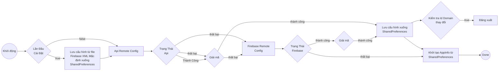
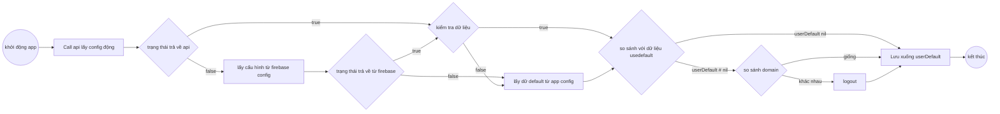

## Tổng quan

1. Mục đích

    1. Giảm thiểu sự sai sót về cấu hình khi tích hợp với đối tác

    2. Tuỳ biến được domain, cấu hình trong các trường hợp khẩn cấp, tránh việc phải build lại SDK -> review lại ứng dụng.

2. Thông tin thêm

    SDK sẽ ưu tiên lấy cấu hình từ BE API. Nếu API gọi thất bại hoặc dữ liệu trả về không giải mã được, SDK sẽ tự động fallback sang Firebase Remote Config. Trường hợp cả hai nguồn đều thất bại, SDK sẽ sử dụng cấu hình đã được lưu trước đó trong SharedPreferences (hoặc cấu hình mặc định trong file Firebase XML nếu là lần đầu cài đặt).

## API

1. Sơ đồ luồng

    - Android

    - IOS

2. Chi tiết

    - Domain production: [https://config.vapi24.vn](https://config.vapi24.vn/)

    - Domain beta: https://beta-config.vapi24.vn

## Firebase Remote Config

1. Sơ đồ luồng

2. Chi tiết

## Phiên bản

| **Platform** | **Inventory** | **Tag version** | **CommitID** | **Release date** |
| --- | --- | --- | --- | --- |
| Android | | | | |
| IOS | | | | |
