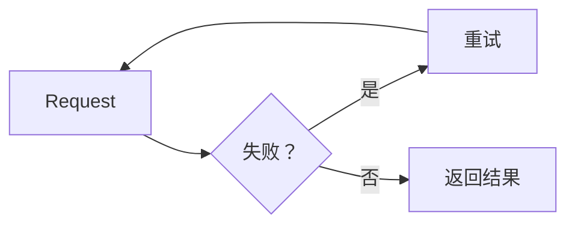

标注框（**Callout**，也称为 **Aside**）是一种从正文中独立出来的内容块，用于吸引读者的注意力。

在技术文档中，标注框 通常用于：

* 警告危险或不可逆的操作。
* 强调容易被忽略的细节。
* 提出更好的做法建议。
* 指出常见错误。

例如，与其写一段普通文字：

```md title="普通段落"
注意：使用此命令删除分支后无法恢复。
```

可以使用标注框来表达：

**代码**

```mdx showLineNumbers title="使用标注框"
:::caution[警告]
使用此命令删除分支后无法恢复。
:::
```

**效果**

:::caution[警告]
使用此命令删除分支后无法恢复。
:::

标注框 能让重要信息比页面上其他内容更加突出，而不是淹没在大段文字之中。

---

## 1. 基础 标注框 语法

在使用 Starlight 的 MDX 中，标注框 通过 `:::`（三个冒号）语法创建，后面紧跟 标注框 类型。

**代码**

```mdx showLineNumbers title="基础 标注框"
:::note
这是一条普通提示。
:::
```

**效果**

:::note
这是一条普通提示。
:::

其结构包含三部分：

1. 开始行 `:::<type>`，用于指定 标注框 类型。
2. 标注框 内容，使用普通 Markdown 编写。
3. 结束行 `:::`。

:::caution[警告]
开始行和结束行必须使用相同数量的 `:`。如果 标注框 内部还嵌套了同样使用 `:::` 语法的内容（例如 tab 内的 标注框），外层的冒号数量必须多于内层，否则会导致闭合位置错误。
:::

---

## 2. 标注框 的类型

Starlight 支持四种 标注框 类型，每种类型代表不同的重要程度。

| 类型      | 用途                             |
| --------- | -------------------------------- |
| `note`    | 补充信息，中性内容                |
| `tip`     | 建议、更好的做法                  |
| `caution` | 警告，需要在继续前留意             |
| `danger`  | 危险，可能造成严重后果的行为        |

### Note

**代码**

```mdx showLineNumbers title="Note"
:::note
该组件仅在客户端环境中运行。
:::
```

**效果**

:::note
该组件仅在客户端环境中运行。
:::

`note` 适用于读者应该了解的补充信息，但不具有警告性质。

### Tip

**代码**

```mdx showLineNumbers title="Tip"
:::tip
当需要在说明中引用某一具体代码行时，使用 `showLineNumbers`。
:::
```

**效果**

:::tip
当需要在说明中引用某一具体代码行时，使用 `showLineNumbers`。
:::

`tip` 适用于想要建议一种更高效做法的场景，非强制但值得采用。

### Caution

**代码**

```mdx showLineNumbers title="Caution"
:::caution
重命名 API 参数会对旧客户端造成破坏性变更。
:::
```

**效果**

:::caution
重命名 API 参数会对旧客户端造成破坏性变更。
:::

`caution` 适用于操作可能引发问题，但尚未达到危险或破坏系统程度的情况。

### Danger

**代码**

```mdx showLineNumbers title="Danger"
:::danger
在生产环境运行此迁移会删除 `orders` 表中的全部数据。
:::
```

**效果**

:::danger
在生产环境运行此迁移会删除 `orders` 表中的全部数据。
:::

`danger` 仅应用于可能导致数据丢失、宕机或其他严重后果的行为。

---

## 3. 修改 标注框 标题

每种 标注框 类型都有默认标题（`Note`、`Tip`、`Caution`、`Danger`）。可以通过在类型后添加 `[]` 并在其中填写文字来修改标题。

**代码**

```mdx showLineNumbers title="自定义标题的 标注框"
:::danger[无法恢复]
删除此存储桶将删除其中的所有文件，且无法撤销。
:::
```

**效果**

:::danger[无法恢复]
删除此存储桶将删除其中的所有文件，且无法撤销。
:::

自定义标题应简洁并准确描述警告的本质，而不是笼统地重复"警告"或"注意"这类词语。

例如，应该写：

```mdx title="具体的标题"
:::caution[速率限制]
该 API 限制每分钟 100 次请求。
:::
```

而不是：

```mdx title="笼统的标题"
:::caution[警告]
该 API 限制每分钟 100 次请求。
:::
```

具体的标题能帮助读者更快地浏览页面。

---

## 4. 包含多行内容的 标注框

标注框 可以包含多个段落、列表或其他 Markdown 元素。

**代码**

```mdx showLineNumbers title="多行 标注框"
:::caution[部署前]
在部署到生产环境之前，请检查以下步骤：

* 已在 staging 环境执行迁移。
* 已备份数据库。
* 已通知相关团队。
:::
```

**效果**

:::caution[部署前]
在部署到生产环境之前，请检查以下步骤：

* 已在 staging 环境执行迁移。
* 已备份数据库。
* 已通知相关团队。
:::

当 标注框 需要表达的内容超过一句话时，这种方式很合适，但仍应保持内容聚焦于单一主题。

---

## 5. 包含代码的 标注框

标注框 内部也可以包含 fenced code block。

:::danger
当 标注框 中包含代码块时，标注框 的 `:` 数量必须多于内部代码块的反引号数量，以避免 MDX 误判两个块之间的边界。
:::

**代码**

````mdx showLineNumbers title="包含代码的 标注框"
::::caution[必需的配置]
如果缺少 `DATABASE_URL` 环境变量，应用将无法启动：

```bash
export DATABASE_URL="postgres://localhost:5432/app"
```
::::
````

**效果**

::::caution[必需的配置]
如果缺少 `DATABASE_URL` 环境变量，应用将无法启动：

```bash
export DATABASE_URL="postgres://localhost:5432/app"
```
::::

---

## 6. 包含 Mermaid 的 标注框

由于 Mermaid 本身也是一个 fenced code block，在 标注框 中放置 Mermaid 图表时同样适用相同的 `:` 数量规则。

**代码**

````mdx showLineNumbers title="包含 Mermaid 的 标注框"
::::note[错误处理流程]
当请求失败时，系统会在向用户报错之前最多重试 3 次：


::::
````

**效果**

::::note[错误处理流程]
当请求失败时，系统会在向用户报错之前最多重试 3 次：


::::

当需要同时给出警告并直观展示该行为时，这种方式非常有用。

---

## 7. 包含表格的 标注框

当需要在警告旁边列出结构化信息时，也可以在 标注框 内放置表格。

**代码**

```mdx showLineNumbers title="包含表格的 标注框"
:::caution[v2 中的破坏性变更]
| 旧字段 | 新字段 | 说明 |
| --- | --- | --- |
| `user_id` | `userId` | 改为 camelCase |
| `created` | `createdAt` | 重命名并采用 ISO 8601 格式 |
:::
```

**效果**

:::caution[v2 中的破坏性变更]
| 旧字段    | 新字段      | 说明                       |
| --------- | ----------- | -------------------------- |
| `user_id` | `userId`    | 改为 camelCase              |
| `created` | `createdAt` | 重命名并采用 ISO 8601 格式   |
:::

---

## 8. 该使用哪种 标注框 类型？

选错 标注框 类型会导致读者对信息重要性产生误判。

一个简单的判断规则：

| 场景                                       | 标注框 类型 |
| ------------------------------------------ | :-----------: |
| 补充信息，忽略也无妨                        | `note`        |
| 最佳实践、优化、更好的做法建议                | `tip`         |
| 可能导致错误、破坏性变更，需谨慎处理          | `caution`     |
| 数据丢失、宕机、无法撤销的操作                | `danger`      |

:::tip
如果不确定该用 `caution` 还是 `danger`，可以问自己："如果读者忽略这个 标注框，后果是否可以恢复？"如果不能，就使用 `danger`。
:::

---

## 9. 不要过度使用 标注框

标注框 只有在被有选择地使用时才有效。

不应该这样写：

:::note
该函数接受一个参数。
:::

:::note
该参数的类型为 `string`。
:::

:::note
返回值为 `boolean`。
:::

当连续三个 标注框 只包含普通信息、没有真正需要强调的内容时，这种写法并不合适。

应该将它们合并为一段普通文字或表格：

| 参数    | 类型     | 返回值    |
| ------- | -------- | --------- |
| `input` | `string` | `boolean` |

:::caution[警告]
一个页面中如果有过多 标注框，会削弱其强调效果——读者会倾向于跳过所有 标注框，包括真正重要的那些。只有真正需要突出的信息才应使用 标注框。
:::

---

## 10. 标注框 不能替代标题结构

标注框 用于强调，而不是用来组织页面的主要内容。

不应该这样写：

:::note[身份验证]
关于整个身份验证机制的长篇说明……
:::

如果这是页面的主要内容，应该使用标题：

```md title="身份验证"
## 身份验证

关于整个身份验证机制的长篇说明……
```

标注框 应该代表**独立于主要阅读流程之外的简短提示**，而不是页面的完整章节。

---

## 11. 标注框 的放置位置

标注框 应放置在与其相关内容直接对应的位置，而不应把所有 标注框 都堆积在页面开头或结尾。

良好的示例——放置在相关描述之后：

````mdx showLineNumbers title="正确放置标注框"
运行以下命令清除缓存：

```bash
rm -rf .cache
```

:::caution
此命令会清除整个缓存，包括之前构建的缓存。仅在确定不需要保留时才运行。
:::

清除缓存后，重新运行构建。
````

将 标注框 放在正确的位置，能让读者**在需要的时刻**收到提示，而不必回想起页面顶部读过的某条警告。

---

## 12. 使用 标注框 前的检查清单

在添加 标注框 之前，请自问：

* 这条信息真的需要比普通文字更加突出吗？
* 是否选择了正确的类型（`note`、`tip`、`caution`、`danger`）？
* 如果有自定义标题，它是否准确描述了内容？
* 是否存在连续过度使用 标注框 的情况？
* 标注框 是否被用来替代不应被替代的标题或表格？
* 标注框 是否放置在正确的位置，靠近相关内容？
* 如果 标注框 中包含代码块或 Mermaid，其 `:` 数量是否多于内部的反引号数量？

---

## 总结

标注框 是技术文档中用于强调重要信息的有效工具，但只有在恰当的时机使用恰当的类型时才能发挥效果。

基础结构：

```mdx showLineNumbers title="标注框"
:::note[可选标题]
标注框 内容。
:::
```

最重要的原则：

1. **根据重要程度选择合适的 标注框 类型**：`note` → `tip` → `caution` → `danger`。
2. **标题应具体**，避免笼统地重复类型名称。
3. **不要对普通信息过度使用 标注框。**
4. **不要用 标注框 替代标题或表格。**
5. **将 标注框 放在正确的位置**，紧邻相关内容。
6. **当 标注框 包含代码块或 Mermaid 图表时**，增加 `:` 的数量以避免解析错误。

一个好的 标注框 不是页面上出现次数最多的那个，而是能让读者**在真正需要停下的那一刻停下来**的那个。
