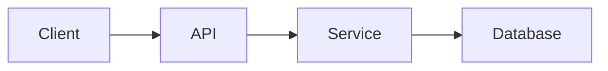
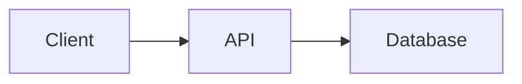
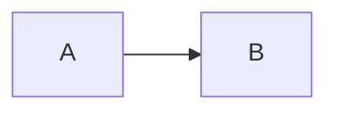
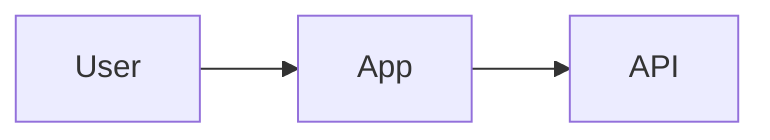
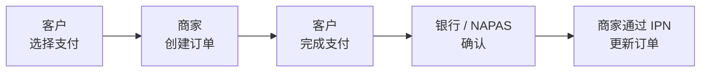
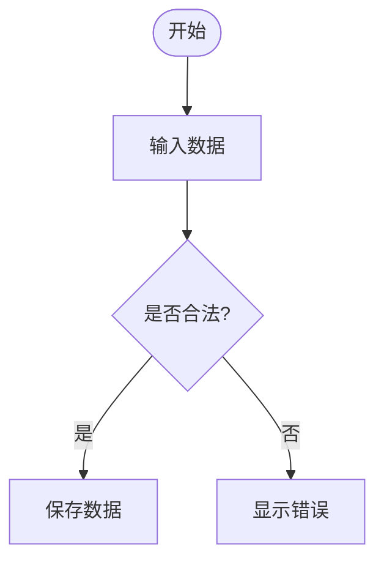
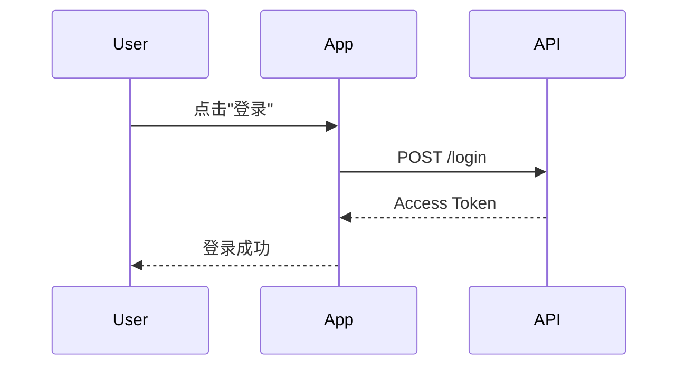
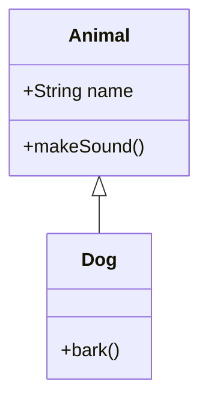
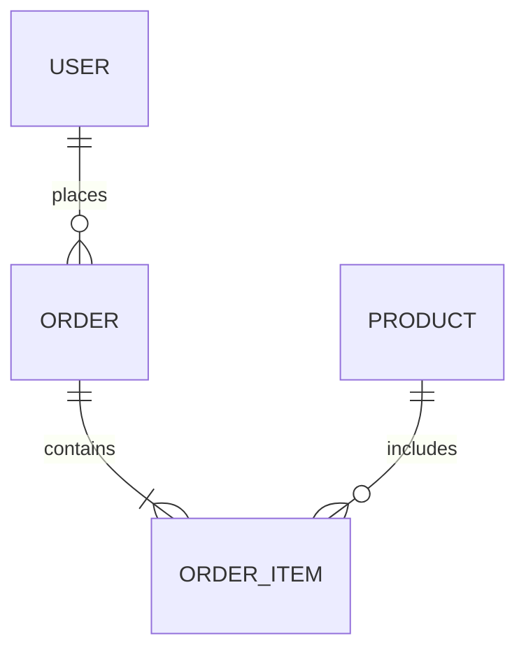

Mermaid 是一种用文本描述 diagram 的语言。你不需要手动绘制每一个 node、连线或箭头,只需要用 Mermaid 的语法描述 diagram 的结构,系统就会把这段描述渲染成可视化的图形。

有趣的是,Mermaid 同样是写在 Markdown/MDX 的围栏代码块里的:

````mdx showLineNumbers title="基础 Mermaid"

````


因此,从 MDX 语法上看,Mermaid 和普通代码块非常相似。但它内部的内容既不是用来运行的程序,也不只是单纯做语法高亮,而是**用来生成 diagram 的源代码**。

## Mermaid 和普通代码块有什么不同

一个普通的代码块:

````mdx showLineNumbers title="TypeScript"
```ts
const user = {
    name: "Ninh",
    age: 22,
};
```
````

主要用来以语法高亮的方式展示源代码。

而 Mermaid:

````mdx showLineNumbers title="Flowchart"

````

则是用来描述一张 diagram。

可以简单理解为:

| 类型      | 用途                |
| --------- | ----------------------- |
| `ts`      | 显示 TypeScript     |
| `java`    | 显示 Java           |
| `json`    | 显示 JSON           |
| `css`     | 显示 CSS            |
| `mermaid` | 描述并渲染 diagram |

所以标识符 `mermaid` 所承载的意义,远不止选择一种语法高亮方案。它是在告诉系统:里面的内容需要被当作 diagram 来处理。

## 基本结构

一个 Mermaid 图通常以一个用于标识 diagram 类型的关键字开头:

````mdx showLineNumbers title="Mermaid 的结构"

````


在上面的例子中:

* `flowchart` 用于标识 diagram 的类型。
* `LR` 表示绘制方向为 **Left → Right**（从左到右）。
* `A` 和 `B` 是 node。
* `-->` 在两个 node 之间建立连接。

Mermaid 会根据这第一个关键字,决定接下来要用哪种解析器,以及 diagram 内部允许使用的语法。

:::note
在 MDX 中,Mermaid 的围栏代码块前后一定要留一个空行。如果代码块紧挨着上方的一行文本或一个表格,某些 MDX 解析器可能无法正确识别代码围栏,导致 diagram 无法渲染。
:::

---

## 用户如何使用 Mermaid

在阅读包含 Mermaid 的文档时,用户通常会同时接触到两部分内容:**Mermaid 源代码** 和 **渲染后的 diagram**。

## 在 MDX 中编写 Mermaid

要创建一张 diagram,只需在围栏代码块中使用 `mermaid` 标识符编写 Mermaid:

````mdx showLineNumbers title="Mermaid 示例"

````

这部分是源代码,系统会将其渲染成 diagram。如果需要给 diagram 的框架单独设置标题,可以在源代码开头添加一行 `%% title:` 注释:

````mdx showLineNumbers title="带标题的 Mermaid"

````

## 查看渲染后的 diagram

在代码下方,文档中应当放置一个真正的 Mermaid 区块,让读者能够看到渲染结果:


在渲染区域中,用户可以:

* 点击 **Fullscreen** 以大屏方式打开 diagram。
* 使用 **+** 和 **-** 进行缩放,最高可放大到 1000%。
* 当 diagram 大于屏幕时,可以拖动进行平移(pan)。
* 按 **0** 重置缩放比例和位置。
* 按住 **C** 键查看 Mermaid 源代码,松开 **C** 键返回 diagram。
* 按 **Esc** 关闭大屏视图。

如果当前 Mermaid 版本尚不支持某种 diagram 类型,渲染区域会提示无法渲染,而不会破坏页面的布局。

:::caution
使用带 `-beta` 后缀的 diagram 类型(`architecture-beta`、`packet-beta`、`radar-beta`、`sankey-beta`、`treemap-beta`、`xychart-beta`)时,在把它们加入正式文档之前,请先确认项目的 Mermaid 版本。beta 语法可能在不同版本之间发生变化,即使在本地能正确渲染,如果版本不匹配,也不能保证在生产环境中同样能正确渲染。
:::

---

## Mermaid diagram 的类型

Mermaid 支持很多种 diagram,分别服务于不同的目的。不要试图用一种 diagram 类型应付所有场景,而应该根据要传达的信息选择合适的类型。

## Flowchart

**Flowchart** 适合用来描述处理流程、条件判断、操作步骤,或者系统的逻辑。

**代码**

````mdx showLineNumbers title="Flowchart"

````

**演示**


`LR` 表示 **Left to Right**（从左到右）。除了 `LR`,flowchart 还常用以下方向:

* `TD` — Top to Down（从上到下）。
* `TB` — Top to Bottom（从上到下）。
* `RL` — Right to Left（从右到左）。
* `BT` — Bottom to Top（从下到上）。

SePay 支付流程的例子:

**代码**

````mdx showLineNumbers title="SePay 支付流程(业务)"

````

**演示**


带条件分支的例子:

**代码**

````mdx showLineNumbers title="带条件分支的 Flowchart"

````

**演示**



---

## Sequence Diagram

**Sequence Diagram** 用来描述系统中各组件之间的交互顺序。

在编写 API、身份认证或通信流程相关文档时,它是最实用的 diagram 类型之一。

**代码**

````mdx showLineNumbers title="Sequence Diagram"

````

**演示**


一些常见的箭头写法:

* `->>` — message（消息）。
* `-->>` — response（响应）。
* `-)` — asynchronous message（异步消息）。
* `--x` — 以 X 结尾的消息。

---

## Class Diagram

**Class Diagram** 适合用来描述 class、属性、method,以及 class 之间的关系。

**代码**

````mdx showLineNumbers title="Class Diagram"

````

**演示**


---

## Entity Relationship Diagram

**ER Diagram** 常用于描述数据库以及各个 entity 之间的关系。

**代码**

````mdx showLineNumbers title="Entity Relationship Diagram"

````

**演示**


当文档需要从整体上解释数据库 schema 时,这是非常合适的选择。

---

## State Diagram

**State Diagram** 用来描述一个 object 或 process 的状态,以及状态之间的 transition。

**代码**

````mdx showLineNumbers title="State Diagram"
```mermaid
stateDiagram-v2
    [*] --> Pending
    Pending --> Paid
    Paid --> Shipped
    Shipped --> [*]
```
````

**演示**

```mermaid
stateDiagram-v2
    [*] --> Pending
    Pending --> Paid
    Paid --> Shipped
    Shipped --> [*]
```

---

## Mindmap

**Mindmap** 适合用来呈现某个主题的层级结构。

**代码**

````mdx showLineNumbers title="Mindmap"
```mermaid
mindmap
    root((Product))
        Backend
            API
            Database
        Frontend
            Web
            Mobile
```
````

**演示**

```mermaid
mindmap
    root((Product))
        Backend
            API
            Database
        Frontend
            Web
            Mobile
```

---

## Architecture Diagram

Architecture Diagram 用来描述各个 service 或基础设施组件之间的架构关系。

**代码**

````mdx showLineNumbers title="Architecture Diagram"
```mermaid
architecture-beta
    group api(cloud)[API]
    service server(server)[Server] in api
    service db(database)[Database] in api
    server:R -- L:db
```
````

**演示**

```mermaid
architecture-beta
    group api(cloud)[API]
    service server(server)[Server] in api
    service db(database)[Database] in api
    server:R -- L:db
```

---

## Block Diagram

Block Diagram 用来描述 block 以及它们之间的关系。

**代码**

````mdx showLineNumbers title="Block Diagram"
```mermaid
block-beta
    columns 3
    Client Gateway Service
```
````

**演示**

```mermaid
block-beta
    columns 3
    Client Gateway Service
```

---

## C4 Diagram

C4 Diagram 适合按照 C4 模型来描述软件架构。

**代码**

````mdx showLineNumbers title="C4 Context"
```mermaid
C4Context
    Person(user, "User")
    System(app, "Application")
    Rel(user, app, "Uses")
```
````

**演示**

```mermaid
C4Context
    Person(user, "User")
    System(app, "Application")
    Rel(user, app, "Uses")
```

---

## Gantt Chart

Gantt Chart 用来按时间呈现计划和工作进度。

**代码**

````mdx showLineNumbers title="Gantt Chart"
```mermaid
gantt
    title Release Plan
    dateFormat YYYY-MM-DD

    section Backend
    API Design       :a1, 2026-01-01, 5d
    API Development  :a2, after a1, 10d
```
````

**演示**

```mermaid
gantt
    title Release Plan
    dateFormat YYYY-MM-DD

    section Backend
    API Design       :a1, 2026-01-01, 5d
    API Development  :a2, after a1, 10d
```

---

## Git Graph

Git Graph 用来描述 Git 中的分支、提交和合并。

**代码**

````mdx showLineNumbers title="Git Graph"
```mermaid
gitGraph
    commit
    branch feature
    checkout feature
    commit
    checkout main
    merge feature
```
````

**演示**

```mermaid
gitGraph
    commit
    branch feature
    checkout feature
    commit
    checkout main
    merge feature
```

---

## Kanban

Kanban 用来描述各个 task 的状态。

**代码**

````mdx showLineNumbers title="Kanban"
```mermaid
kanban
    Todo
        Task A
        Task B
    Doing
        Task C
    Done
        Task D
```
````

**演示**

```mermaid
kanban
    Todo
        Task A
        Task B
    Doing
        Task C
    Done
        Task D
```

---

## Packet Diagram

Packet Diagram 适合用来描述一个 network packet 的比特或字段结构。

**代码**

````mdx showLineNumbers title="Packet Diagram"
```mermaid
packet-beta
    0-15: "Source Port"
    16-31: "Destination Port"
```
````

**演示**

```mermaid
packet-beta
    0-15: "Source Port"
    16-31: "Destination Port"
```

---

## Pie Chart

Pie Chart 用来表现各组数据之间的比例。

**代码**

````mdx showLineNumbers title="Pie Chart"
```mermaid
pie title Traffic Source
    "Organic" : 45
    "Referral" : 25
    "Direct" : 30
```
````

**演示**

```mermaid
pie title Traffic Source
    "Organic" : 45
    "Referral" : 25
    "Direct" : 30
```

---

## Quadrant Chart

Quadrant Chart 用来基于两个坐标轴对元素进行分类。

**代码**

````mdx showLineNumbers title="Quadrant Chart"
```mermaid
quadrantChart
    title Feature Priority
    x-axis Low Impact --> High Impact
    y-axis Low Effort --> High Effort
    quadrant-1 Do first
    quadrant-2 Plan
    quadrant-3 Avoid
    quadrant-4 Delegate
```
````

**演示**

```mermaid
quadrantChart
    title Feature Priority
    x-axis Low Impact --> High Impact
    y-axis Low Effort --> High Effort
    quadrant-1 Do first
    quadrant-2 Plan
    quadrant-3 Avoid
    quadrant-4 Delegate
```

---

## Radar Chart

Radar Chart 用来比较一个或多个对象在多个属性上的表现。

**代码**

````mdx showLineNumbers title="Radar Chart"
```mermaid
radar-beta
    axis Speed, Security, Cost, UX
    curve Product["Speed": 80, "Security": 60, "Cost": 40, "UX": 90]
```
````

**演示**

```mermaid
radar-beta
    axis Speed, Security, Cost, UX
    curve Product["Speed": 80, "Security": 60, "Cost": 40, "UX": 90]
```

---

## Requirement Diagram

Requirement Diagram 用来描述 requirement 以及它与系统各组成部分之间的关系。

**代码**

````mdx showLineNumbers title="Requirement Diagram"
```mermaid
requirementDiagram
    requirement loginReq {
        id: 1
        text: User must be able to log in
        risk: medium
    }
```
````

**演示**

```mermaid
requirementDiagram
    requirement loginReq {
        id: 1
        text: User must be able to log in
        risk: medium
    }
```

---

## Sankey Diagram

Sankey Diagram 用来表现各组之间数据的流向与占比。

**代码**

````mdx showLineNumbers title="Sankey Diagram"
```mermaid
sankey-beta
Traffic,Organic,45
Traffic,Referral,25
Traffic,Direct,30
```
````

**演示**

```mermaid
sankey-beta
Traffic,Organic,45
Traffic,Referral,25
Traffic,Direct,30
```

---

## Timeline

Timeline 用来按时间顺序描述一系列事件。

**代码**

````mdx showLineNumbers title="Timeline"
```mermaid
timeline
    title Product Roadmap
    2026 Q1 : Launch MVP
    2026 Q2 : Add payments
    2026 Q3 : Scale infrastructure
```
````

**演示**

```mermaid
timeline
    title Product Roadmap
    2026 Q1 : Launch MVP
    2026 Q2 : Add payments
    2026 Q3 : Scale infrastructure
```

---

## Treemap

Treemap 用面积来表现层级数据。

**代码**

````mdx showLineNumbers title="Treemap"
```mermaid
treemap-beta
    "Revenue"
        "Product A": 40
        "Product B": 35
        "Product C": 25
```
````

**演示**

```mermaid
treemap-beta
    "Revenue"
        "Product A": 40
        "Product B": 35
        "Product C": 25
```

---

## User Journey

User Journey 用来描述用户在某个流程中所经历的体验或步骤。

**代码**

````mdx showLineNumbers title="User Journey"
```mermaid
journey
    title Checkout Journey
    section Cart
        Add item: 5: User
    section Payment
        Enter card: 3: User
        Confirm: 4: User
```
````

**演示**

```mermaid
journey
    title Checkout Journey
    section Cart
        Add item: 5: User
    section Payment
        Enter card: 3: User
        Confirm: 4: User
```

---

## XY Chart

XY Chart 适合用于具有 X/Y 坐标轴的数据,例如柱状图或折线图。

**代码**

````mdx showLineNumbers title="XY Chart"
```mermaid
xychart-beta
    title "Monthly Revenue"
    x-axis [Jan, Feb, Mar]
    y-axis "Revenue" 0 --> 1000
    bar [300, 500, 800]
```
````

**演示**

```mermaid
xychart-beta
    title "Monthly Revenue"
    x-axis [Jan, Feb, Mar]
    y-axis "Revenue" 0 --> 1000
    bar [300, 500, 800]
```

---

## ZenUML

ZenUML 允许用更接近代码的语法来描述 sequence diagram。

**代码**

````mdx showLineNumbers title="ZenUML"
```mermaid
zenuml
    Client->API: request()
    API->Client: response()
```
````

**演示**

```mermaid
zenuml
    Client->API: request()
    API->Client: response()
```

---

## 深入了解 Flowchart

Flowchart 是技术文档中最常用的 diagram 类型之一。

与其用大段文字描述一个冗长的流程,不如把它转换成一张 diagram,让读者一次性看清整个流程。

以身份认证流程为例:

**代码**

````mdx showLineNumbers title="Authentication Flow"
```mermaid
flowchart TD
    Start([Start]) --> Login[Login Request]
    Login --> Validate{Credentials valid?}

    Validate -- Yes --> Token[Generate Token]
    Validate -- No --> Error[Return Error]

    Token --> Response[Return Response]
    Error --> End([End])
    Response --> End
```
````

**演示**

```mermaid
flowchart TD
    Start([Start]) --> Login[Login Request]
    Login --> Validate{Credentials valid?}

    Validate -- Yes --> Token[Generate Token]
    Validate -- No --> Error[Return Error]

    Token --> Response[Return Response]
    Error --> End([End])
    Response --> End
```

## Subgraph

当 flowchart 包含较多组成部分时,可以用 `subgraph` 把相关的 node 分组在一起。

**代码**

````mdx showLineNumbers title="带 Subgraph 的 Flowchart"
```mermaid
flowchart LR
    subgraph Client
        Mobile
        Web
    end

    subgraph Backend
        API
        Service
        Database
    end

    Mobile --> API
    Web --> API
    API --> Service
    Service --> Database
```
````

**演示**

```mermaid
flowchart LR
    subgraph Client
        Mobile
        Web
    end

    subgraph Backend
        API
        Service
        Database
    end

    Mobile --> API
    Web --> API
    API --> Service
    Service --> Database
```

`subgraph` 在描述架构时特别有用,因为它能帮助读者清楚区分前端、后端、数据库或外部系统之间的边界。

---

## 深入了解 Sequence Diagram

当文档需要解释 API 的请求/响应时,Sequence Diagram 尤其有用。

以 OAuth 登录流程为例:

**代码**

````mdx showLineNumbers title="OAuth Authentication Flow"
```mermaid
sequenceDiagram
    participant User
    participant App
    participant OAuth
    participant API

    User->>App: Click Login
    App->>OAuth: Authorization Request
    OAuth-->>App: Authorization Code
    App->>API: Exchange Code
    API->>OAuth: Verify Code
    OAuth-->>API: Access Token
    API-->>App: Session
    App-->>User: Login Success
```
````

**演示**

```mermaid
sequenceDiagram
    participant User
    participant App
    participant OAuth
    participant API

    User->>App: Click Login
    App->>OAuth: Authorization Request
    OAuth-->>App: Authorization Code
    App->>API: Exchange Code
    API->>OAuth: Verify Code
    OAuth-->>API: Access Token
    API-->>App: Session
    App-->>User: Login Success
```

当文档需要描述 API、身份认证、支付,或多个 service 之间的通信时,sequence diagram 通常比一长串请求/响应的列表要清晰得多。

---

## 什么时候应该使用 Mermaid

当信息具有**关系、顺序或结构**时,Mermaid 尤其适用。

在以下情况下应该使用 Mermaid:

* 有多个组件相互交互。
* 存在多步骤的处理流程。
* 存在 `if/else` 分支。
* 需要描述 request/response。
* 需要描述 architecture。
* 需要描述数据库之间的关系。
* 需要描述 lifecycle 或 state。
* 需要描述 timeline 或 roadmap。
* 需要描述 Git 的 branch/merge。

反过来说,并不是所有内容都需要画图。

如果一个流程只有两三个简单步骤:

> 用户登录 → API 验证 → 服务器返回 token。

那么一句话可能比一张 diagram 更容易读懂。

---

## 保持 Mermaid 图的可读性

过大的 diagram 可能会适得其反。如果读者必须不断缩放或滚动屏幕才能理解这个流程,那么这个 diagram 反而让文档变得更难读。

一些值得遵循的原则:

### 1. 一张 diagram 只服务一个目的

与其把整个架构塞进一张巨大的 diagram,不如把它拆分为:

* High-level architecture。
* Authentication flow。
* Payment flow。
* Database relationship。
* Deployment architecture。

### 2. 不要塞入过多的 node

如果一个 flowchart 开始出现过多的 node 或分支,可以考虑把它拆分成多张 diagram。

### 3. node 的命名要清晰

不要这样写:

```text
A --> B --> C
```

如果这张 diagram 是给文档读者看的。

而应该这样写:

```text
Client --> API --> Auth Service --> Database
```

:::danger
避免在 node 的 label 中直接使用 `"`、`(`、`)`、`:`、`#` 等特殊字符,或者不加引号包裹就使用原始换行。这是导致 Mermaid 语法解析出错最常见的原因,一旦出错,整个 diagram、甚至整个页面都可能无法渲染,而不是仅仅在出错的地方提示。
:::

### 4. 使用合适的 diagram 类型

不要什么内容都用 flowchart。

| 内容           | 合适的 diagram   |
| ------------------ | ----------------- |
| Process / logic    | Flowchart         |
| Request / response | Sequence          |
| Class relationship | Class             |
| Database           | ER Diagram        |
| State / lifecycle  | State             |
| Architecture       | Architecture / C4 |
| Git workflow       | Git Graph         |
| Timeline           | Timeline / Gantt  |
| User experience    | User Journey      |
| Data proportion    | Pie / Sankey      |
| Metrics            | XY / Radar        |

---

## Mermaid 与 MDX

在 MDX 中,Mermaid 可以和普通代码块并排出现。

例如,同一个页面可以同时包含 TypeScript 和 Mermaid:

**代码**

````mdx showLineNumbers title="TypeScript + Mermaid"
```ts
const user = await api.getUser();
```

```mermaid
flowchart LR
    App --> API --> Database
```
````

**演示**

```ts
const user = await api.getUser();
```

```mermaid
flowchart LR
    App --> API --> Database
```

这让技术文档可以在同一个页面中,把**源代码**和**可视化说明**结合起来。

---

## 关于 Mermaid 版本的说明

并不是所有 diagram 在 Mermaid 各个版本之间都拥有相同的稳定性。

一些语法带有 `-beta` 后缀,例如:

* `architecture-beta`
* `packet-beta`
* `radar-beta`
* `sankey-beta`
* `treemap-beta`
* `xychart-beta`

因此,在把一种新的 diagram 类型正式写入文档之前,应该检查:

1. 项目使用的 Mermaid 版本。
2. 该版本是否支持这种 diagram type。
3. 当前语法是否与 Mermaid 官方文档相比已经发生变化。
4. 生产环境构建渲染 diagram 的效果,是否和开发环境一致。

尤其需要注意,不应该只靠查看源代码来判断是否可用。一个 Mermaid 图即便语法完全正确,如果项目的集成方式或 Mermaid 版本不支持该 diagram type,依然可能无法渲染。

---

## 文档中的 Mermaid 渲染

并不是 Markdown 里出现了:

````md
```mermaid
...
```
````

Mermaid 就会自动变成一张 diagram。

项目需要具备一套 **Mermaid 渲染管线（rendering pipeline）**,用来识别 `mermaid` 代码块、解析其中的源代码,并将其渲染为 diagram。

具体采用哪种管线,取决于项目本身的构建方式。例如可能是:

* Markdown/MDX 插件。
* remark/rehype 集成。
* Starlight 集成。
* Mermaid 组件。
* 客户端 Mermaid 渲染。
* 构建时的 diagram 渲染。

因此,项目文档应当描述**实际正在使用的渲染管线**,而不是假设所有 MDX 环境都以相同的方式处理 Mermaid。

---

## 小结

在技术文档中,Mermaid 是一种把文本转化为 diagram 的强大方式。

从 MDX 语法角度看,Mermaid 依然使用围栏代码块:

````mdx showLineNumbers title="Mermaid"
```mermaid
flowchart LR
    Client --> API --> Database
```
````

但系统不会只是单纯展示这段源代码,而是可以把它渲染成一张可视化的 diagram。

编写文档时,请记住:

* 使用 `mermaid` 作为代码围栏的标识符。
* 根据内容选择合适的 diagram 类型。
* 始终提供源代码,方便读者复制。
* 在源代码下方立即渲染出 diagram,让读者看到结果。
* 把过大的 diagram 拆分成多张较小的 diagram。
* 在使用新语法之前,先确认 Mermaid 的版本。
* 确保项目的 MDX/Markdown 渲染管线确实支持 Mermaid。

文档中一个不错的写法模式是:

````mdx showLineNumbers title="diagram 名称 演示"
```mermaid
flowchart LR
    Client --> API --> Database
```
````

紧接着在下方展示渲染出来的 **Mermaid 演示**。这种排版方式既能让读者看到实际效果,也方便开发者直接复制准确的源代码来复用。
