import { Tabs, TabItem } from '@astrojs/starlight/components';

本文档描述 SDK 的**各个业务流程**，并附带与当前源码一致的时序图和分支条件。

## 流程列表

1. [初始化 SDK](#1-初始化-sdk)
2. [登录 / 登出](#2-登录--登出)
3. [进入 LIVE 房间](#3-进入-live-房间)
4. [接收并路由 overlay（LIVE）](#4-接收并路由-overlaylive)
5. [将 overlay 渲染到屏幕](#5-将-overlay-渲染到屏幕)
6. [overlay WebView 的生命周期](#6-overlay-webview-的生命周期)
7. [回答问题（mini game）](#7-回答问题mini-game)
8. [预测 — Predict（`typeTimeline = 3`）](#8-预测--predicttypetimeline--3)
9. [幸运转盘 — Lucky（`typeTimeline = 5`）](#9-幸运转盘--luckytypetimeline--5)
10. [Headline（`typeTimeline = 4`）](#10-headlinetypetimeline--4)
11. [撤回 overlay — overlay-recall](#11-撤回-overlay--overlay-recall)
12. [辅助事件：liveviews、fan-club、ckst](#12-辅助事件liveviewsfan-clubckst)
13. [VOD 流程](#13-vod-流程)
14. [断线与恢复](#14-断线与恢复)
15. [释放资源](#15-释放资源)

## 1. 初始化 SDK

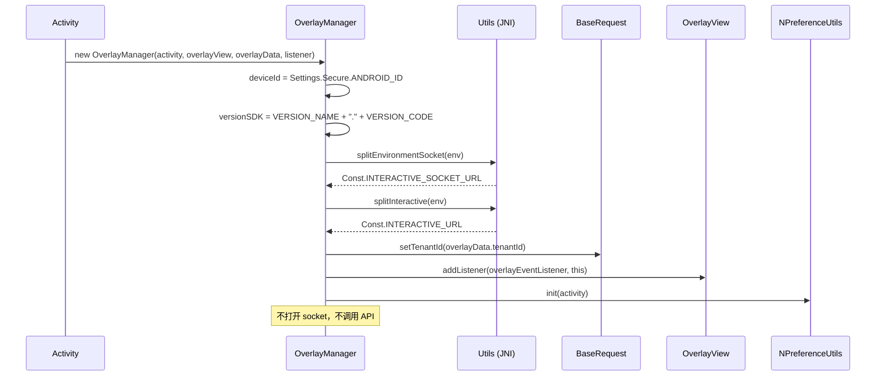

完成此步骤后，SDK 处于 **Idle** 状态：已知晓环境、tenant，具备渲染的位置 —— 但尚未
关联任何内容。

## 2. 登录 / 登出

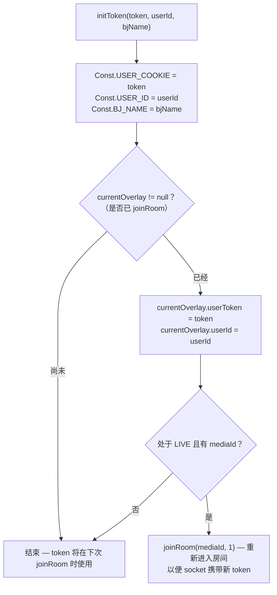

实际含义：

- **在观看 Live 期间登录** → SDK 会自动重新连接；正在显示的 overlay 会被清理
  （`joinRoom` 内部的 `cleanUp()`）。
- **登出** = `initToken("", "")`；若处于 Live 状态，也会以匿名身份重新进入房间。
- Header `Authorization`：若 token 以 `"ey"` 开头（JWT）→ `"Bearer <token>"`，否则原样发送。

---

## 3. 进入 LIVE 房间

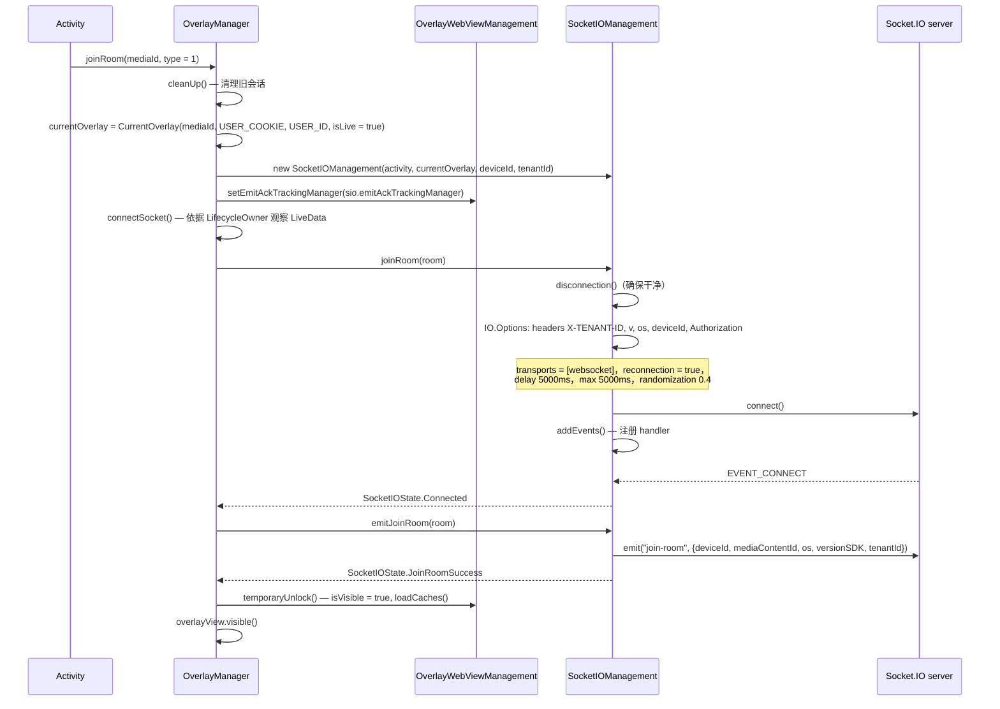

需要记住的要点：

- 指令 `emit("join-room")` **只会在 socket 连接成功后才发生**，而不是在调用
  `joinRoom()` 时立即发生。
- 在进入 `Connected` 状态之前，`OverlayWebViewManagement.isVisible = false` → 所有提前到达的
  overlay 都会被**放入缓存**而不是直接显示。
- `overlayView` 只会在 `temporaryUnlock()` 中被设为 `visible()`。

## 4. 接收并路由 overlay（LIVE）

### 4.1. Socket 层的预先过滤

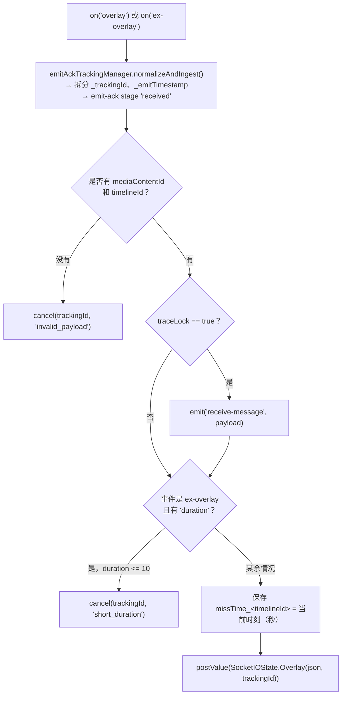

### 4.2. `OverlayManager` 层的业务检查

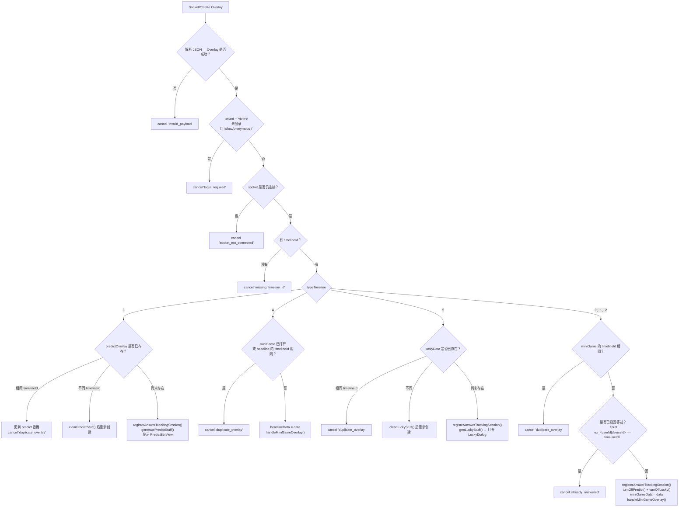

> 键 `ex_...` 在已登录时使用 `userId`；若未登录但 overlay 允许匿名，
> 则使用 `deviceId`。

## 5. 将 overlay 渲染到屏幕

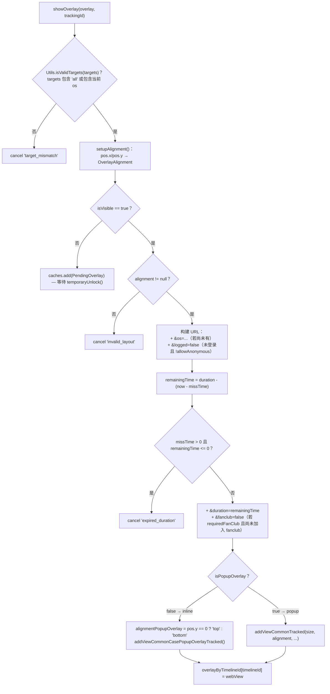

`OverlayView` 中的**几何约束**：

- `addViewCommonTracked`：宽/高按百分比（`constrainPercentWidth/Height`），并根据
  `metadata.pos` 推导出 9 个锚点位置（`LeftTop` … `RightBottom`）。
- `addViewCommonCasePopupOverlayTracked`：宽度为 `WRAP_CONTENT`，高度按百分比，根据
  `alignmentPopupOverlay` 锚定在上/下/左/右。
- 两者在添加前都会调用 `clearViews()` → **同一时刻只存在一个 overlay WebView**。

---

## 6. overlay WebView 的生命周期

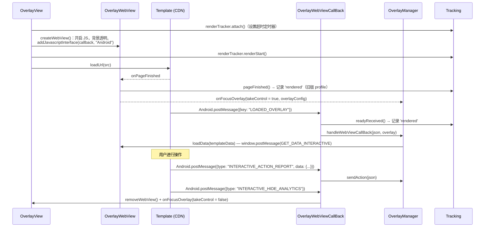

页面加载失败（`onReceivedError`、`onReceivedHttpError`、`onReceivedSslError`）时都会：
`renderTracker.failed(...)` → 隐藏 WebView → `onFocusOverlay(webViewError = true)`。

## 7. 回答问题（mini game）

这是最复杂的流程，在发送 API 之前有 4 层检查。

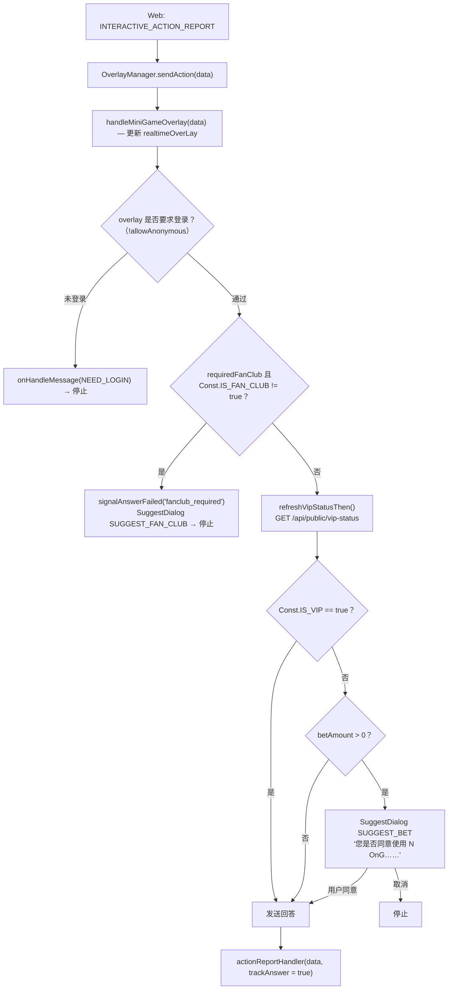

### 7.1. `actionReportHandler` — 发送 API

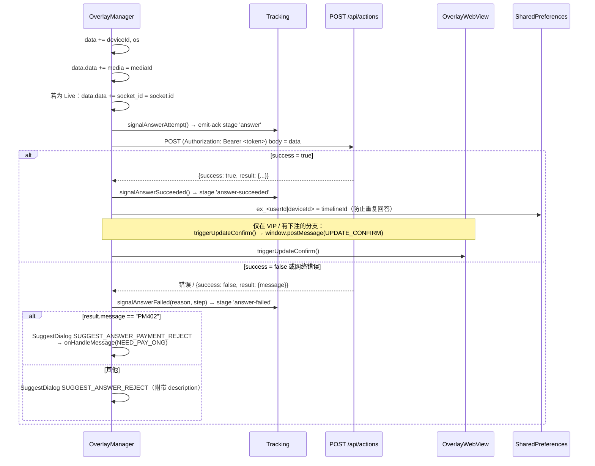

错误码 → tracking 中 `failureReason` 的映射（`AnswerTrackingMapper`）：

| `result.message` | `failureReason` | `failureStep` |
|---|---|---|
| `EX400` | `api_EX400` | `api_response` |
| `TL404` | `api_TL404` | `api_response` |
| `PM402` | `api_PM402` | `api_response` |
| 其他，`success = false` | `api_false` | `api_response` |
| 网络错误 | `network_error` | `network` |
| body 为空 / 无法解析 | `unknown_response` | `unknown_response` |

### 7.2. `sendAction` 中的其他 `type`

| `type` | 行为 |
|---|---|
| `INTERACTIVE_SHOW_ANALYTICS` | `onShowITR(true)` + 通过 `/api/actions` 记录行为 |
| `INTERACTIVE_HIDE_ANALYTICS` | 记录，清除 `overlay`/`miniGameData`，**重新启用** predict 与 lucky |
| `INTERACTIVE_OPEN_ANALYTICS` | `onShowITR(true)` + 记录（predict/lucky） |
| `INTERACTIVE_CLOSE_ANALYTICS` | 记录（predict/lucky） |
| `action = CLICK_ADS` 且带 `url` | 不调用 API，通过 `onClickAdsOverlay(url)` 打开外部浏览器 |

## 8. 预测 — Predict（`typeTimeline = 3`）

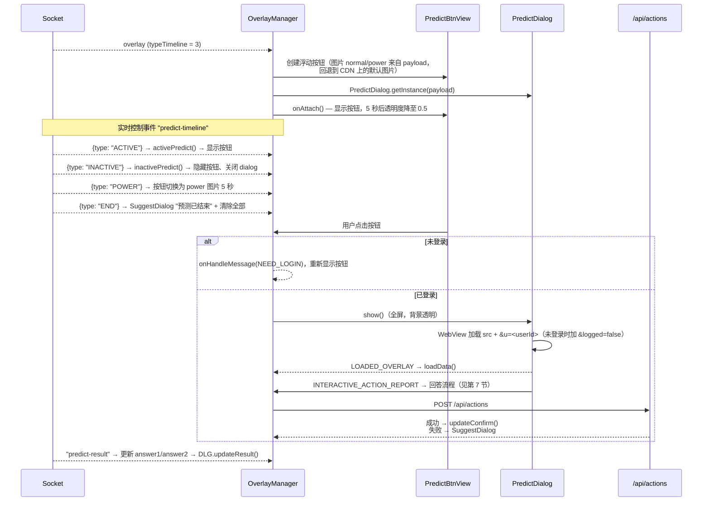

控制按钮显示的状态标志：

| 标志 | 含义 | 由谁修改 |
|---|---|---|
| `isPredictOn` | 是否允许显示（被 mini game 占据屏幕时会关闭） | `turnOnPredict()` / `turnOffPredict()` |
| `isPredictActive` | 服务器是否允许互动 | 事件 `ACTIVE` / `INACTIVE` |
| `isPredictDialogOn` | dialog 是否处于打开状态 | `showPredictDialog()` / `hidePredictDialog()` |

按钮仅在 `isPredictOn && isPredictActive` 时显示。

## 9. 幸运转盘 — Lucky（`typeTimeline = 5`）

结构与 Predict 类似（`LuckyBtnView` + `LuckyDialog`，socket 事件为 `lucky-event`，带
`ACTIVE/INACTIVE/POWER/END`），**有一处关键区别**：

<Tabs>
  <TabItem label="Kotlin">
```kotlin
// OverlayManager.genLuckyStuff() — 最后一行
showLuckyDialog()
```
  </TabItem>
  <TabItem label="Java">
```java
// OverlayManager.genLuckyStuff() — 最后一行
showLuckyDialog();
```
  </TabItem>
</Tabs>

→ lucky overlay 会在收到后**立即自动打开 dialog**，无需等待用户点击按钮。

API 返回的结果通过 `UPDATE_NUMBER_LUCKY` 推送到 web：

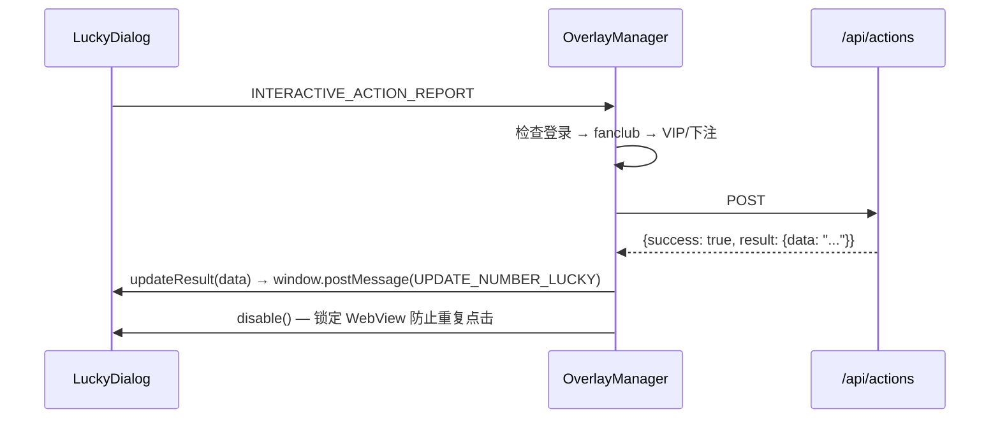

---

## 10. Headline（`typeTimeline = 4`）

- 与 mini game 共用同一渲染路径（`handleMiniGameOverlay`）。
- 若**当前已有打开的 mini game**（`miniGameData != null`）或与当前 headline 的 `timelineId`
  相同，则被忽略。
- 仅接受两种行为 `type`：`INTERACTIVE_SHOW_ANALYTICS` 和 `INTERACTIVE_HIDE_ANALYTICS`
  （没有回答流程）。

## 11. 撤回 overlay — overlay-recall

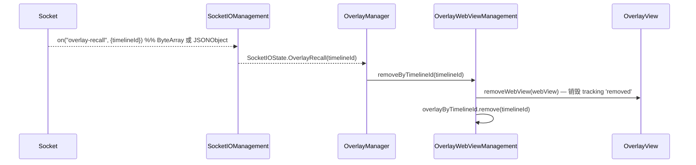

用于编辑人员在整个系统范围内移除正在播放的某个 overlay。

## 12. 辅助事件：liveviews、fan-club、ckst

| Socket 事件 | 处理方式 |
|---|---|
| `liveviews` | 解析 `OverlayLiveViews.count`，**额外加上 230**，调用 `onHandleLiveViews(count)` |
| `data`（fan-club） | 若 `mediaId` 与正在观看的媒体匹配（比较下划线 `_` 前的部分）→ 更新 `Const.IS_FAN_CLUB`；否则设为 `false` |
| `ckst` | 服务器询问 player 状态 → SDK 回传 `ckst`，携带 `{action: "CHECK_PLAYER_STATUS", sessionId, data: {deviceId, os, mediaContentId, playerStatus}}` |
| `update-result` | `OverlayWebView.updateResult(data)` → `window.postMessage(UPDATE_DATA_INTERACTIVE)` |
| `predict-result` | 将 `answer1`/`answer2` 更新到 `predictOverlay`，调用 `PredictDialog.updateResult()` |

> `liveViews` 加 230 是当前代码中的有意行为
> （[OverlayManager.kt:435](../interactive/src/main/java/vn/interactive/OverlayManager.kt:435)）——
> 若 app 需要原始数值，需自行在 app 侧减去。

`playerStatus` 只有在 app 已调用 `addPlayerListener(...)` 时才不为空。

---

## 13. VOD 流程

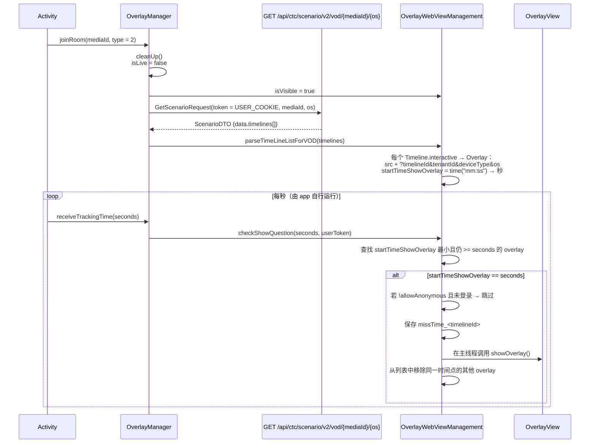

与 LIVE 的区别：

| | LIVE | VOD |
|---|---|---|
| overlay 来源 | Socket.IO 推送 | REST 预先加载整个剧情 |
| 显示触发方式 | 实时事件 | app 注入的 `receiveTrackingTime(秒)` |
| `socketIOManagement` | 有 | **null**（所有 socket 调用都被安全忽略） |
| action 中的 `socket_id` | 有 | 无 |
| Tracking emit-ack | 有 | 无（没有 socket 可供 emit） |
| Predict / Lucky / liveviews | 有 | 无 |

## 14. 断线与恢复

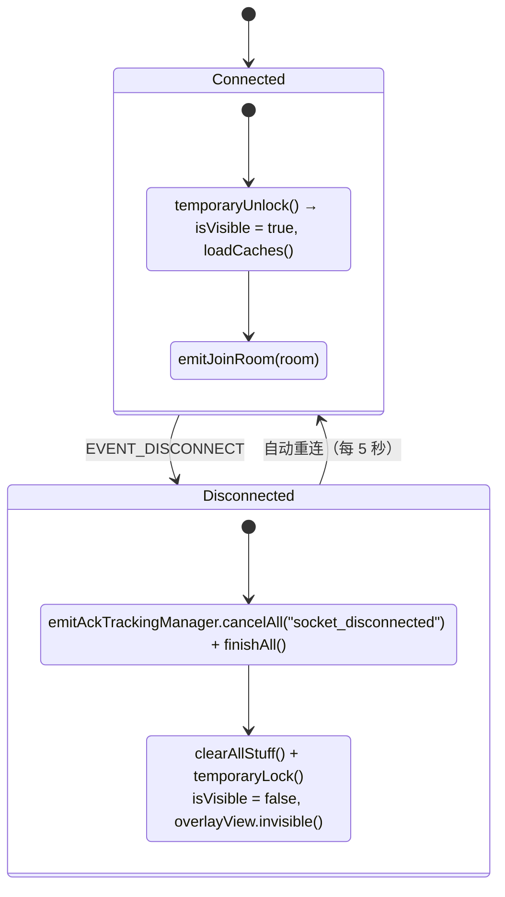

- **overlay 缓存**：当 `isVisible = false` 时，新的 overlay 会进入 `caches`。解锁后，
  `loadCaches()` 只会显示**最后一个元素**，之前的元素会以 `superseded_cache` 原因
  销毁 tracking。
- **`missTime`**：借助已保存的时间戳，断线后重新显示的 overlay 会扣除已流逝的时间
  作为 `duration`；若已超时则被丢弃（`expired_duration`）。
- 事件 `EVENT_CONNECT_ERROR` → `SocketIOState.Error` → `clearAllStuff()`。

## 15. 释放资源

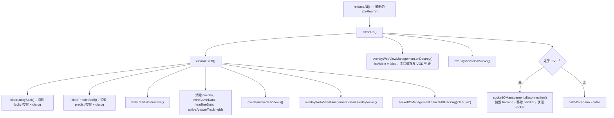

调用 `releaseAll()` 的时机：

- 包含 player 的 Activity 的 `onDestroy()`，
- 用户退出内容时（关闭 player、返回列表页），
- 切换到另一个 `mediaId` 之前，**如果**不会立即使用 `joinRoom()`（因为 `joinRoom` 已经会
  自动清理）。
