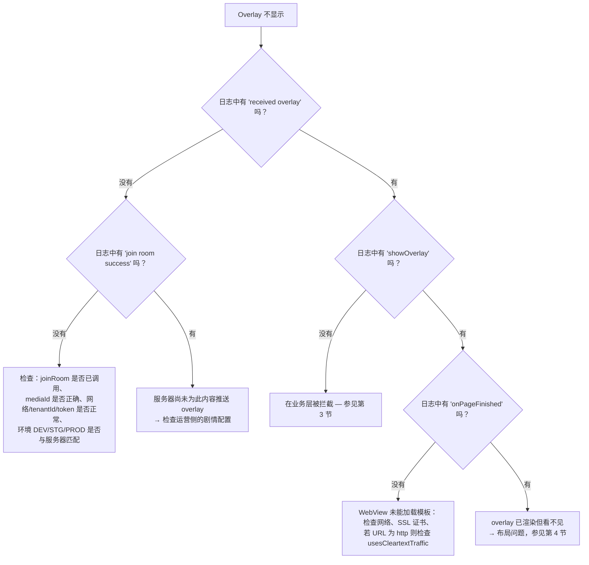

## 1. 开启 SDK 日志

SDK 通过函数 `logcat {}` 记录日志 —— 只有当 **AAR 以 buildType `debug` 构建时**才生效
（模块 `:interactive` 的 `BuildConfig.DEBUG = true`）。默认 Tag：`Interactive`。

```bash
adb logcat -s System.out | grep Interactive
```

值得关注的日志内容：

| 日志 | 含义 |
|---|---|
| `overlay manager: Khởi tạo mới Innteractive` | 构造函数已执行 |
| `socket io management initialization: socketUrl = ...` | 正在准备连接 |
| `overlay manager socket: connected socket` / `join room success` | 成功进入房间 |
| `socket io management addEvents: received overlay` | 收到来自服务器的 overlay |
| `<-- check point: showOverlay -->` | 开始构建 WebView |
| `VLive: Website onPageFinished url: ...` | 模板加载完成 |
| `overlay web view manager: add caches` | overlay 因 `isVisible = false` 被延迟 |
| `socket io management prevent ex-overlay: user answered` | 因已回答过而被拦截 |

---

## 2. Overlay 不显示 — 诊断树



---

## 3. 在业务层被拦截

将日志与原因表对照（详情见 [05 — Tracking](05-tracking-emit-ack.md#5-取消原因-cancelreason-列表)）：

| 症状 | 原因 | 处理方式 |
|---|---|---|
| `user haven't logged in yet` | Tenant 为 `vtvlive`，尚未 `initToken`，overlay 不允许匿名 | 登录后调用 `initToken()` |
| `timelineId not found` | Payload 缺少 `timelineId` | 反馈给服务器方 |
| `socket is not connect` | 处理时 socket 恰好断开 | 检查网络；SDK 会在 5 秒后自动重连 |
| `duplicate predict overlay` / `duplicate miniGame overlay` | 与当前显示的 overlay 的 `timelineId` 相同 | 符合设计的正常行为 |
| `prevent ex-overlay: user answered` | 已回答过该节点（pref `ex_*`） | 若想重新测试，需清除 app 数据 |
| `ex-overlay duration < 10s` | 补发 overlay 时长过短 | 符合设计的正常行为 |
| Cancel `target_mismatch` | `targets` 与 `DEVICE_TYPE` 不匹配 | 构建正确的变体（`androidmobile` / `androidtv`）或修改剧情配置 |
| Cancel `expired_duration` | overlay 相对 `missTime` 已超时 | 符合设计的正常行为 |
| `add caches` 但看不到显示 | `isVisible = false`（尚未 `Connected`） | socket 连接后 overlay 会显示；若始终未连接 → 参见第 5 节 |

---

## 4. Overlay 已渲染但看不见 / 位置错误

| 原因 | 表现 | 处理方式 |
|---|---|---|
| `OverlayView` 尺寸为 `0` | 渲染日志正常，屏幕空白 | 明确设置 `layout_width/height` 约束；可临时用 `setBackgroundColor(Color.YELLOW)` 检查 |
| `OverlayView` 被 player 覆盖绘制 | overlay “闪一下”后消失 | 在 layout 中将 `OverlayView` 声明在 player **之后**，或提高 `elevation`/`translationZ` |
| `OverlayView` 大于视频框 | overlay 偏移到画面之外 | 将 `OverlayView` 的约束设置为与 player 的 16:9 画框完全贴合 |
| `OverlayView` 处于 `INVISIBLE` | 断线之后 | SDK 在断线时调用 `temporaryLock()`；重新连接后会再次 `visible()` |
| player 的 `SurfaceView` 遮挡 WebView | 仅在部分 player 上出现 | player 使用 `TextureView`，或将 `OverlayView` 放在单独的上层 ViewGroup 中 |

---

## 5. Socket 无法连接

排查清单：

1. **环境**：`EnvInteractive` 必须与服务器系统（DEV/STG/PROD）一致 —— URL 来自 native 层，app 无法修改。
2. **`tenantId`**：tenant 错误 → 服务器拒绝进入房间。
3. **权限**：缺少 `INTERNET` 权限 → 不会有明确的错误日志，只会看到 `connect error`。
4. **Token 过期**：header `Authorization` 错误 → 是否被拒绝取决于服务器配置。
5. **`liboverlay.so` 被排除**：若 app 使用了 `abiFilters` 或 split ABI 而缺少对应架构，`Utils` 会在初始化时立即抛出 `UnsatisfiedLinkError` → `INTERACTIVE_SOCKET_URL` 为空。
   可用 `unzip -l app-release.apk | grep liboverlay` 检查。

日志 `socket io management initialization: url value uninitialized` 正是情况 5 的表现。

---

## 6. 集成 AAR 后的编译 / 运行错误

| 错误 | 原因 | 处理方式 |
|---|---|---|
| `NoClassDefFoundError: io/socket/client/IO` | 缺少传递依赖 | 补全 [02 §3](02-cai-dat-va-tich-hop.md#3-khai-báo-phụ-thuộc) 中列出的库 |
| `ClassCastException` / 打开 dialog 时崩溃 | Activity 不是 `FragmentActivity` | 使用 `AppCompatActivity` |
| Dialog 无法打开，日志 `showPredictDialog error` | `activity as? FragmentActivity` 返回 `null` | 同上 |
| 开启 R8 后收不到 WebView 的 callback | JS interface 被混淆 | 按 [02 §14](02-cai-dat-va-tich-hop.md#14-proguard--r8) 添加 `@JavascriptInterface` 规则 |
| overlay 收不到数据（`GET_DATA_INTERACTIVE`） | 模板尚未发送 `LOADED_OVERLAY` | 与 web 模板团队协调 |
| `UnsatisfiedLinkError: liboverlay.so` | 缺少 ABI | 检查 `ndk.abiFilters`，不要排除该 native 库 |

---

## 7. VOD：overlay 未在正确的时间点出现

| 原因 | 处理方式 |
|---|---|
| app 未调用 `receiveTrackingTime()` | 在 `joinRoom(type = 2)` 之后添加每秒一次的循环 |
| 注入的单位错误（毫秒而非秒） | 将 `player.currentPosition` 除以 1000 |
| 用户快进跳过了该时间点 | SDK 采用**精确秒数**匹配；该时间点的 overlay 会被跳过 —— 这是当前的限制 |
| 尚未登录，且 overlay 不允许 `allowAnonymous` | `checkShowQuestion` 会跳过；登录后重新 `joinRoom` |
| 剧情返回为空 | 检查日志 `response vod failed`，确认 `mediaId` 和 token |

---

## 8. 常见问题

**SDK 会自动跟随 Activity 生命周期吗？**
不会。`LifecycleOverlay` 目前为空接口。app 必须自行调用 `releaseAll()`。而 socket 的
LiveData 是根据 `LifecycleOwner` observe 的，因此会在 Activity 非活跃状态时自动停止发送。

**能同时显示多个 overlay 吗？**
不能。`OverlayView.addViewCommon*` 在添加前会调用 `clearViews()` → 始终只有一个 overlay WebView。
Predict/Lucky 按钮是独立的 view，因此可以与 overlay 同时存在（当 mini game 出现时 SDK 会
主动关闭它们）。

**中途切换账号会怎样？**
调用 `initToken(新token, 新userId)`。若当前处于 Live，SDK 会自动使用新 token 重新进入房间。

**观看人数是准确的吗？**
`onHandleLiveViews` 返回的是 `count + 230`（当前代码中的固定加成常量）。若需要原始数值，
app 需自行减去。

**每次 `joinRoom()` 之前都需要调用 `releaseAll()` 吗？**
不需要 —— `joinRoom()` 内部已经会自动 `cleanUp()`。

**旋转屏幕会丢失 overlay 吗？**
不会，前提是 Activity 声明了 `configChanges="orientation|screenSize"`。若 Activity 被重建，
则必须重新创建 `OverlayManager` 并重新 `joinRoom()`。

**SDK 使用的是系统自带的 WebView 吗？**
是的 —— `OverlayWebView` 继承自 `android.webkit.WebView`，开启 JavaScript 和 DOM storage，背景透明，
`cacheMode = LOAD_NO_CACHE`，并拦截外部导航（`shouldOverrideUrlLoading` 返回 `true`）。

---

[← Tracking emit-ack](05-tracking-emit-ack.md) · [返回目录](README.md)
