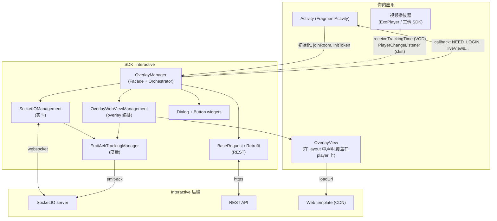
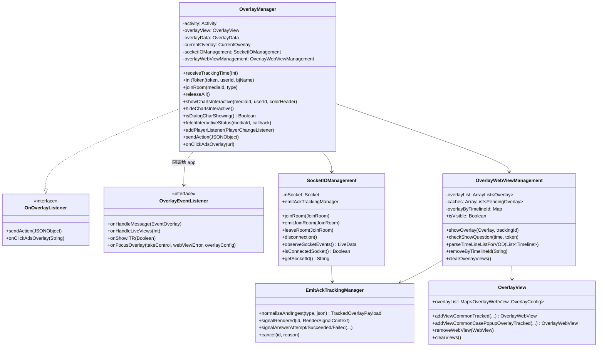
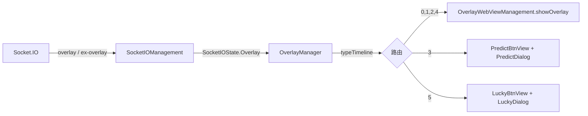
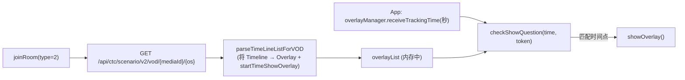
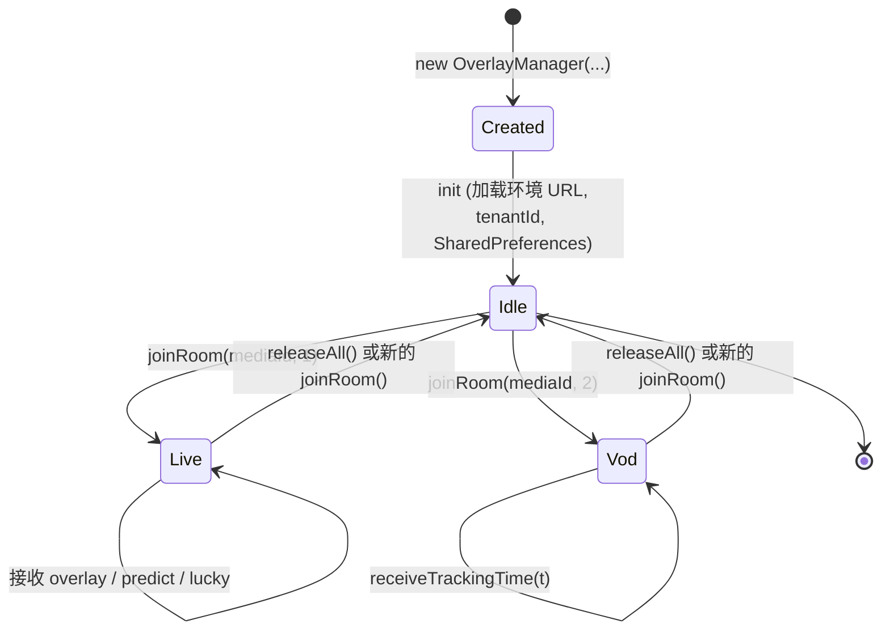
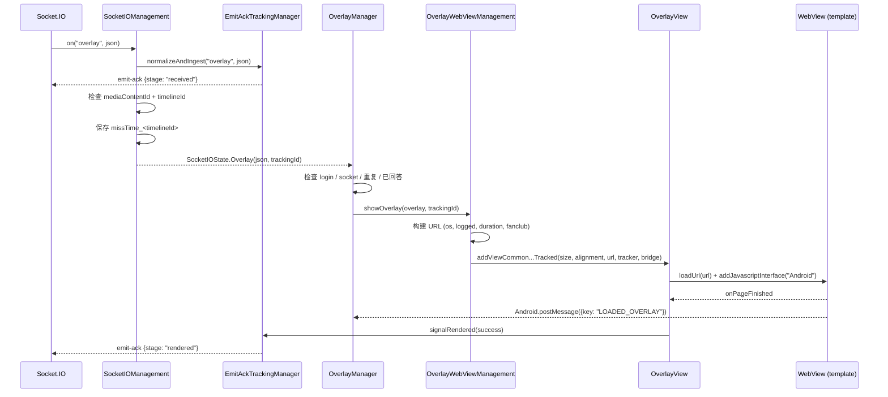
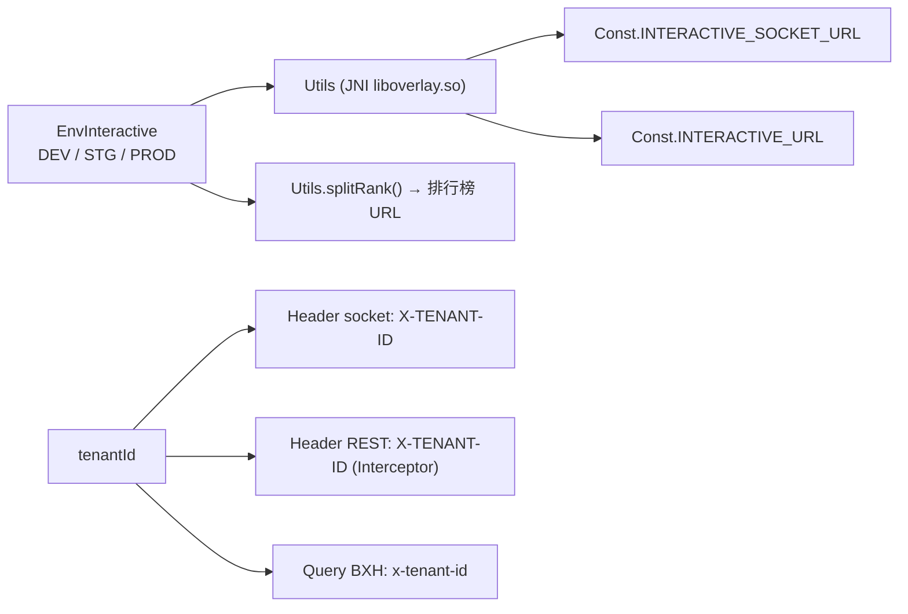

## 1. 总体视角

SDK 是一个 **Android 库(AAR)**,封装了 3 个主要职责:

1. 通过 Socket.IO 与 Interactive 服务器进行**实时连接**(Live 场景)。
2. **编排显示**以 web 方式编写的交互内容,在透明的 `WebView` 中展示。
3. 将用户的操作**转发**给服务器(通过 REST),并将事件反向通知给 app。

---

## 2. 分层与职责

| 层 | 组件 | 职责 |
|---|---|---|
| **Facade** | `OverlayManager` | app 的唯一入口。接收指令(`joinRoom`、`initToken`、`releaseAll`……)、监听 socket 状态、决定 overlay 类型、处理回答流程 |
| **实时传输** | `SocketIOManagement` | 创建/销毁 socket、注册事件、规范化 payload、通过 LiveData 发出 `SocketIOState` |
| **REST 传输** | `BaseRequest` + 各 `*Request` + `OverlayService` | Retrofit 客户端,附加 `X-TENANT-ID` 头,调用 scenario/action/vip/interactive-status API |
| **展示** | `OverlayWebViewManagement`、`OverlayView`、`OverlayWebView` | 构建 overlay URL、创建 WebView、根据 `metadata` 绑定位置/尺寸、清理 view |
| **附加展示** | `PredictDialog`、`LuckyDialog`、`SuggestDialog`、`DialogChartsInteractive`、`PredictBtnView`、`LuckyBtnView` | 各种特定 UI 形式(全屏 dialog、浮动按钮) |
| **Bridge** | `OverlayWebViewCallBack`、`PostMessageListener` | JavaScript ⇄ Kotlin 之间的桥梁(`@JavascriptInterface postMessage`) |
| **可观测性** | `tracking/*` | 度量 overlay 生命周期并向服务器发送 `emit-ack` |
| **基础设施** | `Const`、`WSK`、`Utils`、`Ext`、`NPreferenceUtils`、`QueuedMutableLiveData` | 常量、通过 JNI 获取环境 URL、扩展函数、本地存储 |

### 代码中体现的设计原则

- **单一 facade,不泄露内部细节**:app 只接触 `OverlayManager`、`OverlayView`、`OverlayData`、
  `EnvInteractive`、`OverlayEventListener`。所有 tracking 相关类都是 `internal`。
- **状态驱动**:socket 不直接调用 UI,而是通过 `QueuedMutableLiveData` 发出 `SocketIOState`
  (sealed class);`OverlayManager` 根据 Activity 生命周期进行 observe。
- **交互内容以 web 形式呈现**:SDK 不绘制问题界面,只加载 template URL 并通过
  `postMessage` 通信。因此更改交互界面无需重新构建 app。
- **环境 URL 隐藏在 native 层**:`Utils` 通过 `System.loadLibrary("overlay")` 调用
  JNI 函数 `socketDEV/STG/PRD`、`interactiveDEV/STG/PRD` —— URL 不以字符串形式存在于 Kotlin/DEX 中。

---

## 3. 简化的类图

## 4. 两种运行模式

### 4.1. LIVE

(`type = 1`) —— 由服务器控制

服务器主动实时推送 overlay。显示条件(剩余时长、是否已回答、
是否在 fanclub 中等)在客户端立即检查。

### 4.2. VOD

(`type = 2`) —— 由播放进度控制

没有 socket。SDK 会预先加载整个 scenario,然后**app 必须每秒向 SDK 注入播放时间**:

> `startTimeShowOverlay` 是从 `Timeline.time`(`"mm:ss"` 格式,通过 `String.toSecond()` 函数)
> 推导出来的,因此注入 `receiveTrackingTime` 的单位是**秒**。

---

## 5. 线程模型(threading)

| 工作 | 线程 | 备注 |
|---|---|---|
| Socket.IO 事件 | socket 客户端的线程 | 推送到 `QueuedMutableLiveData.postValue` |
| Observe `SocketIOState` | **主线程** | 通过 `LiveData.observe(LifecycleOwner)` |
| 创建/销毁 WebView | **主线程** | `showOverlayForVod` 包裹在 `GlobalScope.launch(Dispatchers.Main)` 中 |
| 解析 VOD scenario | `Dispatchers.IO` | `parseTimeLineListForVOD` 中的 `GlobalScope.launch(Dispatchers.IO)` |
| 调用 REST | OkHttp 的线程,callback 回到主线程 | 使用 `Call.enqueue` |
| Tracking emit-ack | `EmitAckTrackingManager` 上的 `@Synchronized` | render 计时器在 `Handler(Looper.getMainLooper())` 上运行 |
| 清理 tracking session | 守护线程 `EmitAckTrackingCleanup` | `ScheduledExecutorService`,周期 5 分钟 |

`QueuedMutableLiveData` 是值得注意的一点:它会将各个 state **排队**,而不是让 `postValue` 相互覆盖——
这是必要的,因为两个 overlay 事件可能几乎同时到达,不能丢失。

---

## 6. 对象生命周期

代码中的重要点:

- **构造函数不打开连接。** `init {}` 只是根据环境加载 URL,为 Retrofit 设置
  `tenantId`,将 listener 绑定到 `OverlayView`,初始化 `NPreferenceUtils`。
- **`joinRoom()` 总是先执行 `cleanUp()`** → 关闭旧 socket、清除 WebView、取消正在挂起的 tracking。
  因此连续调用 `joinRoom` 是安全的。
- **`SocketIOManagement` 在每个 Live session 中都会重新创建**,不会复用。
- **在观看 Live 期间调用 `initToken()` 会自动重新 `joinRoom()`**,以便 socket 携带新的 token。

---

## 7. 一个 overlay 的数据流(Live)

各分支的详情(包括被阻断的情况)请参见 [03 — 运行流程](03-luong-hoat-dong.md)。

---

## 8. WebView 桥接协议

SDK 注入名为 **`Android`** 的 JS interface(`Const.JS_INTERFACE_NAME`)。

**Web → SDK**(`Android.postMessage(jsonString)`):

| 字段 | 值 | 含义 |
|---|---|---|
| `key` | `LOADED_OVERLAY` | Template 已就绪 → SDK 推送数据下去,同时确认 `rendered` |
| `type` | `INTERACTIVE_SHOW_ANALYTICS` | Overlay 已显示(记录行为日志) |
| `type` | `INTERACTIVE_HIDE_ANALYTICS` | Overlay 关闭 → SDK 移除 WebView,重新打开 predict/lucky |
| `type` | `INTERACTIVE_ACTION_REPORT` | 用户回答 / 点击广告 |
| `type` | `INTERACTIVE_OPEN_ANALYTICS` | 打开 predict/lucky dialog |
| `type` | `INTERACTIVE_CLOSE_ANALYTICS` | 关闭 predict/lucky dialog |

**SDK → Web**(通过 `evaluateJavascript` 执行 `window.postMessage(...)`):

| `key` | 何时 | 函数 |
|---|---|---|
| `GET_DATA_INTERACTIVE` | `LOADED_OVERLAY` 之后 | `OverlayWebView.loadData()` / `*Dialog.loadData()` |
| `UPDATE_DATA_INTERACTIVE` | Socket `update-result` | `OverlayWebView.updateResult()` |
| `UPDATE_CONFIRM` | 回答成功(mini game/predict) | `updateConfirm()` |
| `UPDATE_COUTER` | Socket `predict-result` | `PredictDialog.updateResult()` |
| `UPDATE_NUMBER_LUCKY` | API 返回 lucky 结果 | `LuckyDialog.updateResult(data)` |

---

## 9. 环境与 tenant 配置

- `EnvInteractive.DEV | STG | PROD` 同时决定 socket URL 和 REST URL。
- `tenantId` 用于区分产品(例如 `vtvlive`、`VTVprime`、`onlive`……)。其中 tenant `vtvlive`
  有特殊规则:**没有 `allowAnonymous` 的 overlay,如果用户未登录会被忽略**。
- `BuildConfig.DEVICE_TYPE`(`androidmobile` / `androidtv`)会进入 `os` header、template URL 的
  `os=` query 以及 `targets` 过滤条件。

---

## 10. 本地存储

SharedPreferences 使用了两个不同的文件(现有代码的有意设计):

| Key | 文件 | 用途 |
|---|---|---|
| `missTime_<timelineId>` | `interactive_vlive` | 接收 overlay 的时间点,用于在延迟显示时计算剩余 `duration` |
| `ex_<userId 或 deviceId>` | `INTERACTIVE` | 记录已回答的 mini game `timelineId`,避免重复显示 |
| `timelineId`、`currentTime` | `interactive_vlive` | 最近一次被接受的 overlay 的痕迹 |
