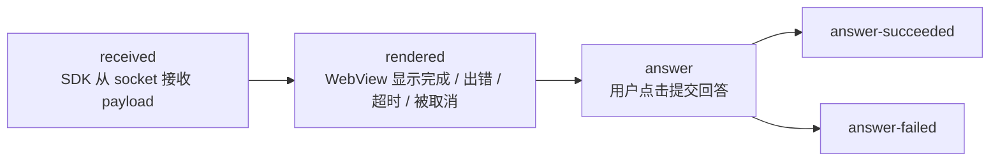
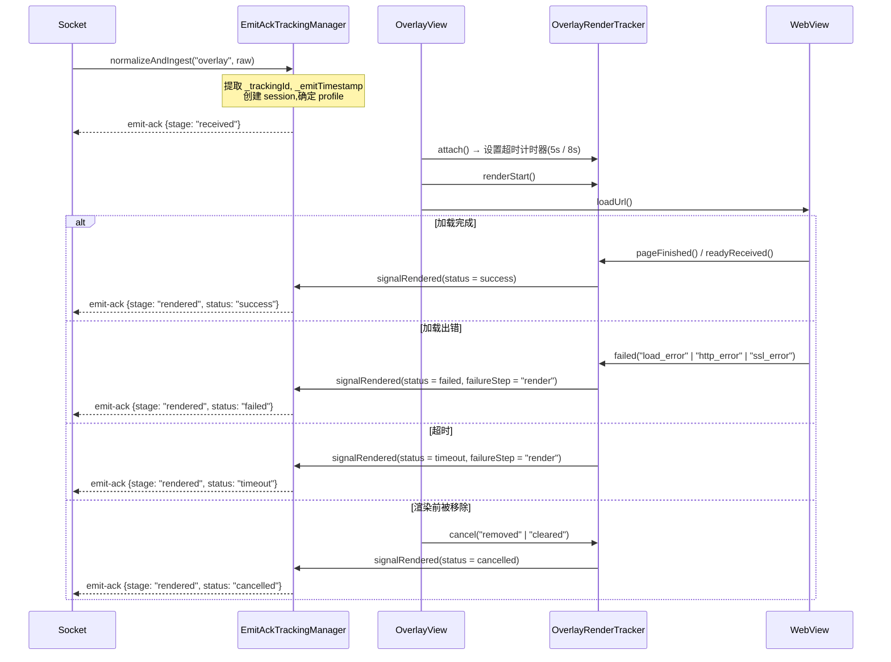
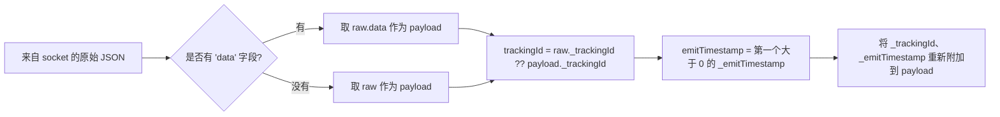

这个机制回答了运营方的问题:*"服务器推送的 overlay 是否真的到达了用户设备,
是否能够渲染,以及用户是否回答了?"* —— 由客户端自行度量,通过
`emit-ack` socket 事件反向发送给服务器。

> 通过 build 标志 `FEATURE_TRACKING_ACK_OVERLAY` 开启/关闭,位于
> [interactive/build.gradle](../interactive/build.gradle)(当前为 `true`)。
> 所有 tracking 相关的类都是 `internal` —— app 不会直接与之交互。

---

## 1. 各个阶段(stage)



| Stage | 含义 | 是否结束 session? |
|---|---|---|
| `received` | 合法的 payload 已进入 SDK | 否 |
| `rendered` | 确定显示结果,附带 `status` | 是,若 `status != success` |
| `answer` | 开始发送回答 | 否 |
| `answer-succeeded` | API 返回 `success = true` | 是 |
| `answer-failed` | API 出错 / 拒绝 / 网络错误 | 是 |

`rendered` 的 `status`:`success` | `failed` | `timeout` | `cancelled`。

每个 stage 对每个 `trackingId` **只会发送一次**(`emittedStages` 是一个 `Set`);如果 `emit`
抛出异常,该 stage 会从 set 中移除,以便在下次触发时可以重试。

---

## 2. 发送给服务器的 payload 结构

```jsonc
// emit("emit-ack", payload)
{
  "trackingId": "<从 overlay payload 中取出的 _trackingId>",
  "event": "overlay",
  "stage": "received | rendered | answer | answer-succeeded | answer-failed",
  "deviceId": "<android-id>",
  "clientContext": { /* 见下文 */ }
}
```

### `clientContext` —— 通用部分

| 字段 | 来源 |
|---|---|
| `profile` | `overlay.legacyIframe` 或 `overlay.wsInteractive` |
| `transportMode` | `legacyIframe` / `wsInteractive` |
| `overlayType` | `metadata.type` → `typeTimeline` → `type` |
| `duration` | overlay 的 `duration`(秒) |
| `sdkVersion` | `versionName.versionCode`(例如 `1.2.18`) |
| `platform` | 若 `DEVICE_TYPE` 包含 "tv" 则为 `tv`,否则为 `android` |
| `os` | `"Android <release>"` |
| `deviceClass` | `tv` / `tablet` / `mobile_large` / `mobile` / `mobile_small` |
| `viewportWidth`、`viewportHeight` | `displayMetrics` |

### 按 stage 划分

| Stage | 附加字段 |
|---|---|
| `received` | `emitTimestamp`、`receiveTimestamp`、`receiveLatencyMs`、`ackLatencyMs`、`timeline{received, ackSent}` |
| `rendered` | `status`、`receiveLatencyMs`、`renderLatencyMs`、`ackLatencyMs`、`timeline{attached, renderStart, loadComplete, readyReceived, ackSent}`、`failureReason?`、`failureStep?`、`custom.cancelReason?` |
| `answer*` | `actionType`(`answer_submit`)、`actionResult`(`attempted`/`success`/`failure`)、`actionLatencyMs`、`occurrenceId`(= `timelineId`)、`failureReason?`、`failureStep?`、`custom{timelineId, typeTimeline, mediaId, apiMessage?, apiDescription?, error?}` |

---

## 3. 两种档案(profile)与超时阈值

`EmitAckTrackingManager.resolveProfile()` 会检查 overlay 的 `src` URL:

| 条件 | Profile | 渲染超时 | 确定 `rendered` 的时刻 |
|---|---|---|---|
| `src` 含有 `?ws=1` 或 `&ws=1` | `overlay.wsInteractive` | **8000 ms** | 仅当 web 发送 `LOADED_OVERLAY`(`readyReceived`)时 |
| 其他情况 | `overlay.legacyIframe` | **5000 ms** | `onPageFinished` **或** `LOADED_OVERLAY`,以先到者为准 |

也就是说,新版 template(`ws=1`)必须主动报告就绪,而旧版 template 只需页面加载完成即可。

---

## 4. 一个 overlay 上的度量流程



`OverlayRenderTracker` 运行在 `Handler(Looper.getMainLooper())` 上,使用 `terminalSent` 标志确保
只发出**一个**终止信号,即使超时和 `pageFinished` 几乎同时发生。

---

## 5. 取消原因表(`cancelReason`)

以下是 SDK **有意不显示** overlay 的所有情况的完整列表 —— 在排查
"为什么 overlay 没有显示"时非常有用:

| `cancelReason` | 发生位置 | 原因 |
|---|---|---|
| `invalid_payload` | Socket / OverlayManager | 缺少 `mediaContentId`/`timelineId`,或 JSON 无法解析为 `Overlay` |
| `short_duration` | Socket(`ex-overlay`) | `duration <= 10` 秒 |
| `login_required` | OverlayManager | Tenant 为 `vtvlive`,未登录,overlay 没有 `allowAnonymous` |
| `socket_not_connected` | OverlayManager | 处理时 socket 已断开 |
| `missing_timeline_id` | OverlayManager | `timelineId` 为空 |
| `duplicate_overlay` | OverlayManager | `timelineId` 与正在显示的 overlay/predict/lucky/headline 重复 |
| `already_answered` | OverlayManager | Pref `ex_<userId\|deviceId>` 中已记录该 `timelineId` |
| `target_mismatch` | WebViewManagement | `targets` 不包含 `all` 也不包含当前平台 |
| `invalid_layout` | WebViewManagement / OverlayView | 无法从 `metadata.pos` 推断出 `alignment` |
| `expired_duration` | WebViewManagement | `duration - (now - missTime) <= 0` |
| `superseded_cache` | WebViewManagement | 缓存中的旧 overlay 在解锁时被新 overlay 替代 |
| `removed`、`cleared` | OverlayView | WebView 被移除 / 全部清空 |
| `socket_disconnected`、`sdk_disconnect`、`leave_room`、`clear_all`、`destroy` | Socket / Manager | Session 结束 |

---

## 6. Tracking session 的内存管理

| 参数 | 值 |
|---|---|
| 最大 session 数 | **256**(超过则移除最旧的 session —— `LinkedHashMap` 按最近访问顺序) |
| 每个 session 的 TTL | **30 分钟** |
| 后台清理周期 | **5 分钟**(守护线程 `EmitAckTrackingCleanup`) |

Session 会在以下情况立即被删除:`rendered` 的 status 不是 `success`、`answer-succeeded`、`answer-failed`,
或在离开房间/断开 socket 时调用 `finish()`/`cancelAll()`。

---

## 7. Payload 规范化(`TrackingPayloadNormalizer`)



通过这一步,SDK 的其余部分始终处理已经"解包"的 payload,同时保留了
tracking 的 metadata。

---

## 8. 对接入 app 的影响

- Tracking **不会**增加权限,也不会调用额外的 API —— 使用的是已经打开的同一个 socket。
- 在 **VOD 模式下没有 tracking**(没有 socket 可用来 emit)。
- 如果 app 想要完全关闭:将 `FEATURE_TRACKING_ACK_OVERLAY` 改为 `false` 并重新构建 AAR。

---

[← API Reference](04-api-reference.md) · [返回目录](README.md) · [下一篇: 常见错误 →](06-loi-thuong-gap.md)
