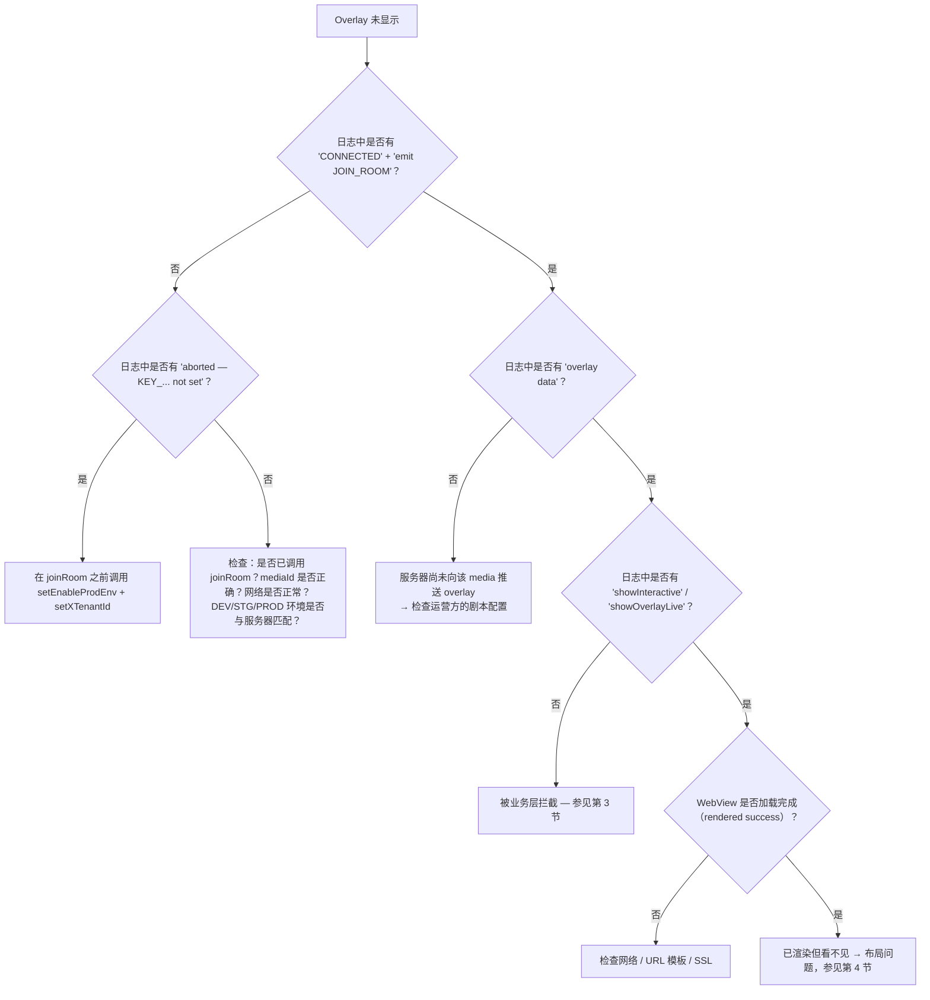

## 1. 开启 SDK 日志

SDK 通过 `logLine(...)` 函数（`Const/PrintLog.swift`）记录日志 — 始终以 `print` 输出，前缀为
**`Interactive:`**。可在 Xcode Console 中查看，或使用以下方式过滤：

```bash
# 通过 Console.app / log stream 运行时
log stream --predicate 'eventMessage CONTAINS "Interactive:"'
```

值得关注的日志字符串（前缀 `Interactive:`）：

| 日志 | 含义 |
|---|---|
| `[Socket] connectSocket() — env: ...` | 开始准备连接 |
| `[Socket] ❌ connectSocket() aborted — KEY_X_TENANT_ID not set` | 尚未调用 `setXTenantId` |
| `[Socket] ❌ connectSocket() aborted — KEY_ENABLE_PROD_ENV not set` | 尚未调用 `setEnableProdEnv` |
| `[Socket] ✅ CONNECTED — sid: ...` | Socket 已连接 |
| `[Socket] emit JOIN_ROOM — mediaContentId: ...` | 已进入房间 |
| `Interactive-socket overlay data` | 收到来自服务器的 overlay |
| `startShowLiveOverlayWithDataReceived` | 开始处理 overlay |
| `1 showInteractive isView : false` | Overlay 因 `Compensatory` 被拦截（已互动过） |
| `quá giờ trả lời` | Overlay 从 `ts` 起算的 `duration` 已过期 |
| `[Socket] 🔌 DISCONNECTED` / `🔄 RECONNECT` | 断开/恢复连接 |

---

## 2. Overlay 未显示 — 诊断树



---

## 3. 被业务层拦截

| 现象 | 原因 | 处理方式 |
|---|---|---|
| `showInteractive isView : false` | `Compensatory` — 该节点已互动过，仍在 `frequencyLimit` 内 | 属于正常设计。若要重新测试：删除 suite `INTERACTIVE_<userId>` / `INTERACTIVE_DEFAULT` |
| `quá giờ trả lời` | Overlay 从 `ts` 起算的 `duration` 已过期 | 属于正常设计 |
| Overlay 未显示，`targets` 不匹配 | `targets` 既不包含 `iphone` 也不包含 `all` | 修改剧本，使 `targets` 包含 `iphone`/`all` |
| OnPlus/OnLiveTV/SeeNow 上 predict/lucky 按钮不显示 | `receiveDataActionButtonPredict` 对 tenant `vtvlive`/`onlivetv`/`VTVprime` 提前 return | 属于当前设计；若要启用，需修改 SDK 中的 tenant 判断条件 |
| 用户点击回答但没有任何反应 | `!allowAnonymous` 且尚未登录 | 确保已实现 `InteractiveLoginDelegate.showInteractiveLogin()`，并在登录后调用 `initAuthenToken` |
| 显示"您必须是……的 FanClub"对话框 | `requiredFanClub` 且 `KEY_FAN_CLUB == false` | 属于正常设计；需先加入 fanclub（等待 socket `data` 事件更新） |
| 显示"使用 N OnG 回答？"对话框 | `typeTimeline == 2`、`betAmount > 0`、非 VIP | 属于正常设计（telco VIP 流程） |

---

## 4. Overlay 已渲染但不可见 / 位置错误

| 原因 | 现象 | 处理方式 |
|---|---|---|
| `uiView`（overlay 容器）尺寸为 0 | 渲染日志正常，但屏幕为空 | 在调用 `initOverlay` 之前，确保 `uiView` 的约束正确铺满视频框架 |
| `uiView` 被 player 覆盖绘制 | Overlay "闪一下"就消失 | 将 `uiView` 添加到 player **之后**（调整 subview 顺序），或提高 `zPosition` |
| `predictView` 位置错误 | predict/lucky 按钮位置偏移 | 在 `showLayoutViewPredictRoot()` 中更新 `predictView` 的 frame（参见 demo 中的 `updateLayoutPredict`） |
| 切换画面时未调用 `resizeVideoView` | Overlay 不随 player 全屏而缩放 | 在视频框架变化时调用 `interactive.resizeVideoView(width:height:)` |
| `locationLayoutViewRoot` 未处理 | Overlay 始终停留在同一位置 | 实现 `InteractiveViewDelegate.locationLayoutViewRoot(location:width:height:)`，根据 `location`（0..8）进行定位 |

Overlay 使用的 WebView 是**透明**的 `WKWebView`（`isOpaque = false`、背景 `.clear`、禁止滚动）。若
看到黑/白背景遮住视频，请检查 web 模板背景是否为透明。

---

## 5. Socket 无法连接

排查清单：

1. **尚未配置**：日志出现 `aborted — KEY_X_TENANT_ID not set` / `KEY_ENABLE_PROD_ENV not set`。
   → 在启动时调用 `InteractiveSetting().setXTenantId(...)` 与 `setEnableProdEnv(...)`。
2. **环境错误**：`Enviroment` 必须与服务器系统（DEV/STG/PROD）匹配 — URL 由 env 推导而来。
3. **Tenant 错误**：服务器可能拒绝该房间。
4. **Token**：socket header 的 `Authorization` **原样**发送（不会自动加 `Bearer`）。若后端
   要求 socket 也带 `Bearer`，需在 `initAuthenToken` 中传入已带前缀的字符串。
5. **`isConnected()` 返回 `true` 但实际仍在连接中**：该函数在 `.connecting`/`reconnects` 状态下
   也会返回 `true` — 不要完全依赖它来判断是否已经上线。

---

## 6. 集成后崩溃

| 错误 | 原因 | 处理方式 |
|---|---|---|
| 在 joinRoom / 调用 API 时立即出现 `Unexpectedly found nil` 崩溃 | 尚未配置时强制解包 `UserDefaults.string(forKey: KEY_X_TENANT_ID)!` / `KEY_ENABLE_PROD_ENV!` | **务必**先调用 `setEnableProdEnv` + `setXTenantId`（这正是 `[fixbug] crash` 提交的原因） |
| 链接时缺少 symbol（Alamofire / SocketIO / SwiftyJSON） | 静态 XCFramework 未携带依赖 | 在 app target 中重新声明相应的 pod |
| 缺少 RxSwift/RxCocoa 的 symbol | 尚未嵌入相应的 Rx `*.xcframework` | 嵌入 `RxSwift/RxCocoa/RxRelay.xcframework`（Embed & Sign） |
| WebView 未收到 callback | 模板调用的 interface 名称错误 | Interface 必须是 **`IOS`**（`window.webkit.messageHandlers.IOS.postMessage(...)`） |

---

## 7. VOD：overlay 未在正确的时间点出现

| 原因 | 处理方式 |
|---|---|
| App 未调用 `getTimeVideo()` | 在 `joinRoom(type: 2)` 之后添加每秒一次的循环/observer |
| 注入的单位错误（毫秒而非秒） | `getTimeVideo` 接收的是**秒**（与 `timeShow` 匹配） |
| 用户跳过了某个时间点 | SDK 只匹配**精确的秒数**（`timeShow == Int(time)`）；该节点会被跳过 — 这是当前的限制 |
| 尚未登录，且 overlay 不是 `allowAnonymous` | `showInteractiveVod` 会跳过；登录后重新 `joinRoom` |
| 剧本返回为空 | 检查 `callApiScenarioForVod`（env、`X-TENANT-ID`、`mediaId`）；`convertVodInteractive` 只获取 `showStatus == "ACTIVE"` 的项 |

---

## 8. 维护时需要了解的技术说明

以下是当前代码中容易造成混淆、值得记录的要点：

- **`liveViews + 230`**：`showCCU` 在调用 `showLiveView` 之前会给观看人数硬编码加上 230。若
  需要原始数值，app 需自行减去。
- **`CkstData.data` 映射 JSON key `"os"`**：向上 emit 的 `ckst` payload 中，嵌套字段名为 `os`
  （而不是 `data`）。如与后端不一致，请对照检查。
- **`UPDATE_COUTER`**（缺少字母 N）与 **`PredictResult.timlineId`**（缺少字母 e）在代码中
  **原文如此** — web 模板必须完全匹配这个拼写。
- **`DialogLuckyNumberView` 在运行时同时用于 predict 和 lucky**；`DialogPredictView` 几乎
  不再被使用。
- **`LiveCompensatoryShotImpl.loadScenarioLive`** 在 Alamofire 请求完成**之前**就**同步**返回
  → 几乎总是返回 `nil`。只有 `fetchOverlayStatus`（用于 `fetchInteractiveStatus`）能正常工作。
  若要复用此函数请务必小心。
- **Tenant header 大小写不一致**：socket 使用 `x-tenant-id`（小写），REST 使用
  `X-TENANT-ID`（大写）。
- **Sentry 已被禁用**：`SentryInteractor` 与 `InteractiveSetting.startSentry` 均已被注释掉。
- **`addCallback` 只有一个槽位**：后调用会覆盖之前的 callback — 不支持挂接多个 listener。

---

## 9. 常见问题

**SDK 是否会自动跟随 `UIViewController` 的生命周期？**
不会。App 必须在退出界面时自行调用 `releaseAll()`。SDK 只会自动监听
`orientationDidChange` 以重新校准 predict 按钮的位置。

**是否可以同时显示多个 minigame overlay？**
不可以。`showOverlayLive` 在添加新 overlay 之前会调用 `cancelActiveOverlay` + `onStop()` →
始终只存在一个 minigame overlay。predict/lucky 按钮是独立的 view，因此可以并存（当
minigame 占用屏幕时，SDK 会自动隐藏按钮）。

**中途切换账号会怎样？**
调用 `initAuthenToken(新token, 新userId, "")`。若正处于 Live 状态，SDK 会自动使用新
token 重新进入房间。

**每次 `joinRoom()` 之前都需要先调用 `releaseAll()` 吗？**
不需要 — `joinRoom()` 已经会自动执行 `removeAllView()` 并处理 socket。只有在真正退出时才
需要调用 `releaseAll()`。

**旋转屏幕会导致 overlay 丢失吗？**
由服务器控制的 minigame overlay，若仍在有效期内会被重新推送；predict 按钮会通过
`orientationDidChange` 重新校准位置。布局由 app 通过 `InteractiveViewDelegate` 控制。

**SDK 使用哪种 WebView？**
`WKWebView`（部分对话框使用 `NoZoomWKWebView` 以阻止双指缩放）。已开启 JavaScript，
背景透明，禁止滚动。

---

[← Tracking emit-ack](05-tracking-emit-ack.md) · [返回目录](README.md)
