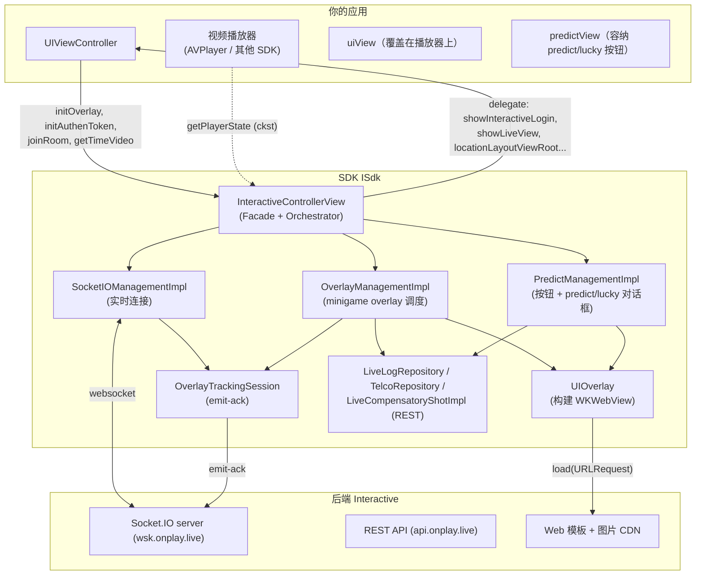
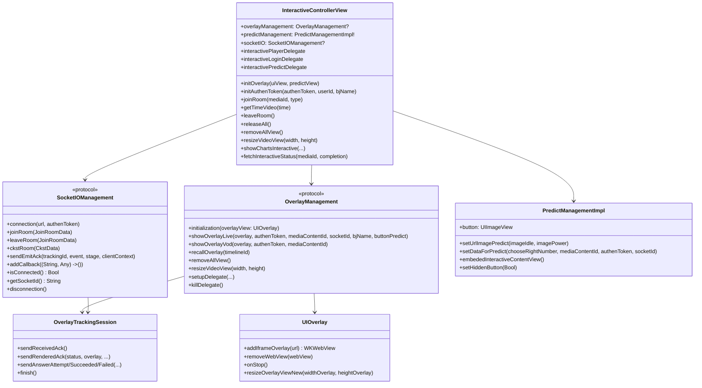
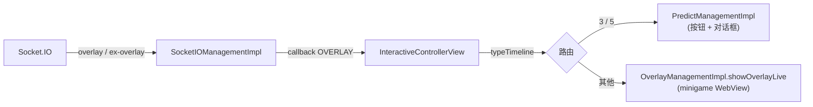
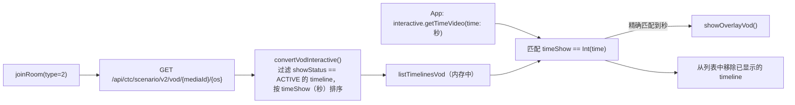
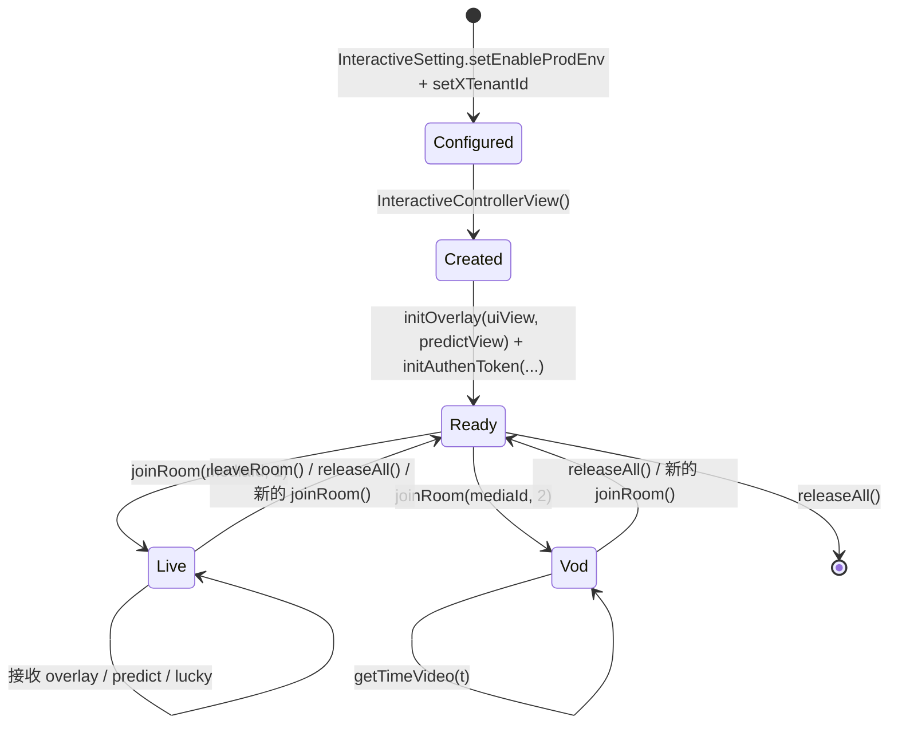
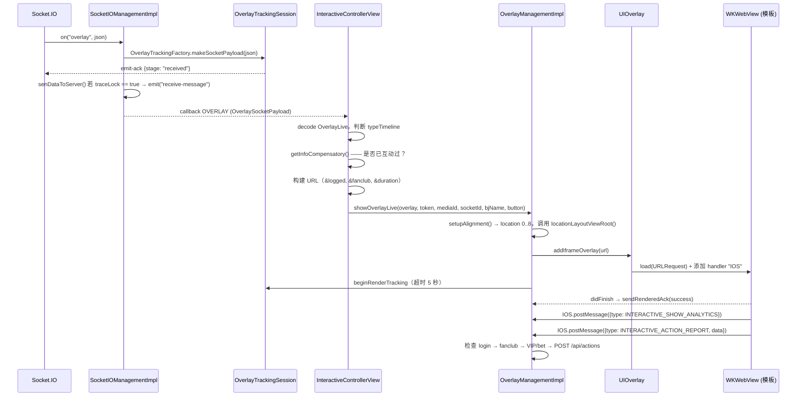
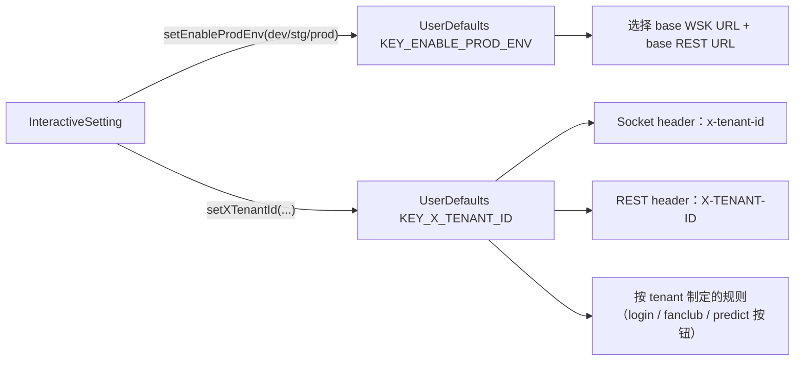

## 1. 总体视角

SDK 是一个**iOS 库（XCFramework `ISdk`）**，封装了 3 项主要职责：

1. 通过 Socket.IO 与 Interactive 服务器建立**实时连接**（Live 场景）。
2. **调度显示**互动内容（以 web 方式编写），呈现在若干透明的 `WKWebView` 中。
3. 通过 REST **转发**用户操作到服务器，并通过各个 delegate **回调**app。

---

## 2. 分层与职责

| 层 | 组成部分（文件） | 职责 |
|---|---|---|
| **Facade / Orchestrator** | `InteractiveControllerView` | app 唯一的入口点。接收命令（`joinRoom`、`initAuthenToken`、`getTimeVideo`、`releaseAll` 等），监听 socket 事件，决定 overlay 类型（minigame / predict / lucky），调度各个 manager |
| **配置** | `InteractiveSetting` | 将环境（`KEY_ENABLE_PROD_ENV`）和 tenant（`KEY_X_TENANT_ID`）写入 `UserDefaults` |
| **实时传输** | `SocketIOManagementImpl`（`SocketIOManagement`） | 创建/销毁 socket，注册事件，规范化 payload，发送 emit-ack |
| **overlay 调度** | `OverlayManagementImpl`（`OverlayManagement`） | 构建 minigame overlay，处理回答流程（login → fanclub → VIP/bet → 调用 API），tracking |
| **predict/lucky 调度** | `PredictManagementImpl` | GIF 悬浮按钮、预测/幸运数字对话框、独立的回答流程 |
| **WebView 呈现** | `UIOverlay`、`ConfigureWebView`（`NoZoomWKWebView`） | 创建透明 `WKWebView`，按 overlay 生命周期挂载/卸载 |
| **辅助呈现** | `DialogLuckyNumberView`、`DialogPredictView`、`DialogConfirmView`、`DialogDeductionView`、`FanClubView`、`LeaderboardView` | 全屏对话框 / 悬浮按钮 / 排行榜 |
| **Bridge** | `OverlayWebViewCallBack`、`PredictWebViewCallBack` | JavaScript ⇄ Swift 的桥接（`WKScriptMessageHandler`，interface 名为 `IOS`） |
| **REST** | `LiveLogRepository`（`/api/actions`）、`TelcoRepository`（`/api/public/vip-status`）、`LiveCompensatoryShotImpl`（`interactive-status`）、`OverlayVod*` 类（VOD） | 通过 Alamofire 调用 API |
| **可观测性** | `OverlayTracking.swift`（`OverlayTrackingSession`、`OverlayTrackingFactory`） | 测量 overlay 生命周期并发送 `emit-ack` |
| **基础设施** | `ApiConst`、`TypeInteractive`、`SocketEvents`、`Utils`、`PrintLog`，以及各个 `Codable` model | 常量、工具函数、数据 model |

### 代码中体现的设计原则

- **面向 app 只有一个 facade**：app 主要接触 `InteractiveControllerView` + `InteractiveSetting` + 各个
  delegate `protocol`。各个子 manager 虽然是 `public`，但通常无需直接调用。
- **事件都通过单一 callback**：socket 通过闭包 `(String, Any) -> ()` 推送事件给 SDK，该闭包通过
  `addCallback`（单槽位）绑定；`InteractiveControllerView.handleEventsSocket()` 会根据事件名 `switch`。
- **互动内容以 web 形式呈现**：SDK 不自行绘制问题界面，只是将模板 URL 加载到 `WKWebView` 中，并通过
  `postMessage` 进行交互。更换互动界面无需重新构建 app。
- **配置存放在 `UserDefaults` 中**：环境与 tenant 会在多处被重新读取（socket header、选择 REST base
  URL 等）。这也是部分因**未配置而 force-unwrap 崩溃**的根源。

---

## 3. 精简版类图

## 4. 两种运行模式

### 4.1. LIVE（`type = 1`，`ApiConst.TYPE_LIVE`）—— 由服务器驱动

服务器通过 Socket.IO 主动推送 overlay。显示/回答的条件（是否登录、fanclub、VIP/bet、是否已回答）
会在客户端立即进行检查。

### 4.2. VOD（`type = 2`，`ApiConst.TYPE_VOD`）—— 由播放进度驱动

没有 socket。SDK 通过 REST 预先加载整份剧本，之后**app 必须持续注入播放时间**：

> `timeShow` 是从 `Timelines.time`（格式为 `"SS"`、`"MM:SS"` 或 `"HH:MM:SS"`，通过
> `parseTimeToSeconds` 函数）推导出来的，因此传入 `getTimeVideo` 的单位是**秒**。

---

## 5. 线程模型（threading）

| 工作 | 线程 | 备注 |
|---|---|---|
| Socket.IO 事件 | Socket.IO client 的线程 | 通过 `addCallback` 闭包传入 |
| 构建/销毁 WebView | **主线程** | `showInteractive`/`setUpDataForTemplatePredict` 在 `DispatchQueue.main.async` 中调用 |
| REST 调用 | Alamofire 的线程，callback 回到主线程 | `AF.request(...).response*` |
| Tracking emit-ack | 在 `OverlayTrackingSession` 中同步进行（标志位 `emittedStages`、`finished`） | render 计时器使用主线程上的 `Timer` |
| predict 按钮切换图片/alpha | 主线程（`Timer.scheduledTimer`） | **5 秒**后将 alpha 渐隐至 0.5 |

> 与 Android 版本不同，iOS **没有** `QueuedMutableLiveData` —— overlay 事件直接在 callback 中按顺序处理。
> `addCallback` 是**单一槽位**，后一次调用会覆盖前一次。

---

## 6. 对象生命周期

代码中的重要要点：

- **构造函数 `InteractiveControllerView()` 只创建 `SocketIOManagementImpl` 和
  `OverlayManagementImpl`**——尚未打开连接，也未调用任何 API。
- **`joinRoom(type: 1)`** 会离开旧房间（若 media 不同）、断开旧 socket、`removeAllView()`、重新绑定
  socket callback 后 `connectSocket()`。`emit("join-room")` 仅在**socket 连接成功后**才会发生
  （位于 `SocketEvents.CONNECTED` 分支中）。
- **`joinRoom(type: 2)`** 断开 socket（若正在打开）、`removeAllView()`，调用 REST 加载 VOD 剧本。
- **在正在连接且有 media 时调用 `initAuthenToken()`** → 会断开 socket 并重新 `joinRoom(type: 1)`，
  以便 socket 携带新 token。
- **`releaseAll()`** 会调用 `leaveRoom()`（若正在连接）、移除所有 delegate，并调用 `disconnection()`。

---

## 7. 一个 minigame overlay 的数据流（Live）

各分支的详细说明（包括被拦截的各个环节）请参见 [03 — 工作流程](03-luong-hoat-dong.md)。

---

## 8. WebView 桥接协议

SDK 绑定了名为 **`IOS`** 的 `WKScriptMessageHandler`（`userContentController.add(callBack, name: "IOS")`）。

**Web → SDK**（`window.webkit.messageHandlers.IOS.postMessage(jsonString)`）—— 解码为
`OverlayDataCallback { data, type }`：

| `type`（常量 `TypeInteractive`） | 含义 |
|---|---|
| `INTERACTIVE_SHOW_ANALYTICS` | overlay 已显示 → `showLayoutViewRoot()`，隐藏播放器控制条 |
| `INTERACTIVE_HIDE_ANALYTICS` | overlay 关闭 → 移除 WebView，清理 tracking，重新显示播放器控制条 |
| `INTERACTIVE_ACTION_REPORT` | 用户回答 / 点击广告（`action = CLICK_ADS`） |
| `INTERACTIVE_OPEN_ANALYTICS` / `INTERACTIVE_CLOSE_ANALYTICS` | 打开/关闭 predict/lucky 对话框（在 `PredictManagementImpl` 中处理） |
| `INTERACTIVE_PING_ANALYTICS` | 仅用于过滤，不记录日志 |

**SDK → Web**（`webView.evaluateJavaScript("window.postMessage('<json>', '*')")`）：

| `key` | 时机 | 发送位置 |
|---|---|---|
| `UPDATE_DATA_INTERACTIVE` | Socket `update-result` | `sendMessageResultinteractive()` |
| `UPDATE_COUTER`*（原文如此，缺少字母 N）* | Socket `predict-result` → `answer1/answer2` | `receiveDataResultPredict()` + 重新打开对话框时 |
| `UPDATE_NUMBER_LUCKY` | API 返回 lucky 结果 | `postMessageWhenClickPlayLucky()` |
| `UPDATE_CONFIRM` | 回答成功（bet/VIP 分支） | `postMessageWhenAnswerSuccess()` |

> ⚠️ 与 Android 版本不同：iOS **不使用** `LOADED_OVERLAY` / `GET_DATA_INTERACTIVE` 这两个 key。
> iOS 的模板直接通过已经附带好参数的 URL 加载；补充数据（结果）则通过上述几个 key 推送下去。

---

## 9. 环境与 tenant 配置

- `Enviroment` = `DEV`（`"dev"`）/ `STG`（`"stg"`）/ `PROD`（`"prod"`）——同时决定 socket URL
  （`*.onplay.live` WSK）以及 REST URL 和排行榜 URL。
- `TenantIdType`：`vtvlive`（OnPlus）、`onlivev2` = `onliveLiveStream`（SOOP）、`onlivetv` =
  `onliveTV`（OnLive TV）、`VTVprime`（SeeNow）。当前代码中的一些特殊规则：
  - **predict/lucky 按钮会被跳过**，适用于 `vtvlive`、`onlivetv`、`VTVprime` 这些 tenant
    （`receiveDataActionButtonPredict` 会提前返回）。
  - **仅 `onlivev2`** 这个 tenant 会在用户尚未加入 fanclub 时附加 `&fanclub=false` 参数。
- `ApiConst.OS = "iphone"` 会被写入 socket header 的 `os`、`/api/actions` body 的 `os` 字段、
  VOD 剧本 URL 的 `os` 参数，以及 overlay 的 `targets` 过滤条件
  （`targets.contains("iphone")` 或 `"all"`）。

---

## 10. 本地存储（`UserDefaults`）

| 键 / suite | 用途 |
|---|---|
| `KEY_ENABLE_PROD_ENV`、`KEY_X_TENANT_ID` | 环境 + tenant（必须先配置） |
| `KEY_MEDIA_CONTENT_ID` | 最近一次加入的 media |
| `MINI_GAMES`、`PREDICT`、`POPUP_PREDICT`、`INTERACTIVE_TYPE_TIMELINE` | 显示状态机（`SHOW`/`HIDE`/`HIDE_CMS`/`END`） |
| `KEY_FAN_CLUB` | 用户是否属于当前观看 media 的 fanclub |
| suite `INTERACTIVE_<userId>` / `INTERACTIVE_DEFAULT`，key = `mediaId` | `Compensatory`——防止某个时间点被重复显示/回答 |
| suite `DATA_RESULT_PREDICT`，key = `timelineId` | predict 结果缓存（`answer1`/`answer2`），在重新打开对话框时推送 |

---

[← 返回目录](README.md) · [下一篇：安装与集成 →](02-cai-dat-va-tich-hop.md)
