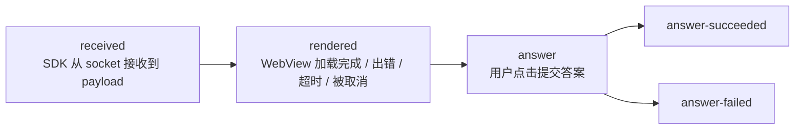
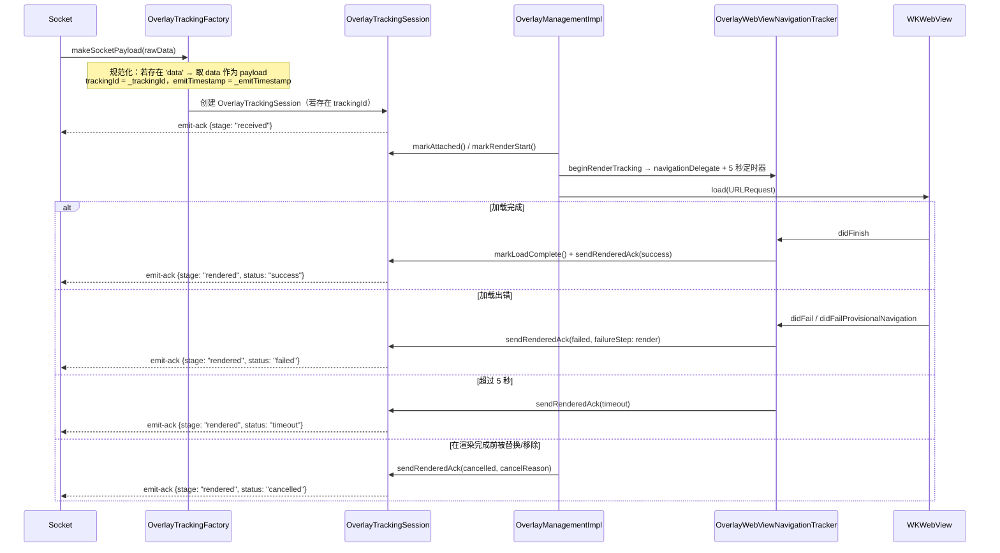
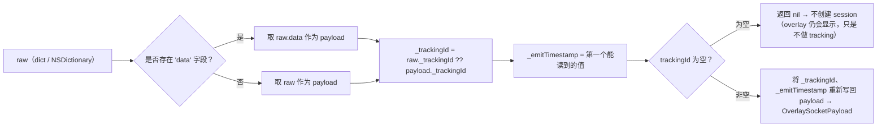

该机制回答的是运营方的问题：*"服务器推送出去的 overlay，是否真正到达了用户设备、能否正常渲染，以及用户是否做出了回应？"*——由客户端自行测量，并通过 **`emit-ack`** socket 事件回传给服务器。

> 整个 tracking 层位于 `Libraries/Overlay/Tracking/OverlayTracking.swift` 中。app **无需**
> 直接与之交互——SDK 会自行测量并通过当前打开的 socket 自动发送。
>
> ⚠️ Tracking **仅在 LIVE 模式下运行**。`showOverlayVod` 不会调用 `beginRenderTracking`，且 VOD
> 没有 socket 可用于 emit。

---

## 1. 各个阶段（stage）



| Stage（`OverlayTrackingStage`） | 含义 | 是否结束会话？ |
|---|---|---|
| `received` | 合法 payload 已进入 SDK | 否 |
| `rendered` | 确定显示结果及 `status` | 是，若 `status != success` |
| `answer` | 开始提交答案 | 否 |
| `answer-succeeded` | API 返回 `success == true` | 是 |
| `answer-failed` | API 出错 / 被拒绝 / 网络错误 | 是 |

`rendered` 的 `status`（`OverlayTrackingStatus`）：`success` | `failed` | `timeout` | `cancelled`。

每个 stage 在每个会话中只会发送**一次**（`emittedStages` 是一个 `Set`）。会话 `finish()` 之后，
后续的所有 `emitStage` 都会被忽略。

---

## 2. 发送到服务器的 payload 结构

```jsonc
// socket.emit("emit-ack", payload)
{
  "trackingId": "<从 overlay payload 中取得的 _trackingId>",
  "event": "overlay",
  "stage": "received | rendered | answer | answer-succeeded | answer-failed",
  "deviceId": "<identifierForVendor>",
  "clientContext": { /* 见下文 */ }
}
```

### `clientContext` —— 通用部分

| 字段 | 来源 |
|---|---|
| `profile` | `"overlay.legacyIframe"`（固定常量，iOS 只有 1 个 profile） |
| `transportMode` | `"legacyIframe"` |
| `sdkVersion` | `ApiConst.VERSION_SDK`（`"2025-05-25"`） |
| `platform` | `"ios"` |
| `os` | `UIDevice.systemName + " " + systemVersion`（例如 `"iOS 17.5"`） |
| `deviceClass` | 若为 iPad 则为 `"tablet"`，否则为 `"mobile"` |
| `viewportWidth`、`viewportHeight` | `UIScreen.main.bounds` |

### 按 stage 划分

| Stage | 附加字段 |
|---|---|
| `received` | `emitTimestamp`、`receiveTimestamp`、`receiveLatencyMs`、`ackLatencyMs`、`timeline{received, ackSent}` |
| `rendered` | `status`、`receiveLatencyMs`、`renderLatencyMs`、`ackLatencyMs`、`timeline{attached, renderStart, loadComplete, readyReceived, ackSent}`、`duration?`、`overlayType?`、`failureReason?`、`failureStep?`、`custom.cancelReason?` |
| `answer*` | `actionType`（`answer_submit`）、`actionResult`（`attempted`/`success`/`failure`）、`actionLatencyMs`、`occurrenceId`（= `timelineId`）、`overlayType?`、`failureReason?`、`failureStep?`、`custom{…}`、`timeline` |

> 与 Android 版本不同：iOS **只有一个 profile**，即 `overlay.legacyIframe`，并使用**固定 5000 ms
> 的 render 超时**（`OverlayTrackingConstants.renderTimeoutMs = 5.0`）。没有 `ws=1` / `wsInteractive`
> 分支，且 timeline 中的 `readyReceived` 始终为 `NSNull()`（iOS 是根据 WebView 的 `didFinish`
> 来确定 `rendered`，而不会等待模板报告 `LOADED_OVERLAY`）。

---

## 3. 一次 overlay 的测量流程（Live）



`OverlayTrackingSession` 使用 `renderedAckSent` 标志位，以确保即使超时与 `didFinish` 几乎同时发生，
`rendered` 也只会被发送**一次**。

---

## 4. Payload 规范化（`OverlayTrackingFactory`）



经过这一步之后，SDK 其余部分处理的都是已经"解包"过的 payload（`data`），同时保留了 tracking 所需的
metadata（`_trackingId`、`_emitTimestamp`）。

创建 session 有**两条路径**：
1. 在 `SocketIOManagementImpl.trackedOverlayPayload()` 中——接收到 `overlay`/`ex-overlay` 时，
   创建 session 并立即发送 `received`。
2. 作为兜底方案，在 `InteractiveControllerView.startShowLiveOverlayWithDataReceived()` 中——如果
   payload 尚未携带 session，但 `OverlayLive.trackingId` 不为空，则创建新的 session 并发送 `received`。

---

## 5. 取消原因（`cancelReason` / `failureReason`）

以下是 SDK **有意不显示 / 取消 tracking** overlay 的各个环节列表——在排查"为什么 overlay 没有显示"
时很有用：

| 值 | 发生位置 | 原因 |
|---|---|---|
| `invalid_overlay_state` | `showOverlayLive` | `pos.alignment == nil` 或 `uiOvelay == nil` |
| `replaced_by_new_overlay` | `showOverlayLive` | 新的 overlay 替换了正在显示的 overlay |
| `recalled` | `recallOverlay` | 服务器根据 `timelineId` 撤回 overlay |
| `remove_all_view` | `removeAllView` | 清理全部 view（重新加入 / 离开房间） |
| `interactive_hide` | `INTERACTIVE_HIDE_ANALYTICS` | Web 端报告关闭 overlay |
| `load_error` / `render` | Navigation delegate | WebView 加载出错 |
| `timeout` | 5 秒计时器 | WebView 未能在 5 秒内加载完成 |
| `api_EX400` / `api_TL404` / `api_PM402` / `api_false` | API `/api/actions` | 服务器拒绝该答案 |
| `network_error`（`network`） | 回答时无网络 | `Connectivity.isConnectedToInternet == false` |
| `unknown_response` | 无法解析响应 | API 响应体格式错误 |

---

## 6. 计算的延迟（latency）

`OverlayTrackingSession` 使用毫秒级时间戳（`Date().timeIntervalSince1970 * 1000`）：

- `receiveLatencyMs = receiveTimestamp - emitTimestamp` —— 服务器到客户端的网络延迟。
- `renderLatencyMs = loadComplete - receiveTimestamp` —— WebView 渲染耗时。
- `ackLatencyMs` —— 发送 ack 的延迟。
- `actionLatencyMs = actionTimestamp - (readyReceived ?? loadComplete ?? renderStart ?? receive)` ——
  从渲染完成到用户回答之间的耗时。

---

## 7. 对集成 app 的影响

- Tracking **不会**新增任何权限，也不会调用额外的 API——使用的是当前已打开的 socket。
- 在 **VOD 模式下没有 tracking**。
- 如果 overlay 没有 `_trackingId`（服务器未附加），overlay 仍会正常显示，但**不会**发出 emit-ack。
- app 无需做任何事情；这是提供给运营/后端团队使用的监测工具。

---

[← API Reference](04-api-reference.md) · [返回目录](README.md) · [下一篇：常见问题 →](06-loi-thuong-gap.md)
