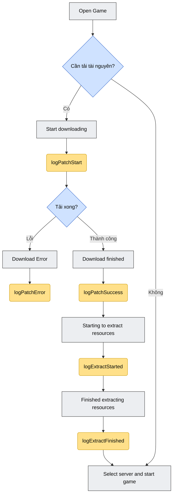
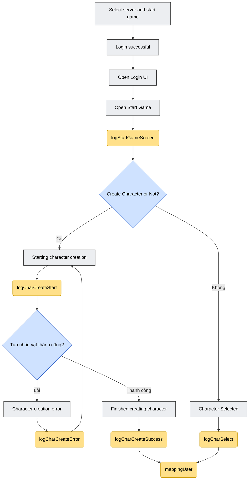
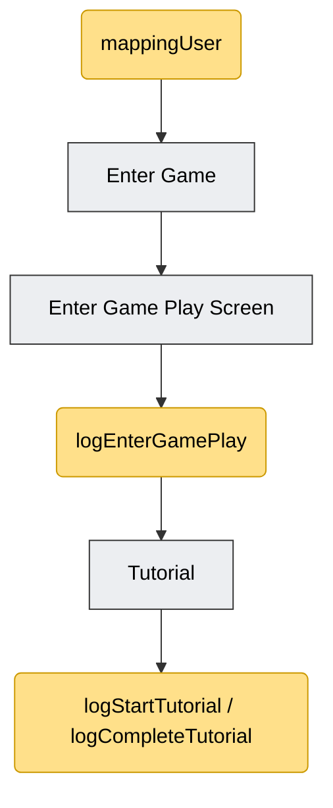

## 1. 更新 147 事件

用于在登录成功后立即检查并显示 "Event Profile"（事件信息）屏幕。

应在 `SdkDelegate` 的 `loginSuccess` callback 中立即调用，且需在进入游戏屏幕之前。

```objectivec
[[Sdk sharedInstance] showOrHide147];
```

所有的 tracking 函数都通过 singleton 调用：

```objectivec
[[SdkTracking sharedInstance] ...];
```

所需 framework：`ISdkTrackier.xcframework`（已包含在 SDK 集成所需的文件列表中）。

## 2. Mapping User

用于将当前角色/服务器信息绑定到 tracking 系统。应在玩家选择服务器或选择角色后立即调用，且需在调用与该角色相关的其他 log 函数之前。

```objectivec
-(void) mappingUser:(NSString*)characterName
characterId:(NSString*)characterId
characterLevel:(NSString*)characterLevel
serverName:(NSString*)serverName
serverId:(NSString*)serverId;
```

参数：

| 参数 | 说明 |
|---|---|
| characterName | 角色名称 |
| characterId | 角色 Id |
| characterLevel | 角色等级 |
| serverName | 服务器名称 |
| serverId | 服务器 Id |

示例：

```objectivec
[[SdkTracking sharedInstance] mappingUser:@"name"
characterId:@1
characterLevel:@1
serverName:@"test"
serverId:@"1"];
```

## 3. Log Function

Log 函数用于追踪用户旅程：打开游戏 → 下载/解压资源 → 登录/选择服务器 → 创建或选择角色 → 进入游戏 → tutorial。

按原始 flowchart 说明：

- **灰色**：游戏内发生的步骤。
- **黄色**：游戏调用 SDK 的步骤（即下方的各个 log 函数）。

总体声明（无参数）：

```objectivec
-(void) logStartGameScreen;
-(void) logEnterGamePlay;
-(void) logStartTutorial;
-(void) logCompleteTutorial;
```

### 3.1. logStartGameScreen

在打开 "Open Start Game" 屏幕（进入游戏前的开始屏幕）时调用。

```objectivec
[[SdkTracking sharedInstance] logStartGameScreen];
```

### 3.2. logEnterGamePlay

追踪用户在点击 "Vào Game"/"Enter Game" 按钮后进入游戏画面（Game Play Screen）。

```objectivec
[[SdkTracking sharedInstance] logEnterGamePlay];
```

在处理 "Vào Game" 按钮点击事件的位置立即调用，且需在切换到 gameplay 屏幕之前。

### 3.3. 资源下载（Resource download）

#### 开始下载资源

```objectivec
// 开始下载资源
-(void) logPatchStart:(NSNumber *_Nullable)sizeMB
withVerrsion:(NSString *_Nullable)version
withNetworkType:(NSString *_Nullable)networkType;
```

| 参数 | 说明 |
|---|---|
| sizeMB | 需要更新的补丁文件大小（以 Mb 显示） |
| version | 安装包版本 |
| networkType | 网络类型（例如：`"wifi"`） |

```objectivec
[[SdkTracking sharedInstance] logPatchStart:@"500"
withVerrsion:@"1.0.1"
withNetworkType:@"wifi"];
```

#### 资源下载成功

```objectivec
-(void) logPatchSuccess:(NSNumber *_Nullable)durationSec
withAvgSpeedKbps:(NSNumber *_Nullable)avgSpeedKbps
withCdnNode:(NSString *_Nullable)cdnNode;
```

| 参数 | 说明 |
|---|---|
| durationSec | 从开始下载到下载完成所经过的时间 |
| avgSpeedKbps | 平均下载速度（请另外确认当 `update_type` 为 Store 时是否也能获取到） |
| cdnNode | 用于下载的 CDN 节点 |

```objectivec
[[SdkTracking sharedInstance] logPatchSuccess:@"500"
withAvgSpeedKbps:@"450"
withCdnNode:@"192.168.0.2"];
```

> **注意：** 原始文档中的示例出现了 `avgSpeedKbps` 参数重复的问题（原文档的一处笔误）；上方示例已去除重复部分，以符合函数签名。

#### 资源下载失败

```objectivec
// 当资源下载被中断或失败时
-(void) logPatchError:(NSString *_Nullable)errorCode
withRetryCount:(NSNumber *_Nullable)retryCount
withFailedUrl:(NSString *_Nullable)failedUrl
withCdnNode:(NSString *_Nullable)cdnNode;
```

| 参数 | 说明 |
|---|---|
| errorCode | 错误代码 |
| retryCount | 因错误需要重试的次数 |
| failedUrl | 出错的 URL |
| cdnNode | 出错的 CDN 节点 |

```objectivec
[[SdkTracking sharedInstance] logPatchError:@"500"
withRetryCount:@1
withFailedUrl:@"https://cdn.game.com/patch/v120.zip"
withCdnNode:@"192.168.0.2"];
```

### 3.4. 资源解压（Resource extraction）

#### 开始解压

下载完成后立即开始解压/安装：

```objectivec
-(void) logExtractStarted:(NSString *_Nullable)totalSizeMb
withTotalSize:(NSString *_Nullable)totalSize;
```

| 参数 | 说明 |
|---|---|
| totalSizeMb | 解压后的大小，以 Mb 计算 |
| totalSize | 补丁中需要解压的文件数量（若无法获取则可忽略） |

```objectivec
[[SdkTracking sharedInstance] logExtractStarted:@"500"
withTotalSize:@"400"];
```

#### 解压完成

解压完成后，准备进入 Login 屏幕：

```objectivec
-(void) logExtractFinished:(NSNumber *_Nullable)durationSec
withResultCode:(NSString *_Nullable)resultCode;
```

| 参数 | 说明 |
|---|---|
| durationSec | 从开始解压到解压成功所经过的时间 |
| resultCode | 结果代码（`0`/`"ok"`：OK，`1`：Disk Full） |

```objectivec
[[SdkTracking sharedInstance] logExtractFinished:@100
withResultCode:@"ok"];
```

### 3.5. 创建角色（Character creation）

#### 开始创建角色

```objectivec
-(void) logCharCreateStart:(NSString *_Nullable)serverId;
```

| 参数 | 说明 |
|---|---|
| serverId | 服务器 Id |

```objectivec
[[SdkTracking sharedInstance] logCharCreateStart:@"100"];
```

> **注意：** 需要使用一个 timer 来计算从开始到角色创建完成所经过的时间（`durationSec` 用于 `logCharCreateSuccess`）。

#### 创建角色成功

```objectivec
-(void) logCharCreateSuccess:(NSString *_Nullable)serverId
withCharId:(NSString *_Nullable)charId
withCharName:(NSString *_Nullable)charName
withCharClass:(NSString *_Nullable)charClass
withDurationSec:(NSNumber *_Nullable)durationSec;
```

| 参数 | 说明 |
|---|---|
| serverId | 服务器 Id |
| charId | 角色 Id |
| charName | 角色名称 |
| charClass | 角色 class/职业 Id |
| durationSec | 从开始创建角色到创建成功所经过的时间 |

```objectivec
[[SdkTracking sharedInstance] logCharCreateSuccess:@"100"
withCharId:@"1001"
withCharName:@"test"
withCharClass:@"1"
withDurationSec:@5];
```

> **注意：** 原始文档中的示例误将 `logPatchStart` 的参数（`withVerrsion`、`withNetworkType`）复制到此处 — 与 `logCharCreateSuccess` 的签名不符。上方示例已按该函数实际参数重新编写；如需 100% 精确核对，建议再与 SDK 团队（VTVLive）确认。

#### 创建角色失败

```objectivec
-(void) logCharCreateError:(NSString *_Nullable)errorCode
withCharName:(NSString *_Nullable)charName
withServerId:(NSString *_Nullable)serverId;
```

| 参数 | 说明 |
|---|---|
| errorCode | 错误代码（例如：`"NAME_DUPLICATED"`） |
| charName | 角色名称 |
| serverId | 服务器 Id |

```objectivec
[[SdkTracking sharedInstance] logCharCreateError:@"NAME_DUPLICATED"
withCharName:@"test"
withServerId:@"1"];
```

### 3.6. 选择角色（Character select）

选择服务器/选择角色完成后，调用此函数：

```objectivec
-(void) logCharSelect:(NSString *_Nullable)charId
withCharacterName:(NSString *_Nonnull)characterName
withCharLevel:(NSString *_Nullable)charLevel;
```

| 参数 | 说明 |
|---|---|
| charId | 角色 Id |
| characterName | 角色名称 |
| charLevel | 角色等级 |

```objectivec
[[SdkTracking sharedInstance] logCharSelect:@"1"
withCharacterName:@"name"
withCharLevel:@"1"];
```

### 3.7. Tutorial

两个无参数声明的函数（用于追踪游戏内 tutorial 的开始/完成）：

```objectivec
[[SdkTracking sharedInstance] logStartTutorial];
[[SdkTracking sharedInstance] logCompleteTutorial];
```

## 4. Tracking 流程图（Flowchart）

该流程图重新绘制了调用 `SdkTracking` 各函数的完整流程，遵循文档原始的 flowchart，并按游戏顺序分为 3 个部分。

颜色说明：

- **灰色方块**：游戏内发生的步骤。
- **蓝色（菱形）方块**：分支/判断点。
- **黄色方块**：游戏调用 SDK 的点（`SdkTracking` 各函数）。

### 4.1. 资源下载与解压



*图 1 — 资源下载与解压流程*

### 4.2. 登录、创建/选择角色



*图 2 — 登录、创建或选择角色流程*

### 4.3. 进入游戏与 Tutorial



*图 3 — 进入游戏与 tutorial 流程*

> **注意：** 该流程图已重新绘制以求清晰，并严格依照文档原始 flowchart 中的函数名/步骤顺序 — 并未照搬原图中一些细小的示例数值（其中有几处参数标注与函数签名不符，如上方 3.3 和 3.5 节所述）。

## 5. 按游戏流程调用顺序汇总

1. 打开游戏 → 是否需要下载更新？→ `logPatchStart` → 下载完成：`logPatchSuccess`，或出错：`logPatchError`
2. 开始解压：`logExtractStarted` → 解压完成：`logExtractFinished`
3. 打开开始屏幕：`logStartGameScreen`
4. 登录/选择服务器成功
5. 创建新角色：`logCharCreateStart` → 成功：`logCharCreateSuccess`/失败：`logCharCreateError`（或）选择已有角色：`logCharSelect`
6. 将角色信息绑定到 tracking：`mappingUser`
7. 点击 "Vào Game"：`logEnterGamePlay`
8. 在新手引导流程中：`logStartTutorial`/`logCompleteTutorial`

