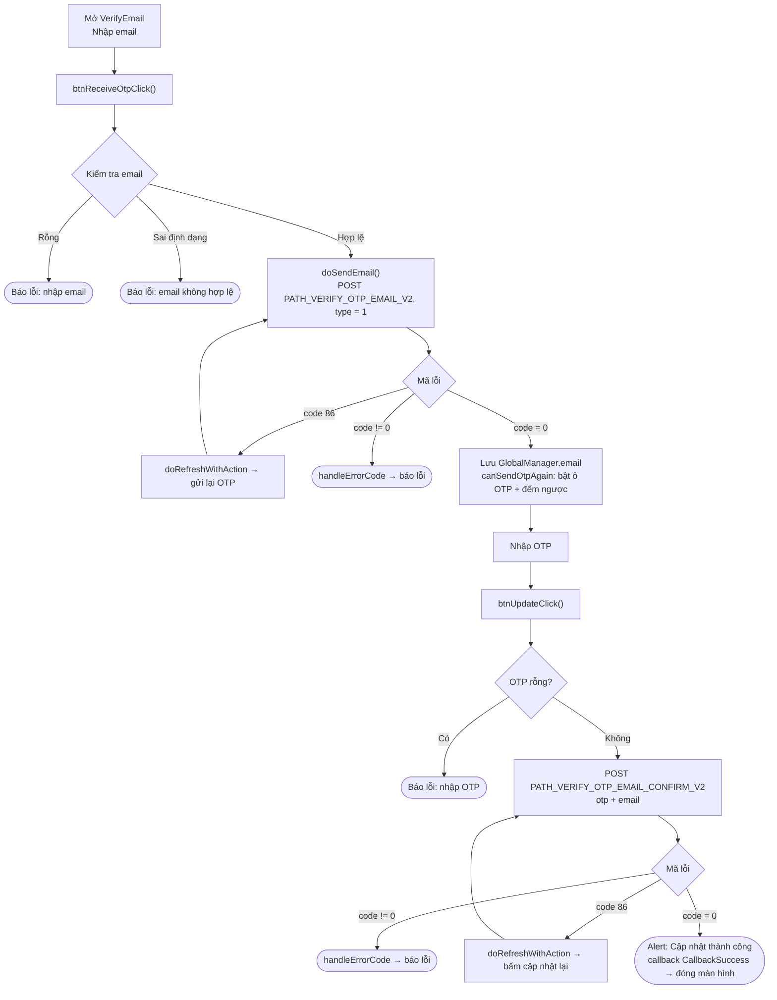
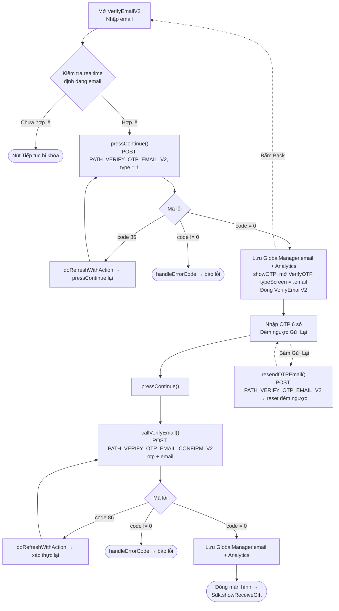

本文档基于实际代码，描述 SDK 更新 / 验证邮箱的流程。
与手机号流程类似，项目中有**两种变体**画面：

- **方式 1 – `VerifyEmail`**（将输入邮箱和输入 OTP 合并在一个画面中；标题为 *"CẬP NHẬT EMAIL"*（更新邮箱））。以 `callback(CallbackSuccess)` 结束。
- **方式 2 – `VerifyEmailV2` → `VerifyOTP`**（新版本，拆分为两个画面；标题为 *"Thêm email"*（添加邮箱），与领取礼物流程 `showReceiveGift` 关联）。

两者共用 2 个 endpoint：`PATH_VERIFY_OTP_EMAIL_V2`（发送 OTP，`type = 1`）和
`PATH_VERIFY_OTP_EMAIL_CONFIRM_V2`（验证 OTP）。所有请求均附带 Bearer accessToken。

## 方式 1 – `VerifyEmail` 画面

### 说明 – 方式 1

1. **输入邮箱并发送 OTP** – `btnReceiveOtpClick()` 检查邮箱是否非空且符合
   格式（邮箱正则），然后 `doSendEmail()` 调用 `PATH_VERIFY_OTP_EMAIL_V2`（`type = 1`）。
   - `code = 0`：保存 `GlobalManager.shared.email`，启用 OTP 输入框并运行重发倒计时。
   - `code = 86`（token 过期）：`doRefreshWithAction` 刷新 token 后自动重新发送。
   - 其他错误：`handleErrorCode`。
2. **输入 OTP 并确认** – `btnUpdateClick()` 检查 OTP 是否非空，调用
   `PATH_VERIFY_OTP_EMAIL_CONFIRM_V2`（`otp`、`email`）。
   - `code = 0`：显示 "更新成功" 提示，发出 `callback(CallbackSuccess)` 后关闭画面。
   - `code = 86`：刷新 token 后重试。
   - 其他错误：`handleErrorCode`。
3. **重新发送 OTP** – 倒计时归零后，"发送验证码" 按钮重新启用以再次调用 `PATH_VERIFY_OTP_EMAIL_V2`。

## 方式 2 – `VerifyEmailV2` → `VerifyOTP`

### 说明 – 方式 2

1. **`VerifyEmailV2`** – 邮箱输入框会实时校验；合法后启用
   "继续" 按钮。`pressContinue()` 调用 `PATH_VERIFY_OTP_EMAIL_V2`（`type = 1`）。
   - `code = 0`：保存 `GlobalManager.shared.email` 并记录 Analytics，然后 `showOTP()` 打开
     `VerifyOTP` 画面（`typeScreen = .email`，传递 `email`、`serverId`、`characterId`）
     并关闭当前画面。
   - `code = 86`：刷新 token 后重新调用。
   - 其他错误：`handleErrorCode`。
2. **`VerifyOTP`** – 输入 6 位 OTP，以遮罩形式显示邮箱（`maskedEmailFrom`）并带
   重发倒计时。`pressContinue()` → `callVerifyEmail()` 调用
   `PATH_VERIFY_OTP_EMAIL_CONFIRM_V2`（`otp`、`email`）。
   - `code = 0`：保存 `GlobalManager.shared.email`，记录 Analytics，关闭画面并
     调用 `Sdk.showReceiveGift()`。
   - `code = 86`：刷新 token 后重试。
   - 其他错误：`handleErrorCode`。
   - **重新发送 OTP**：`resendOTPEmail()` 重新调用 `PATH_VERIFY_OTP_EMAIL_V2` 并重启倒计时。
   - **返回**：回到 `VerifyEmailV2` 画面。

## 使用的 endpoint

- `PATH_VERIFY_OTP_EMAIL_V2` – 向邮箱发送 OTP（POST，`type = 1`）
- `PATH_VERIFY_OTP_EMAIL_CONFIRM_V2` – 验证 OTP 并更新邮箱（POST）

## 说明

- 参数 `type = 1` 表示 *Verify Mail*（与手机号流程的 `type = 0` 不同）。
- 所有请求均附带 `accessToken`（Bearer）。当遇到 `code = 86`（token 过期）时，
  SDK 会自动执行 `doRefreshWithAction` 刷新 token 并重复正在进行的操作。
- 更新成功后都会记录 `GlobalManager.shared.email` 并调用
  `Analytics.initiateOnDeviceConversionMeasurement(emailAddress:)`。
- 结束方式差异：方式 1 向打开该画面的地方发出 `callback(CallbackSuccess)`；
  方式 2 则转到 `Sdk.showReceiveGift()`。
- 与手机号流程的 endpoint 差异：邮箱使用 `PATH_VERIFY_OTP_EMAIL_V2`
  （发送/重发）与 `PATH_VERIFY_OTP_EMAIL_CONFIRM_V2`（验证）；而手机号使用
  `PATH_OTP_PHONE_V2` 和 `PATH_VERIFY_OTP_PHONE_V2`。

