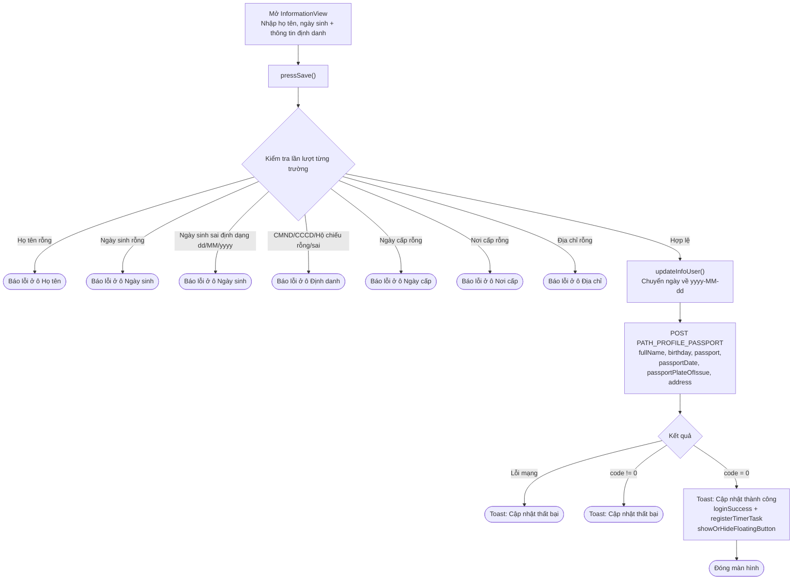
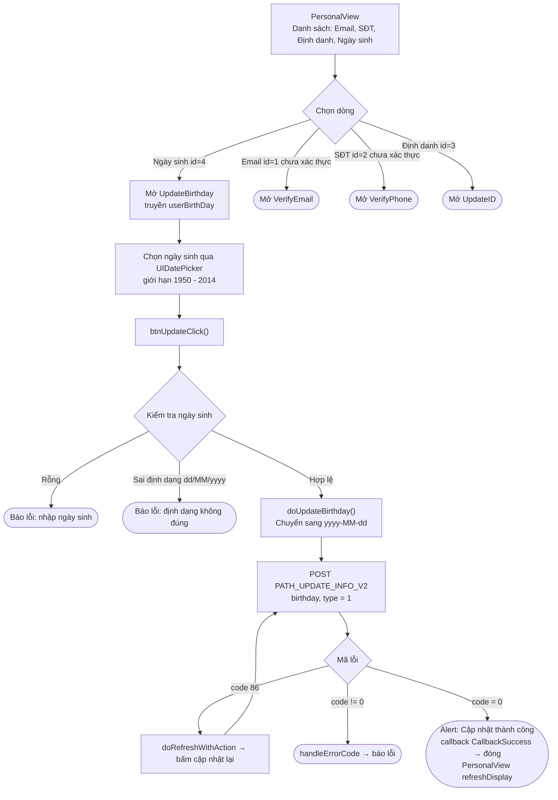

本文档基于实际代码，描述 SDK 更新姓名和出生日期的流程。
项目中有**两个相关画面**：

- **`InformationView`** – 同时更新**姓名 + 出生日期**（附带身份
  信息：身份证/护照号、签发日期、签发地点、地址），通过 endpoint `PATH_PROFILE_PASSPORT`。
  这是完善账户信息 / 身份认证的画面（`requireSecurityLevel`）。
- **`UpdateBirthday`** – 通过 endpoint `PATH_UPDATE_INFO_V2` **单独更新出生日期**。
  从个人信息画面 `PersonalView` 打开（这里没有单独的姓名编辑框；
  姓名仅作为标题显示）。

两者都会附带 Bearer accessToken，并在遇到 `code = 86` 时自动刷新 token。

## 方式 1 – `InformationView`（姓名 + 出生日期同时更新）

### 说明 – 方式 1

用户输入姓名（`tfName`）、出生日期（`tfBirthDay`，通过 UIDatePicker 选择）以及各项
身份信息字段。点击保存时，`pressSave()` 会依次检查：

- 姓名不能为空。
- 出生日期不能为空，且格式必须为 `dd/MM/yyyy`。
- 身份证/护照号不能为空且必须合法（`^[0-9]{9,12}$` 或护照格式 `^[A-Z][0-9]{8}$`）。
- 签发日期、签发地点、地址不能为空。

校验通过后 → `updateInfoUser()` 将出生日期（以及签发日期）转换为 `yyyy-MM-dd` 格式，然后调用
`PATH_PROFILE_PASSPORT`（POST），参数为 `fullName`、`birthday`、`passport`、`passportDate`、
`passportPlateOfIssue`、`address`（附带 `deviceId`、`os`、`osVersion`、`ip`）。

- `code = 0`：显示 "信息更新成功" 提示，调用 `loginSuccess()`（触发 delegate
  `loginSuccess` + `registerTimerTask`）、`showOrHideFloatingButton()` 后关闭画面。
- 网络错误或 `code != 0`：显示 "账户信息更新失败！" 提示。

> 注意：此画面**同时更新姓名和出生日期**，但必须完整填写所有身份信息字段才能保存成功。

## 方式 2 – `UpdateBirthday`（仅出生日期，从 `PersonalView` 打开）

### 说明 – 方式 2

`PersonalView` 是以列表形式展示的个人信息画面（邮箱、手机号、身份认证、
出生日期、退出登录）。账户姓名仅在标题处显示，此处不可编辑。选择
**出生日期**行（`id = 4`，类型 `.edit`）会打开 `UpdateBirthday`（并传入当前出生日期）。

在 `UpdateBirthday` 中，用户通过 `UIDatePicker` 选择日期（限制范围为 1950 年 1 月 1 日
至 2014 年 1 月 1 日）。`btnUpdateClick()` 检查出生日期非空且符合 `dd/MM/yyyy` 格式，
然后 `doUpdateBirthday()` 转换为 `yyyy-MM-dd` 格式并调用 `PATH_UPDATE_INFO_V2`（POST），参数为
`birthday`、`type = 1`。

- `code = 0`：显示 "更新成功" 提示，发出 `callback(CallbackSuccess)` → 关闭画面；
  `PersonalView` 接收到回调后调用 `refreshDisplay()` 刷新列表显示。
- `code = 86`（token 过期）：`doRefreshWithAction` 刷新 token 后自动重新更新。
- 其他错误：`handleErrorCode`。

## 使用的 endpoint

- `PATH_PROFILE_PASSPORT` – 更新姓名 + 出生日期 + 身份信息（POST）– 用于 `InformationView`
- `PATH_UPDATE_INFO_V2` – 更新出生日期（POST，`birthday`、`type = 1`）– 用于 `UpdateBirthday`

## 说明

- 出生日期在 UI 中始终以 `dd/MM/yyyy` 格式输入/显示，但发送到服务器时使用 `yyyy-MM-dd` 格式。
- `InformationView` 是合并更新画面（要求填写完整身份信息），并与安全信息完善流程
  （`requireSecurityLevel`）关联；成功后会通过 `loginSuccess()` 继续登录流程。
- `UpdateBirthday` 仅修改出生日期，遇到 `code = 86` 时自动刷新 token，并通过回调将结果返回给
  `PersonalView` 以刷新显示。
- 目前 SDK 中**没有单独的 "姓名" 编辑画面**；姓名只能随 `InformationView` 一并更新。

