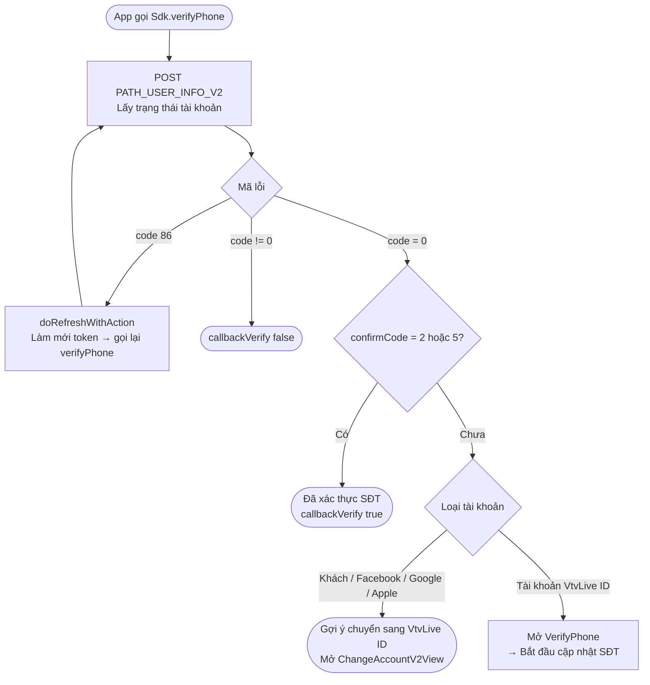
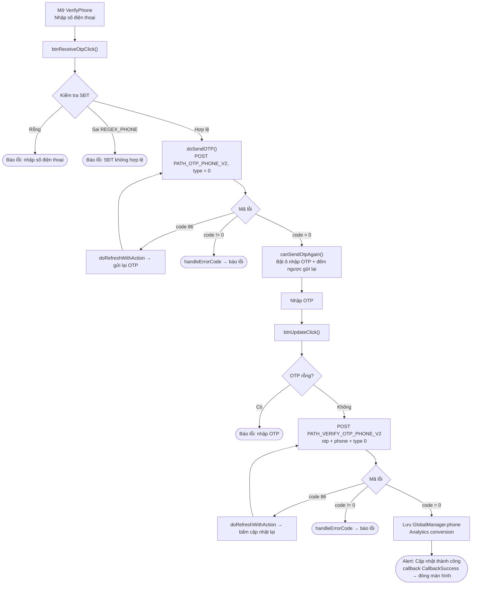
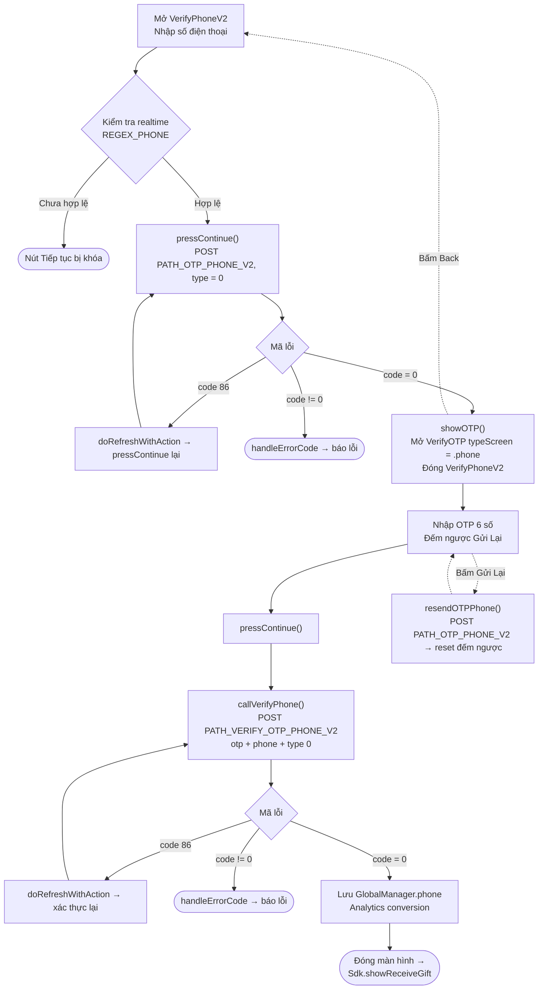

本文档基于实际代码，描述 SDK 更新 / 验证手机号的流程。
项目中目前有**两种变体**画面：

- **方式 1 – `VerifyPhone`**（将输入手机号和输入 OTP 合并在一个画面中；标题为 *"CẬP NHẬT SỐ ĐIỆN THOẠI"*（更新手机号））。通过 `Sdk.verifyPhone(...)` 调用。
- **方式 2 – `VerifyPhoneV2` → `VerifyOTP`**（新版本，拆分为两个画面；标题为 *"Thêm số điện thoại"*（添加手机号），与领取礼物流程 `showReceiveGift` 关联）。

两者共用 2 个 endpoint：`PATH_OTP_PHONE_V2`（发送 OTP）和 `PATH_VERIFY_OTP_PHONE_V2`（验证 OTP），参数为 `type = 0`（Verify Phone），header 附带 Bearer accessToken。

## 进入流程的条件 – `Sdk.verifyPhone()`

只有尚未验证手机号的 VtvLive ID 账户（`confirmCode` 不等于 2 和 5）才能打开
手机号更新画面；游客/社交账户会先被引导进行账户转换。

## 方式 1 – `VerifyPhone` 画面

### 说明 – 方式 1

1. **输入手机号并发送 OTP** – `btnReceiveOtpClick()` 检查手机号非空且匹配
   `REGEX_PHONE`，然后 `doSendOTP()` 调用 `PATH_OTP_PHONE_V2`（`type = 0`，附带 Bearer token）。
   - `code = 0`：启用 OTP 输入框并运行重发倒计时（`Constants.timeOutOtpAgain`）。
   - `code = 86`（token 过期）：`doRefreshWithAction` 刷新 token 后自动重新发送。
   - 其他错误：`handleErrorCode`。
2. **输入 OTP 并更新** – `btnUpdateClick()` 检查 OTP 非空，调用
   `PATH_VERIFY_OTP_PHONE_V2`（`otp`、`phone`、`type = 0`）。
   - `code = 0`：保存 `GlobalManager.shared.phone`，记录 Analytics，显示
     "更新成功" 提示，发出 `callback(CallbackSuccess)` 后关闭画面。
   - `code = 86`：刷新 token 后重试。
   - 其他错误：`handleErrorCode`。
3. **重新发送 OTP** – 倒计时归零后，"发送验证码" 按钮重新启用以再次调用 `PATH_OTP_PHONE_V2`。

## 方式 2 – `VerifyPhoneV2` → `VerifyOTP`

### 说明 – 方式 2

1. **`VerifyPhoneV2`** – 手机号输入框会依据 `REGEX_PHONE` 实时校验；合法后
   启用 "继续" 按钮。`pressContinue()` 调用 `PATH_OTP_PHONE_V2`（`type = 0`）。
   - `code = 0`：`showOTP()` 打开 `VerifyOTP` 画面（`typeScreen = .phone`，传递
     `phone`、`serverId`、`characterId`）并关闭当前画面。
   - `code = 86`：刷新 token 后重新调用。
   - 其他错误：`handleErrorCode`。
2. **`VerifyOTP`** – 输入 6 位 OTP，以遮罩形式显示手机号（`maskedPhoneFrom`）并带
   重发倒计时。`pressContinue()` → `callVerifyPhone()` 调用
   `PATH_VERIFY_OTP_PHONE_V2`（`otp`、`phone`、`type = 0`）。
   - `code = 0`：保存 `GlobalManager.shared.phone`，记录 Analytics，关闭画面并
     调用 `Sdk.showReceiveGift()`（继续领取礼物流程）。
   - `code = 86`：刷新 token 后重试。
   - 其他错误：`handleErrorCode`。
   - **重新发送 OTP**：`resendOTPPhone()` 重新调用 `PATH_OTP_PHONE_V2` 并重启倒计时。
   - **返回**：回到 `VerifyPhoneV2` 画面。

## 使用的 endpoint

- `PATH_USER_INFO_V2` – 获取账户验证状态（用于 `verifyPhone` 的前置条件判断）
- `PATH_OTP_PHONE_V2` – 向手机号发送 OTP（POST，`type = 0`）
- `PATH_VERIFY_OTP_PHONE_V2` – 验证 OTP 并更新手机号（POST，`type = 0`）

## 说明

- 参数 `type = 0` 表示 *Verify Phone*。其他值用于邮箱和其他类型的验证
  （1 = 邮箱，2/3 = 一次性认证，4/5 = 一次性交易）。
- 所有请求均附带 `accessToken`（Bearer）。当遇到 `code = 86`（token 过期）时，
  SDK 会自动执行 `doRefreshWithAction` 刷新 token 并重复正在进行的操作。
- 更新成功后都会记录 `GlobalManager.shared.phone` 并调用
  `Analytics.initiateOnDeviceConversionMeasurement(phoneNumber:)`。
- 结束方式差异：方式 1 向打开该画面的地方发出 `callback(CallbackSuccess)`；
  方式 2 则转到 `Sdk.showReceiveGift()`。

