本文档基于 `Sdk+Authentication.swift` 中的实际代码，描述 SDK 的登出流程。
共有**两个函数**：

- **`logout()`** – 主动登出（用户点击登出按钮）。会调用 `PATH_LOGOUT` API
  在服务器上撤销 refresh token。
- **`forceLogout()`** – 因会话失效（错误码 `1001 / 85 / 98`，
  或 `1008` – 会话过期）而强制登出。**不会**调用 `PATH_LOGOUT` API，仅清理本地数据。

两者都会使用户回到未登录状态并发出 `logout` delegate。

## 登出调用位置

`logout()` 通常从以下位置调用：
- `PersonalView` → `showSignOut()`（确认对话框） → `doSignOut()` → `Sdk.logout()`。
- `CheckLoginView` → 需要登出时的 `doSignOut()`。
- 会话过期时（`code = 1008`），在 `doRefreshToken` / `getUserInfo` 中 → 显示提示 → `logout()`。

`forceLogout()` 在 refresh token 返回 `code = 1001 / 85 / 98`（账户被
锁定 / 会话在其他地方被撤销）时调用。

## 总体流程图

```mermaid
%% width: 1100
flowchart LR
    A([Yêu cầu đăng xuất]) --> B{Loại đăng xuất}

    B -- "Chủ động: logout()" --> C["POST PATH_LOGOUT<br/>token = refreshToken<br/>token_type_hint = refresh_token<br/>client_id + client_secret"]
    B -- "Bắt buộc: forceLogout()" --> D["Bỏ qua gọi PATH_LOGOUT"]

    C --> E
    D --> E["Ẩn nút nổi nếu đang hiện<br/>showOrHideFloatingButton"]

    E --> F["Đăng xuất mạng xã hội<br/>Facebook: LoginManager.logOut nếu token còn hạn<br/>Google: GIDSignIn.signOut nếu đã đăng nhập"]

    F --> G["Giải mã idToken (JWT)<br/>Lấy accountID + accountName → dựng User"]

    G --> H["Xóa dữ liệu cục bộ:<br/>email, phone = rỗng<br/>GlobalManager.clearData()"]

    H --> I["Reset tracking:<br/>EVENT_LOGOUT_SUCCESS<br/>Trackier setAccountId 0<br/>AppsFlyer customerUserID = nil<br/>TikTok logout nếu có TIKTOK_APP_ID"]

    I --> J["delegate?.sdk logout: userInfo<br/>resetTimer()"]

    J --> K([Về trạng thái chưa đăng nhập])
```

## 详细说明

### `logout()` 与 `forceLogout()` 的区别

**唯一的业务差异**在于：`logout()` 会调用 `PATH_LOGOUT` API（POST）在服务器上撤销
`refreshToken`（fire-and-forget，即发即弃），而 `forceLogout()` 会跳过此步骤，因为
会话在服务器端已经失效。其余清理步骤都相同。

`PATH_LOGOUT` 的 body：
`token = refreshToken`、`token_type_hint = "refresh_token"`、`client_id`、`client_secret`；
header 为 `ServiceProcessor.createHeaderFieldType1()`。

### 通用清理步骤

1. **隐藏浮动按钮（floating button）** – 如果正在显示，则调用 `showOrHideFloatingButton()`。
2. **社交账户登出**：
   - Facebook：如果 `AccessToken.current` 仍然有效 → `LoginManager().logOut()`。
   - Google：如果 `GIDSignIn.hasPreviousSignIn()` → `GIDSignIn.sharedInstance.signOut()`。
3. **构造要返回的用户信息** – 解析 `idToken`（JWT），从 payload 中获取 `accountID` 和
   `accountName` 以创建 `User` 对象（用于 delegate）。
4. **清除本地数据** – 将 `email`、`phone` 置空，并调用 `GlobalManager.shared.clearData()`
   （清除 token 和登录状态）。
5. **重置 tracking / analytics**：
   - 发送 `EVENT_LOGOUT_SUCCESS` 事件。
   - `TrackierSdk.setAccountId(0, withAccountName: "")`。
   - `AppsFlyerLib.shared().customerUserID = nil`。
   - 如果配置了 `TIKTOK_APP_ID`，则调用 `TikTokBusiness.logout()`。
6. **通知 app 并重置定时器**：
   - 调用 delegate `delegate?.sdk?(self, logout: userInfo)` 让 app 知道已登出。
   - `resetTimer()` 停止会话计时器。

完成上述步骤后，SDK 处于未登录状态；下次调用 `Sdk.login()` 时会重新
显示登录画面。

## 使用的 endpoint

- `PATH_LOGOUT` – 在服务器上撤销 refresh token（POST，仅在 `logout()` 中使用）

## 说明

- `forceLogout()` 使用 `getAccountNameInPayloadV2` 获取账户名称（与 `logout()`
  使用的 `getAccountNameInPayload` 不同），但清理部分和 delegate 是相同的。
- 调用 `PATH_LOGOUT` 是 fire-and-forget 的：SDK 不会等待服务器返回结果，而是立即清理本地
  数据，确保用户在客户端始终能够成功登出。
- 登出时始终会发出 `logout` delegate，并附带 `User`（accountID、accountName），以便 app 同步
  状态并进行相应的 UI 处理。

