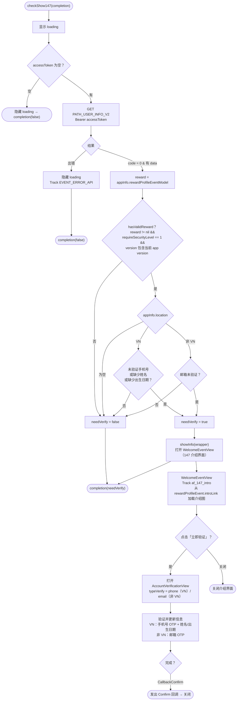

本文档基于实际代码梳理 `show147` 流程：`Sdk.checkShow147()`（Sdk+Ext.swift）、
`WelcomeEventView`（介绍界面）和 `AccountVerificationView`（验证界面）。

> "147" 对应用户身份认证要求（第147号法令）。SDK 会根据事件配置和账户状态决定是否强制
用户进行身份认证，然后显示介绍界面并引导进入验证界面。

入口（App 调用，通常在登录后或进入游戏时）：

```Swift
Sdk.sharedInstance.checkShow147 { needVerify in
    // needVerify = true 表示 SDK 已显示 147 认证界面
}
```

## 总体流程图



## 详细说明

### 1. `checkShow147()` —— 判断是否强制认证（Sdk+Ext.swift）

1. 显示 loading。若 `accessToken` 为空 → 隐藏 loading 并 `completion(false)`（未登录时
不做判断）。

2. 调用 `PATH_USER_INFO_V2`（GET，Bearer accessToken）获取账户信息。

    - **出错**：隐藏 loading，track `EVENT_ERROR_API`（`id_check_token_api`），
    `completion(false)`。

    - **code = 0 且有 data**：按下述规则计算 `needVerify`。

计算 `needVerify` 的规则：

- `reward = appInfo.rewardProfileEventModel`（身份认证事件配置）。

- `hasValidReward = reward != nil && reward.requireSecurityLevel == 1 && reward.version`
包含当前 app 版本。

- 若 `appInfo.location` 为空 → `needVerify = false`。

- 否则若 `hasValidReward`：

    - **越南（`location == "VN"`）**：当**未验证手机号**、或**缺少姓名**、或
    **缺少出生日期**时，`needVerify = true`。

    - **越南以外地区**：当**邮箱未验证**时，`needVerify = true`。

若 `needVerify == true` → 调用 `showInfo(wrapper)` 打开介绍界面。最终始终返回
`completion(needVerify)`，让 App 知道 SDK 是否已显示身份认证界面。

### 2. `WelcomeEventView` —— 147 介绍界面

打开时，此界面发送 `af_147_intro` 埋点（携带 `account_id`、`location`、
`type` = PHONE/EMAIL、`requireSecurityLevel`、`version`），并从
`rewardProfileEvent.introLink` 加载介绍图（根据屏幕方向使用默认图）。

- **点击"立即验证"**（`btnConfirmNow`）：关闭介绍界面并打开 `AccountVerificationView`，
若在 VN 则 `typeVerify = .phone`，否则为 `.email`。传入 `userWrapper` 和 `delegate`。

- **关闭**：移除介绍界面。

### 3. `AccountVerificationView` —— 验证与完善信息界面

根据 `typeVerify` 和账户状态，此界面处理：

- **VN（`.phone`）**：发送/输入手机号 OTP（`PATH_OTP_PHONE_V2` + 验证），若缺少
**姓名 / 出生日期**则补充（通过 `PATH_UPDATE_INFO_V2` 更新）。

- **非 VN（`.email`）**：发送/输入邮箱 OTP 进行验证。

完成后，发出 `callback(CallbackConfirm)`，由 `WelcomeEventView` 将回调转发给调用方。

## 使用的接口

- `PATH_USER_INFO_V2` —— 获取账户状态以判断 `needVerify`（GET）

- `PATH_OTP_PHONE_V2` —— 发送手机号 OTP（POST）—— 在 `AccountVerificationView`（VN）

- `PATH_UPDATE_INFO_V2` —— 更新姓名 / 出生日期（POST）—— 在 `AccountVerificationView`（VN）

- 对应的邮箱 OTP —— 在 `AccountVerificationView`（非 VN）

## 备注

- 强制身份认证的条件取决于 `rewardProfileEventModel` 配置
（`requireSecurityLevel == 1` 且 version 匹配）—— 也就是说仅对已配置的
版本/事件生效，并非全体强制。

- 验证标准**因地区而异**：越南要求手机号 + 姓名 + 出生日期；越南以外要求邮箱。

- `checkShow147` 是异步函数，通过 `completion(needVerify)` 返回结果；App 可据此
在用户完成身份认证之前阻止/开放相关功能。

- `location` 在初始化流程中确定（`getLocation` 根据 IP 获取）—— 若为空则跳过
身份认证步骤。
