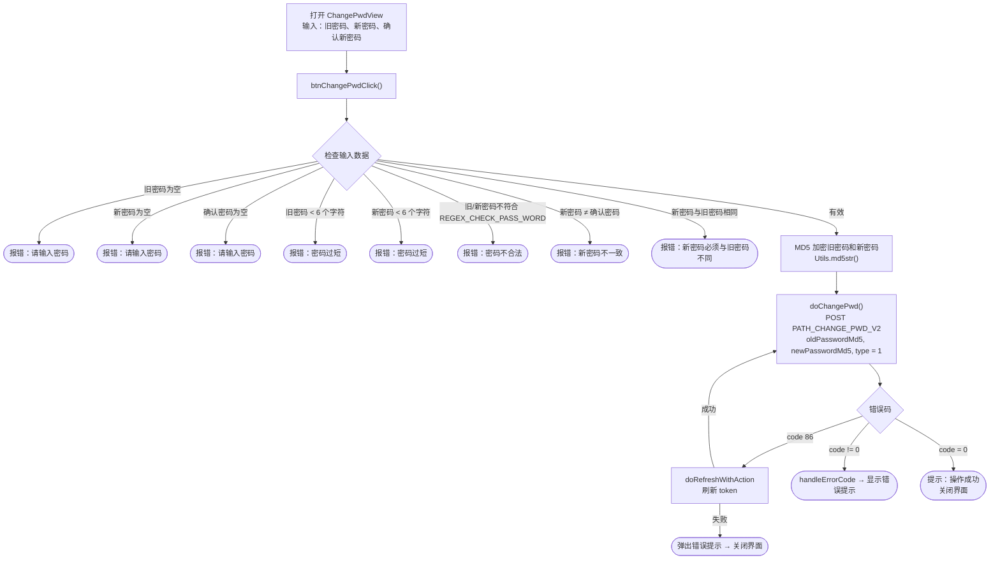

本文档基于实际代码梳理 SDK 的修改密码流程（用户**已登录**的情况）：
`ChangePwdView.swift`（标题为"修改密码"）。

> 区分说明：这里是**修改密码**（知道旧密码，处于登录状态）——不同于
> **忘记密码**（通过邮箱/手机号 OTP 找回）。

## 总体流程图

## 详细说明

### 1. 输入与数据校验 —— `btnChangePwdClick()`

界面有 3 个输入框：**旧密码**（`txtPwd`）、**新密码**（`txtNewPwd`）、
**确认新密码**（`txtConfirmNewPwd`）。点击"修改密码"时，SDK 依次检查
（遇到错误就将对应输入框标红并停止）：

- 旧密码、新密码、确认密码均不能为空。
- 旧密码和新密码至少 6 个字符。
- 旧密码和新密码必须符合 `REGEX_CHECK_PASS_WORD`。
- 新密码和确认密码必须一致。
- 新密码必须与旧密码不同。

### 2. 加密与调用接口 —— `doChangePwd()`

校验通过后 → 旧密码和新密码在发送前经过 **MD5 哈希**（`Utils.md5str`）。调用
`PATH_CHANGE_PWD_V2`（POST），携带 `oldPasswordMd5`、`newPasswordMd5`、`type = 1`
（以及 `deviceId`、`os`、`osVersion`、`ip`）和 Bearer accessToken 头。

- `code = 0`：提示"操作成功" → 关闭界面。
- `code = 86`（token 过期）：`doRefreshWithAction` 刷新 token；成功后**自动重新调用**
  `doChangePwd()`，失败则提示错误后关闭界面。
- 其他错误：`handleErrorCode` 显示错误提示。

## 使用的接口

- `PATH_CHANGE_PWD_V2` —— 登录状态下修改密码（POST，`type = 1`）

## 备注

- 密码**不以明文发送**：旧密码和新密码在客户端都会经过 MD5 哈希
  （`oldPasswordMd5`、`newPasswordMd5`）后再发送到服务器。
- 整个操作都需要 `accessToken`（Bearer）。遇到 `code = 86` 时，SDK 会自动刷新 token
  后重复执行当前未完成的修改密码请求。
- 修改密码成功后**不会要求重新登录**——只是显示成功提示并关闭界面。
