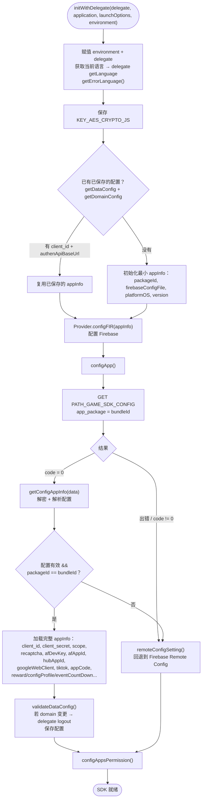

本文档基于实际代码梳理从 `Sdk.initWithDelegate(...)` 开始的 SDK 初始化流程：
`Sdk+Ext.swift`（入口）、`Sdk+Config.swift`（获取与解析配置）。

入口（App 在启动时调用，通常在
`application(_:didFinishLaunchingWithOptions:)` 中）：

```Swift
Sdk.sharedInstance.initWithDelegate(delegate,
                                    application: application,
                                    launchOptions: launchOptions,
                                    environment: .prod)
```

## 总体流程图



## 回退分支与第三方配置流程图

```mermaid
flowchart TD
    subgraph RC["remoteConfigSetting – Firebase Remote Config"]
        A1["设置 minimumFetchInterval = 0<br/>从 plist setDefaults"] --> A2["remoteConfig.fetch → activate"]
        A2 -- "成功" --> A3["getAppInfoConfigDefaultFirebase()<br/>从 Remote Config 解密 APPINFO_CONFIG"]
        A2 -- "出错" --> A4["getAppInfoConfigDefault()<br/>从 bundle 内默认 plist 读取"]
        A3 -- "解密出错" --> A4
        A3 --> A5["configAppsPermission()"]
        A4 --> A5
    end

    subgraph AP["configAppsPermission – 初始化第三方"]
        B1{"有 afAppId？"} -- "没有" --> B9["跳过 tracking 部分"]
        B1 -- "有" --> B2["Facebook：ApplicationDelegate didFinishLaunching + Settings"]
        B2 --> B3["AppsFlyer：devKey, appleAppID,<br/>waitForATT, delegate"]
        B3 --> B4["setupTiktTokSDK()"]
        B4 --> B5["sendLaunch()"]
        B5 --> B6["Trackier：initWith + logDevice + setTimeTrackier"]
        B9 --> B7
        B6 --> B7["getPublicIPAddress → appInfo.ipPublic<br/>getLocation → appInfo.location"]
        B7 --> B8["subscribeToTopic()"]
    end

    subgraph SL["sendLaunch → checkInit"]
        C1["applicationDidBecomeActive5s<br/>AppsFlyer.start() + appDidBecomeActive"] --> C2["checkInit()"]
        C2 --> C3["Track EVENT_APP_LAUNCH<br/>TikTok launchAPP + subscribe"]
        C3 --> C4{首次打开 app？}
        C4 -- "是" --> C5["Track EVENT_FIRST_LAUNCH"]
        C4 -- "否" --> C6{版本变更？}
        C5 --> C6
        C6 -- "是" --> C7["Track EVENT_UPGRADE_VERSION_SUCCESS"]
    end

    subgraph ST["subscribeToTopic"]
        D1["GET PATH_GAME_CHECK_MAINTAIN"] --> D2["订阅各 FCM topic"]
        D1 --> D3["UpdatePushIDRepo.execute()<br/>更新 push id"]
    end
```



## 详细说明

### 1. `initWithDelegate()` —— 入口（Sdk+Ext.swift）

1. 赋值 `environment` 和 `delegate`。

2. 获取当前语言（`Localize.currentLanguage()`），调用 delegate 的 `getLanguage`
并加载多语言错误信息表（`getErrorLanguage()`）。

3. 保存加密密钥 `KEY_AES_CRYPTO_JS`。

4. 读取已保存的配置（`getDataConfig` + `getDomainConfig`）：

    - 若已有 `client_id` 和 `authenApiBaseUrl` → 复用已保存的 `appInfo`（快速启动）。

    - 若没有 → 初始化最小 `appInfo`（packageId 来自 bundle、firebase 配置、
    platformOS、version）。

5. `Provider.shared.configFIR(appInfo)` 配置 Firebase。

6. 调用 `configApp(...)` 从服务器获取配置。

### 2. `configApp()` —— 从服务器获取配置（Sdk+Config.swift）

通过 `configApiService` 调用 `PATH_GAME_SDK_CONFIG`（GET，`app_package = bundleId`）。

- `code = 0`：`getConfigAppInfo(data)` —— AES 解密并解析配置。

- 网络出错或 `code != 0`：转到 `remoteConfigSetting()`（Firebase Remote Config）。

### 3. `getConfigAppInfo()` —— 解密与加载配置

用 `KEY_AES_CRYPTO_JS` 解密字符串，解析 JSON 并检查是否包含所有必需字段
（client_id、client_secret、apiKeyRecapcha、afDevKey、scope、googleWebClient、
packageId、afAppId、各 base URL、hubAppId、appCode 等）。

- 若字段齐全**且** `packageId == bundleIdentifier`：

    - 将全部内容加载到 `appInfo`（包括扩展配置：`rewardProfileEvent`、
    `showFloating`、`configProfile`、`eventCountDown`）。

    - 构建 `DomainConfig`，调用 `validateDataConfig()`：若 authen domain 与已保存的
    版本不同，则触发 delegate `logout`；随后保存配置。

    - 调用 `configAppsPermission()`。

- 若字段缺失、package 不符，或解密/解析出错 → `remoteConfigSetting()`。

### 4. `remoteConfigSetting()` —— 回退到 Firebase Remote Config

设置 `minimumFetchInterval = 0`，从 plist 加载默认值，然后 `fetch → activate`：

- 成功：`getAppInfoConfigDefaultFirebase()` 从 Remote Config 解密 `APPINFO_CONFIG`；
若解密出错，则 `getAppInfoConfigDefault()` 从 bundle 内默认 plist 读取。

- 出错：`getAppInfoConfigDefault()`（默认 plist）。

两个分支最终都会继续调用 `configAppsPermission()`。此外还注册了
`addOnConfigUpdateListener`，用于在配置变更时更新。

### 5. `configAppsPermission()` —— 初始化第三方 SDK

仅在有 `afAppId` 时执行。执行内容：

- Facebook SDK：`ApplicationDelegate didFinishLaunching`，配置 `Settings`。

- AppsFlyer：`devKey`、`appleAppID`、`waitForATTUserAuthorization`，赋值 delegate。

- `setupTiktTokSDK()` 初始化 TikTok Business SDK。

- `sendLaunch()`（见第 6 项）。

- Trackier：`initWith`，发送 `logDevice`，`setTimeTrackier(30)`。

之后获取公网 IP（`getPublicIPAddress` → `appInfo.ipPublic`）和位置
（`getLocation` → `appInfo.location`），然后 `subscribeToTopic()`。

### 6. `sendLaunch()` → `checkInit()`（Sdk+Ext.swift）

`sendLaunch()` 调用 `applicationDidBecomeActive5s`、`AppsFlyerLib.start()`、
`appDidBecomeActive()` 和 `checkInit()`。`checkInit()` 发送启动埋点：

- `EVENT_APP_LAUNCH` 以及 TikTok 事件 `launchAPP` / `subscribe`。

- 首次打开 app → `EVENT_FIRST_LAUNCH`。

- 若版本与上次不同 → `EVENT_UPGRADE_VERSION_SUCCESS`。

### 7. `subscribeToTopic()`

调用 `PATH_GAME_CHECK_MAINTAIN` 获取并订阅各 FCM topic，同时运行
`UpdatePushIDRepo` 将 push id 更新到服务器。

## 使用的接口

- `PATH_GAME_SDK_CONFIG` —— 从服务器获取 SDK 配置（GET）

- `PATH_GAME_CHECK_MAINTAIN` —— 获取 FCM topic / 检查维护状态（GET）

- `PATH_LOCATION` —— 根据 IP 获取国家代码（POST）

- `getclientip`（id.vplay.vn）—— 获取设备公网 IP（GET）

## 备注

- 配置来源的优先顺序为：**服务器（`PATH_GAME_SDK_CONFIG`）→ Firebase Remote
Config → bundle 内默认 plist**。每一层出错就降级到下一层。

- 敏感配置（client_id/secret、scope、各 base URL）经过 AES 加密，只有在
`packageId` 与 App 的 bundle 匹配时才会加载。

- `initWithDelegate` 会复用已保存的配置以实现快速启动，但每次启动仍会调用
`configApp` 刷新配置。

- 若两次启动之间 authen domain 发生变化，SDK 会主动触发 delegate `logout`，
以避免在新 domain 上使用旧 token。
