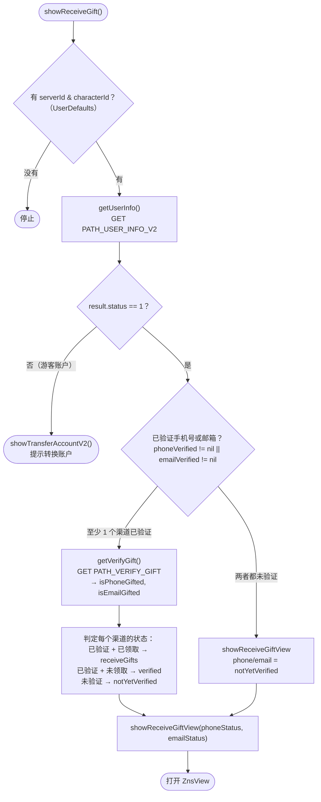
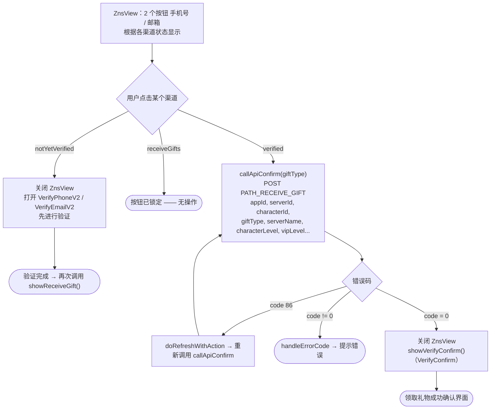

本文档基于实际代码梳理领取礼物流程（验证手机号/邮箱以领取礼物）：
`Sdk+Gift.swift`（判定状态）和 `ZnsView.swift`（选择领取礼物的界面）。

入口：

```Swift
Sdk.sharedInstance.showReceiveGift()
```

`showReceiveGift()` 还会在**手机号/邮箱验证成功后**自动被调用（从
`VerifyOTP` / `VerifyPhoneV2` / `VerifyEmailV2`），形成一个循环：验证 → 回到领取礼物。

## 每个渠道（手机号 / 邮箱）的三种状态 —— `VerifyStatus`

|状态|含义|`ZnsView` 上的按钮|
|---|---|---|
|`notYetVerified`|该渠道尚未验证|点击即**打开验证界面**（VerifyPhoneV2 / VerifyEmailV2）|
|`verified`|已验证，**尚未领取礼物**|"领取礼物 ..." —— 可点击，用于**领取礼物**|
|`receiveGifts`|已领取过礼物|"领取礼物 ..." —— **锁定**（灰色）|

## 1. 判定状态 —— `showReceiveGift()`



## 2. `ZnsView` 上的操作



## 详细说明

### `showReceiveGift()` —— 判定流程（Sdk+Gift.swift）

1. 必须有 `serverId` 和 `characterId`（从 `UserDefaults` 读取：`KEY_SERVER_ID` /
`KEY_SERVER_NAME`）；缺失则停止。

2. 调用 `getUserInfo()`（`PATH_USER_INFO_V2`）：

    - 若 `result.status != 1`（游客账户）→ `showTransferAccountV2()` 提示转换为
    主账户，结束领取礼物流程。

    - 若 `status == 1`：

        - **至少已验证一个渠道**（`phoneVerified != nil` 或 `emailVerified != nil`）：
        调用 `getVerifyGift()` 判断是否已领取礼物，然后计算各渠道状态：

            - 手机号：已验证 → 若 `isPhoneGifted == true` 则为 `receiveGifts`，
            否则为 `verified`。

            - 邮箱：已验证 → 若 `isEmailGifted == true` 则为 `receiveGifts`，
            否则为 `verified`。

            - 未验证的渠道保持 `notYetVerified`。

        - **两个渠道都未验证**：两者均为 `notYetVerified`。

    - 用已计算的两种状态打开 `ZnsView`（`showReceiveGiftView`）。

### `getVerifyGift()` —— 检查是否已领取礼物

调用 `PATH_VERIFY_GIFT`（GET，附带签名 + Bearer accessToken），携带 `appId`、
`appPackage`、`serverId`、`characterId`。返回 `isPhoneGifted`、`isEmailGifted`
（各渠道是否已领取礼物）。

### `ZnsView` —— 选择领取礼物界面

显示 2 个按钮（手机号 / 邮箱），界面根据各渠道状态变化（见上表）。
点击某个渠道时：

- **`notYetVerified`**：关闭 `ZnsView`，打开 `VerifyPhoneV2` / `VerifyEmailV2`
先进行验证。验证完成后，流程会重新调用 `showReceiveGift()` 以更新状态。

- **`verified`**：调用 `callApiConfirm()` 领取礼物。

- **`receiveGifts`**：按钮被锁定，无任何操作。

### `callApiConfirm()` —— 领取礼物

调用 `PATH_RECEIVE_GIFT`（POST，附带签名 + Bearer accessToken），携带 `appId`、
`appPackage`、`serverId`、`characterId`、`sdkVersion`、`giftType`（`phone`/`email`）、
`serverName`、`characterName`、`characterLevel`、`characterVipLevel`。

- `code = 0`：关闭 `ZnsView` 并打开 `VerifyConfirm`（领取礼物成功确认界面）。

- `code = 86`（token 过期）：`doRefreshWithAction` 刷新 token 后重新调用
`callApiConfirm()`。

- 其他错误：`handleErrorCode`。

## 使用的接口

- `PATH_USER_INFO_V2` —— 获取账户状态与验证信息（GET）

- `PATH_VERIFY_GIFT` —— 检查各渠道是否已领取礼物（GET）

- `PATH_RECEIVE_GIFT` —— 发送领取礼物请求（POST）

## 备注

- 前提条件：必须有 `serverId` + `characterId`（通常在 `mappingUser` /
`payProduct` 时设置），且账户必须为主账户（`status == 1`)——游客账户会被
引导去转换账户。

- 要领取礼物，渠道（手机号/邮箱）必须**已验证**；若未验证，`ZnsView` 会引导用户
先去验证，然后自动回到领取礼物流程。

- 领取礼物相关请求使用带**签名**的请求头
（`createHeaderFieldWithSignatureAndBearerToken`）。

- 领取礼物成功以 `VerifyConfirm` 确认界面结束。
