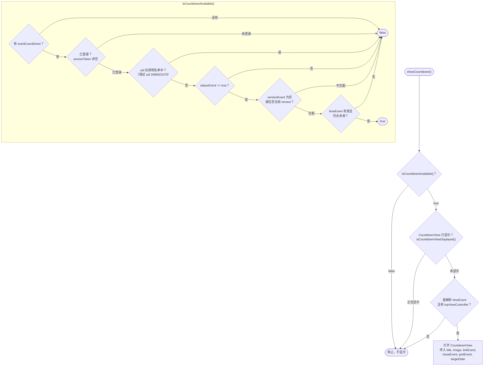
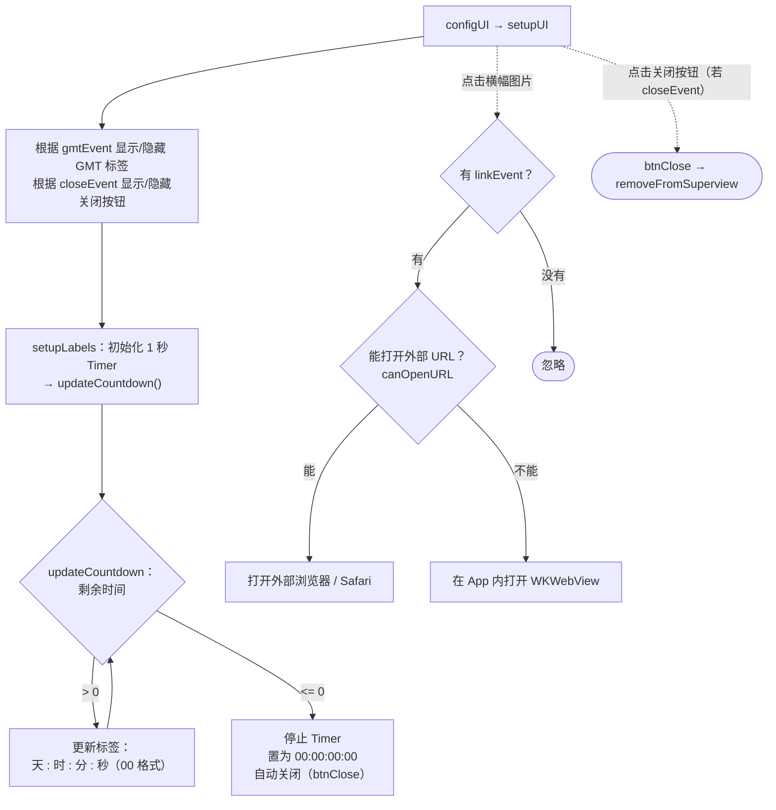

本文档基于实际代码梳理 `showCountdown` 流程：`Sdk+Countdown.swift`（显示条件 +
打开界面）和 `CountdownView.swift`（倒计时时钟 + 打开事件链接）。

入口（App 调用以显示倒计时事件横幅）：

```Swift
Sdk.sharedInstance.showCountdown()
```

事件配置来自 `appInfo.eventCountDown`（在初始化流程中加载，字段为 `EVENT_COUNTDOWN`）。

## 1. 显示条件 —— `showCountdown()` / `isCountdownAvailable()`



## 2. `CountdownView` 生命周期



## 详细说明

### `showCountdown()` —— 入口（Sdk+Countdown.swift）

1. 检查 `isCountdownAvailable()`；若不满足条件则停止。

2. 检查 `isCountdownViewDisplayed()` —— 若横幅已在显示则停止（避免重复打开）。

3. 获取 `event = appInfo.eventCountDown`，并从 `event.timeEvent` 解析 `targetDate`
（格式为 `yyyy-MM-dd'T'HH:mm:ssZ`）。缺失则停止。

4. 在 `topViewController` 上打开 `CountdownView`，传入：`titleText`、`imageUrl`、
`linkEvent`、`closeEvent`、`gmtEvent`、`targetDate`。

### `isCountdownAvailable()` —— 显示条件

只有**同时满足以下所有条件**才返回 `true`：

- 有 `appInfo.eventCountDown` 配置。

- 已登录（`accessToken` 非空）。

- 账户**不在**排除名单中（含测试 uid `2685822470` 的检查代码）。

- `event.statusEvent == true`（事件已启用）。

- `versionEvent` 为空**或**包含当前 app 版本（按版本过滤）。

- `timeEvent` 能解析成功且**仍在未来**（`timeIntervalSinceNow > 0`）。

### `isCountdownViewDisplayed()`

遍历 `topViewController` 的子视图；若已存在一个 `CountdownView`，则视为
正在显示（不再打开新的）。

### `CountdownView` —— 倒计时时钟

- **`setupUI`**：根据 `gmtEvent` 显示/隐藏 GMT 标签，根据 `closeEvent` 显示/隐藏
关闭按钮（若 `closeEvent == false` 则不允许手动关闭）。

- **倒计时**：`setupLabels()` 创建每秒调用一次 `updateCountdown()` 的 `Timer`。

    - 还有剩余时间：更新 4 个标签 **天 : 时 : 分 : 秒**（2 位数格式）。

    - 时间到（`<= 0`）：停止 timer，置为 `00:00:00:00` 并**自动关闭**横幅。

- **点击横幅图片**（`imageViewTapped`）：若有 `linkEvent` 则打开事件链接——
优先使用外部浏览器打开（`UIApplication.open`）；若无法打开，则在 App 内显示
`WKWebView`。

- **关闭**（`btnClose`）：从屏幕上移除横幅；`deinit` 也会销毁 timer。

## 备注

- `showCountdown` **不调用接口**——所有数据（结束时间、标题、图片、链接、显示标志）
均来自 SDK 初始化时已加载的 `eventCountDown` 配置。

- 横幅在时间到时自动关闭；只有当 `closeEvent == true` 时用户才能手动关闭。

- 事件按 **App 版本过滤**（`versionEvent`）以及启用/禁用状态过滤
（`statusEvent`），因此只会向配置好的对象/版本显示。

- 有防重复显示的检查（`isCountdownViewDisplayed`），多次调用
`showCountdown()` 是安全的。
