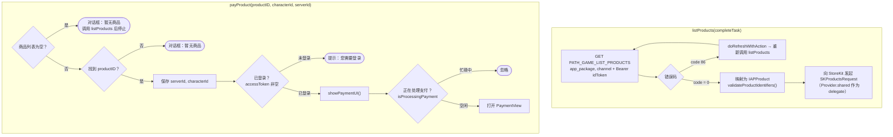
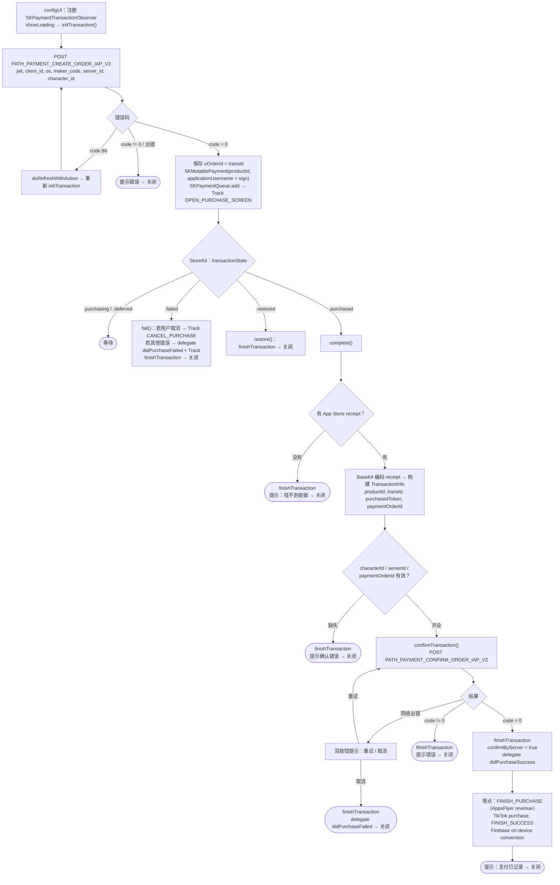

本文档基于实际代码梳理 SDK 的应用内购买（In-App Purchase）流程：
`Sdk+Payment.swift`（公开 API）和 `PaymentView.swift`（处理 StoreKit 交易 +
向服务器验证）。

## 1. 获取商品列表并打开支付

## 2. `PaymentView` 中的交易生命周期

## 详细说明

### `listProducts()` —— 获取商品列表

调用 `PATH_GAME_LIST_PRODUCTS`（GET，附带 Bearer `idToken`），携带 `app_package`
和 `channel`。

- `code = 0`：将数据转换为 `[IAPProduct]`，然后 `validateProductIdentifiers()`
创建 `SKProductsRequest` 从 StoreKit 获取真实商品信息（delegate 为
`Provider.shared`）。若列表为空则返回错误 `CODE_PAYMENT_ERROR_NO_CONFIG`。

- `code = 86`：刷新 token 后重新调用；失败则通过 `getProductTask` 返回错误。

### `payProduct(productID, characterId, serverId)` —— 开始购买

1. 若没有任何商品 → 显示对话框"暂无商品"并调用 `listProducts(nil)` 后停止。

2. 按 `productID` 查找商品；找不到 → 对话框"暂无商品"。

3. 保存 `serverId`、`characterId`（保存到变量和 UserDefaults）。

4. 若 `accessToken` 为空 → 提示"您需要登录"后停止。

5. 调用 `showPaymentUI()`：若当前没有正在进行的交易
（`isProcessingPayment == false`），则打开 `PaymentView`（传入 products、
serverId、characterId、productId、delegate）。

### `PaymentView` —— 创建订单并进行 StoreKit 支付

**初始化（`configUI`）**：注册为 `SKPaymentTransactionObserver`，显示 loading
并调用 `initTransaction()`。

**`initTransaction()`** —— 服务器端创建订单：调用
`PATH_PAYMENT_CREATE_ORDER_IAP_V2`（POST），携带 `jwt`、`client_id`、`os`、
`maker_code = productId`、`server_id`、`character_id`。

- `code = 0`：保存 `vOrderId = transId`，创建 `SKMutablePayment`（将服务器返回的
`sign` 赋给 `applicationUsername`）并加入 `SKPaymentQueue` 以打开 Apple 支付对话框；
埋点 `EVENT_OPEN_PURCHASE_SCREEN`。

- `code = 86`：刷新 token 后重新调用 `initTransaction()`。

- 其他错误：提示错误后关闭。

**交易监听（`paymentQueue:updatedTransactions`）**：

- `.purchasing` / `.deferred`：等待。

- `.failed` → `fail()`：若用户取消则埋点 `EVENT_CANCEL_PURCHASE`；若为其他错误则
触发 delegate `didPurchaseFailed` 并埋点；始终执行 `finishTransaction` 后关闭。

- `.restored` → `restore()`：`finishTransaction` 后关闭。

- `.purchased` → `complete()`。

**`complete()`** —— 准备验证：显示"正在验证交易"loading，读取
`appStoreReceiptURL` 获取 receipt。

- 没有 receipt → `finishTransaction` + 提示"找不到收据" → 关闭。

- 有 receipt → base64 编码，构建 `TransactionInfo`（`productId`、`transId`、
`purchasedToken = receipt`、`paymentOrderId = vOrderId`）。

- 若缺少 `characterId` / `serverId` / `paymentOrderId` → `finishTransaction` +
提示错误 → 关闭。

- 条件齐全 → `confirmTransaction()`。

**`confirmTransaction()`** —— 向服务器验证：调用
`PATH_PAYMENT_CONFIRM_ORDER_IAP_V2`（POST），携带 `jwt`、`cid`/`client_id`、
`client_secret = transactionIdentifier`、`os`、`b_code = purchasedToken`
（receipt）、`transId = paymentOrderId`、`maker_code = productId`、
`character_id`、`server_id`。

- **网络出错**：弹出双按钮提示"重试" / "取消"。"重试"重新调用
`confirmTransaction`；"取消"则执行 `finishTransaction`，触发 delegate
`didPurchaseFailed` 后关闭。

- `code = 0`：`finishTransaction`，设置 `confirmByServer = true`，触发 delegate
`didPurchaseSuccess`。记录埋点 `EVENT_FINISH_PURCHASE`（AppsFlyer 附带收入）、
TikTok 购买事件、`EVENT_FINISH_SUCCESS`、Firebase on-device conversion。
显示提示"支付已记录 ..."后关闭。

- `code != 0`：`finishTransaction` + 提示错误 → 关闭。

## 使用的接口

- `PATH_GAME_LIST_PRODUCTS` —— 获取 IAP 商品列表（GET，Bearer idToken）

- `PATH_PAYMENT_CREATE_ORDER_IAP_V2` —— 创建支付订单（POST）

- `PATH_PAYMENT_CONFIRM_ORDER_IAP_V2` —— 验证/记录交易（POST）

## 备注

- 这是**服务器端验证的支付**：SDK 先创建订单（获取 `transId` + `sign`），
将 `sign` 作为 `SKPayment` 的 `applicationUsername`，只有在服务器验证收据后
（`PATH_..._CONFIRM_...`）才记录为成功。

- `SKPaymentQueue.finishTransaction` 只在验证完成后（成功或用户选择取消）才调用，
避免网络出错时丢失交易——网络出错时，用户可以点击"重试"再次验证。

- 最终结果始终通过 delegate `didPurchaseSuccess` / `didPurchaseFailed`
（附带 `TransactionInfo`）返回给 App。

- `isProcessingPayment` 确保不会同时打开两个支付界面。
