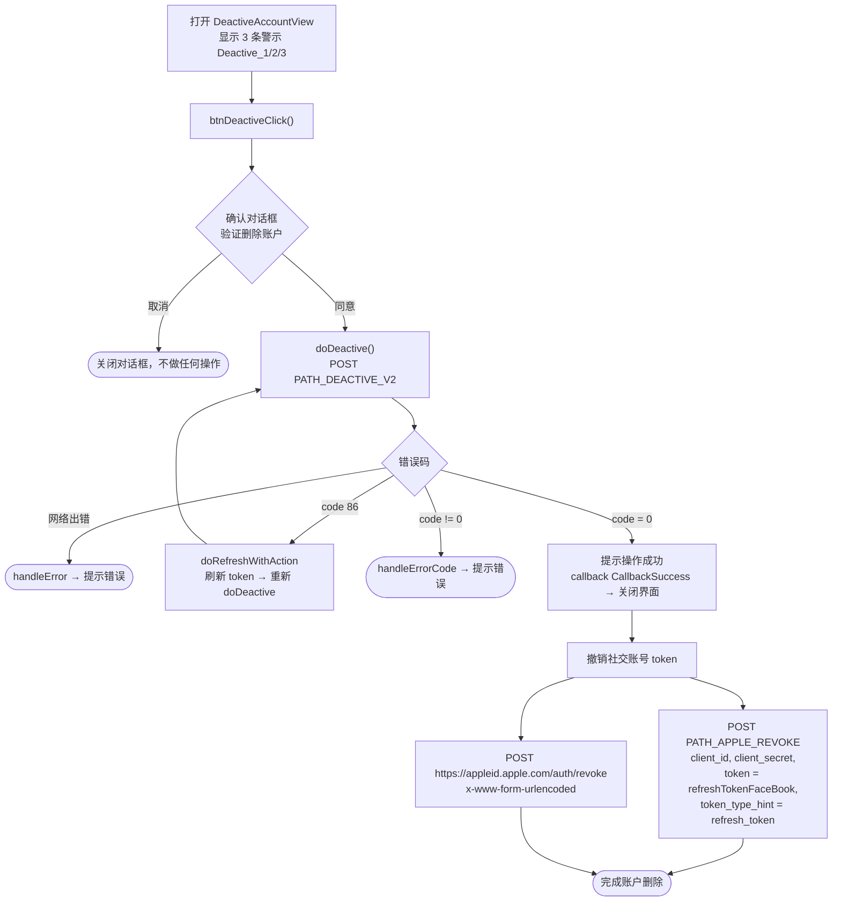

本文档基于实际代码梳理 SDK 的删除（停用）账户流程：
`DeactiveAccountView.swift`。

## 总体流程图

## 详细说明

### 1. 警示与确认界面

`DeactiveAccountView` 显示 3 行警示文字（`Deactive_1`、`Deactive_2`、
`Deactive_3`），说明删除账户的后果。点击删除按钮时，`btnDeactiveClick()`
打开双按钮确认对话框（"验证删除账户"）：

- **取消**：关闭对话框，不执行任何操作。
- **同意**：调用 `doDeactive()`。

### 2. 调用删除账户接口 —— `doDeactive()`

调用 `PATH_DEACTIVE_V2`（POST），携带 `deviceId`、`os`、`osVersion`、`ip`
和 Bearer accessToken 头。

- `code = 0`：显示提示（使用服务器返回的 `message`，默认为"更新成功"），
  触发 `callback(CallbackSuccess)` 后关闭界面。随后执行**社交账号 token 撤销**
  （见第 3 项）。
- `code = 86`（token 过期）：`doRefreshWithAction` 刷新 token 后**自动重新调用**
  `doDeactive()`。
- 其他错误：`handleErrorCode` 显示错误提示。
- 网络出错：`handleError`。

### 3. 撤销 Facebook / Apple token

账户删除成功后，SDK 立即撤销已保存的社交 refresh token
（`GlobalManager.shared.refreshTokenFaceBook`），通过两次调用：

1. `PATH_APPLE_REVOKE`（POST，通过 `appleApiService`），携带 `client_id`、
   `client_secret`、`token = refreshTokenFaceBook`、
   `token_type_hint = "refresh_token"`。
2. 直接调用 `https://appleid.apple.com/auth/revoke`（POST，
   `application/x-www-form-urlencoded`），携带 `client_id`、`client_secret`、
   `token`、`token_type_hint = "KeyRefreshToken"`。

两者都是 fire-and-forget（不阻塞主流程）。

## 使用的接口

- `PATH_DEACTIVE_V2` —— 删除/停用账户（POST，附带 Bearer accessToken）
- `PATH_APPLE_REVOKE` —— 在后端撤销社交 refresh token（POST）
- `https://appleid.apple.com/auth/revoke` —— 直接向 Apple 撤销 token（POST）

## 备注

- 删除账户前有**强制确认步骤**（双按钮对话框），之后才调用接口。
- 成功后，除了删除账户外，还会撤销社交账号 token，以确保不再存在任何社交登录会话。
- 遇到 `code = 86` 时，SDK 会自动刷新 token 并重复未完成的删除操作。
- 此界面通常从设置/账户信息页面打开（例如 `PersonalView`）。
