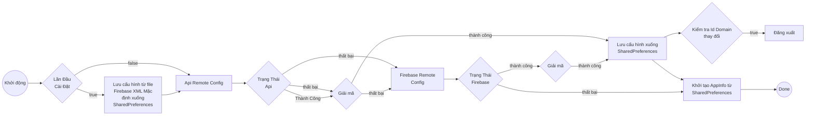
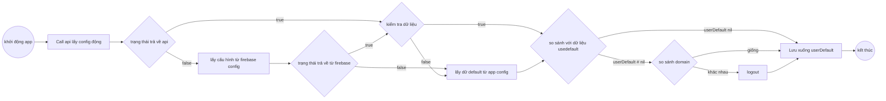

## 总览

1. 目的

    1. 减少与合作伙伴集成时因配置产生的错误

    2. 支持在紧急情况下自定义 domain、配置，避免必须重新构建 SDK -> 重新 review 应用。

2. 补充说明

    SDK 会优先从 BE API 获取配置。如果 API 调用失败或返回的数据无法解码，SDK 会自动 fallback 到 Firebase Remote Config。若两个来源均失败，则 SDK 会使用此前保存在 SharedPreferences 中的配置（若是首次安装，则使用 Firebase XML 文件中的默认配置）。

## API

1. 流程图

    - Android

    - IOS

2. 详情

    - Production domain: [https://config.vapi24.vn](https://config.vapi24.vn/)

    - Beta domain: https://beta-config.vapi24.vn

## Firebase Remote Config

1. 流程图

2. 详情

## 版本

| **Platform** | **Inventory** | **Tag version** | **CommitID** | **Release date** |
| --- | --- | --- | --- | --- |
| Android | | | | |
| IOS | | | | |
